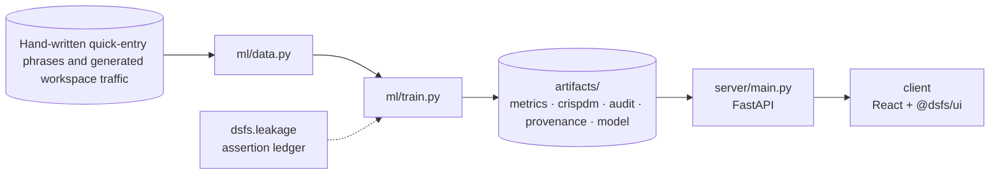

# Design document — Task Workspace

| | |
|---|---|
| Project | 00 · `00_task_workspace` |
| Domain | Full-stack · real-time sync · concurrency |
| Task | quick-entry parsing: recover fields from typed text |
| Ports | API 8000 · web 5100 |
| Dataset | Seeded demonstration tasks (generated) |

## 1. Problem

Does the workspace understand quick entry, keep every tab in sync, and never lose an edit?

State the workspace's promises as things that can be measured.

### Goals

- State the workspace's promises as things that can be measured.
- Decide what to test the parser and the server with.
- Run every check against the real server on a throwaway database.
- Build the grammar, the event stream and the version check.
- Report what the checks measured.
- Ship the workspace.

### Non-goals

- Multi-user accounts, authentication or sharing. Every tab talks to one local workspace.
- Natural-language understanding beyond the documented marker grammar; free text like 'next Tuesday afternoon' is kept as the title.

## 2. Architecture



Training is the only writer of results. The API serves the artifacts it wrote, and the client renders what the API returns, so a figure on screen always traces back to one run.

## 3. Components

| File | Lines | Responsibility |
|---|---:|---|
| `ml/train.py` | 361 | Project 00 -- verify the workspace's three promises. |
| `server/main.py` | 240 | Project 00 -- FastAPI application: the task workspace. |
| `server/parser.py` | 139 | "Draft the Q3 report !high #work #finance @friday ~45m" -> title "Draft the Q3 report", priority high, tags work and finance, due the coming Friday, estimate 45 minutes |
| `server/seed.py` | 57 | A fixed, seeded set of tasks so an empty workspace has something to show. It is generated, not real usage data, and the project's provenance says so. Dates are placed relative… |
| `server/store.py` | 175 | Project 00 -- task storage with optimistic concurrency. |
| `client/src/App.tsx` | 212 | Every view reads the same live task state (useTasks) and writes back through it. Analytics come from /api/analytics and the verification results from /api/evidence; the client… |
| `client/src/Views.tsx` | 309 | Workspace views -- project-00-specific. They group and arrange the tasks the server holds; every change goes back through useTasks, which sends the task's version so a… |
| `client/src/main.tsx` | 10 | — |
| `client/src/useTasks.ts` | 106 | Loads every task once, then applies server-sent events. Each event carries a global sequence number: if one is skipped (a dropped connection, a sleeping laptop), the hook… |

Everything else — the FastAPI factory, dataset cache, provenance, CRISP-DM report, metrics record, leakage auditor and the six shared UI components — comes from `platform/`.

## 4. API

| Method | Path | Purpose |
|---|---|---|
| GET | `/api/parse` | Preview what quick entry would create, resolved against today's date. |
| GET | `/api/tasks` | Every task, with the sequence number of the latest event, so a client knows where to resume. |
| GET | `/api/analytics` | Completions per day, streaks, workload by status and quadrant, and estimate accuracy. |
| GET | `/api/evidence` | Parser accuracy, live-update latency and conflict tests from the recorded verification run. |
| GET | `/api/health` | Liveness, version and whether artifacts are present. (platform) |
| GET | `/api/meta` | Project identity, ports and techniques. (platform) |
| GET | `/api/metrics` | The full run record: models, split, audit, environment. (platform) |
| GET | `/api/crispdm` | The six-phase CRISP-DM report written during training. (platform) |
| GET | `/api/audit` | Static leakage findings. (platform) |
| GET | `/api/provenance` | The dataset receipt. (platform) |
| GET | `/api/docs` | Interactive OpenAPI documentation. (platform) |

## 5. Data and evaluation

⚠️ **Synthetic data**

| Field | Value |
|---|---|
| Dataset | Hand-written quick-entry phrases and generated workspace traffic |
| Source | https://github.com/aniket-alt/ai-coding-assistant/blob/main/00_task_workspace/ml/parser_cases.json |
| Licence | MIT (written for this repository) |
| Rows × columns (as downloaded) | 60 × 0 |
| SHA-256 | `d958d955c4b15f69c36271b3e7b57d7945d527d9bc6ad74543645629102caa6e` |

**Split.** hand-written labelled phrases. Written by the parser's author; generated round trips are the independent check.

## 6. Key decisions

- **Business understanding.** Three measurable promises fixed before building the checks.
- **Data understanding.** Test inputs fixed; their authorship stated.
- **Data preparation.** Isolated database per run.
- **Modeling.** Three mechanisms, each with a test.
- **Evaluation.** All promises checked against the running server.
- **Deployment.** One server, one stream, every view.

## 7. Verification

- 3 of 3 runtime leakage assertions passed.
- Static source audit: 0 critical, 0 warnings.
- 18 screenshots captured by `scripts/capture_screenshots.py`, which fails if any view does not render its expected content.

| Assertion | Result | What it measured |
|---|---|---|
| `assert_round_trips_recover_every_field` | ✅ passed | 5,000 generated tasks rendered as quick-entry text in random order; 0 did not parse back to exactly the fields they were built from. |
| `assert_every_tab_receives_every_change_in_order` | ✅ passed | 1 subscribers: 1 received all 200 changes in sequence; 10 subscribers: 10 received all 200 changes in sequence; 50 subscribers: 50 received all 200 changes in sequence. |
| `assert_exactly_one_concurrent_writer_wins` | ✅ passed | 50 rounds of 8 writers on the same version: 50 accepted, 350 refused with 409; final version 51 (expected 51). |

Recorded by the assertion ledger while training ran; generated from `artifacts/metrics.json`.

## 8. Risks

- The labelled phrases were written by the parser's author, so their pass rate is weak evidence; the generated round trips only cover the grammar they were generated from.
- Latency was measured with server and clients on one machine, which excludes network time, and Windows timestamps have roughly millisecond resolution.
- One uvicorn worker holds the event subscribers in memory; several workers would need a shared broker.
- The demonstration tasks and their history are generated, so the analytics show how the views work, not how anyone works.

## 9. Reproducibility

Last trained at commit `1e3bb26` on Python 3.11.6.

```bash
python ml/train.py
python -m uvicorn main:app --app-dir server --port 8000
npm run dev -w 00_task_workspace/client
```

---

*Generated by `scripts/generate_docs.py`.*
