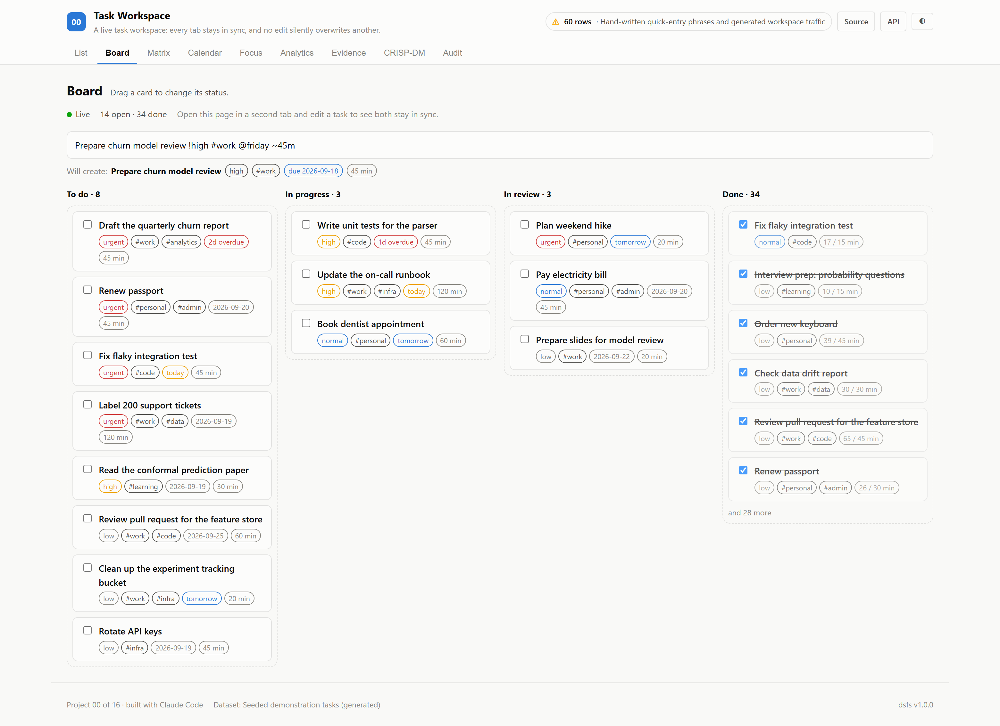
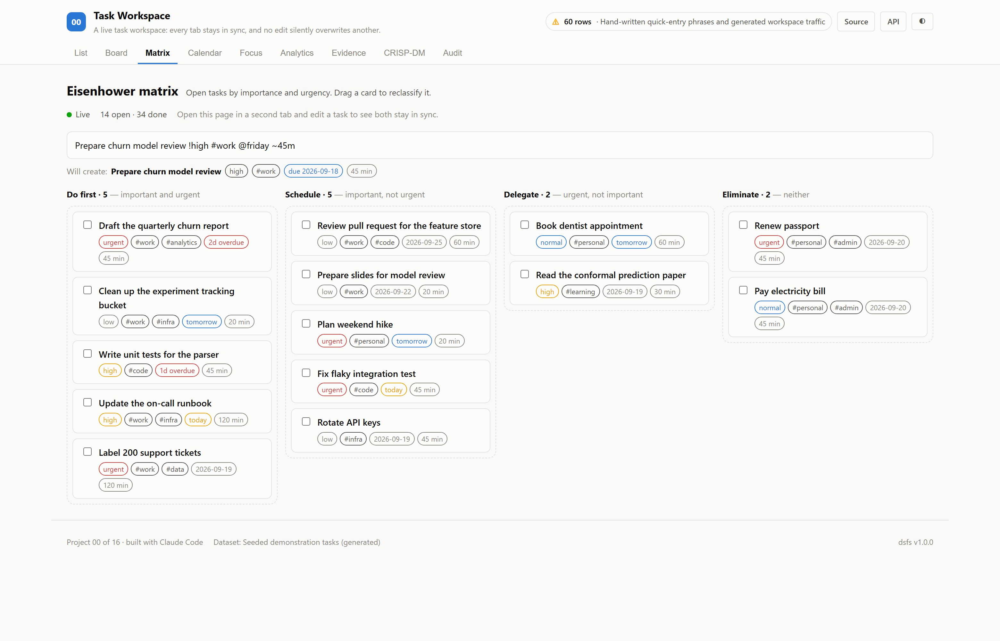
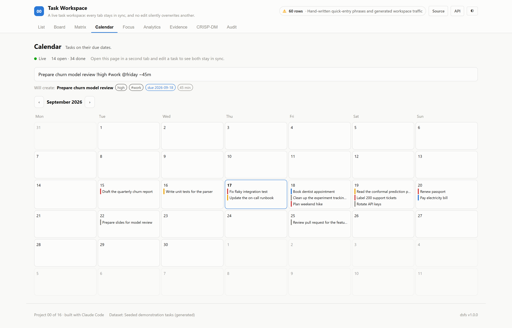
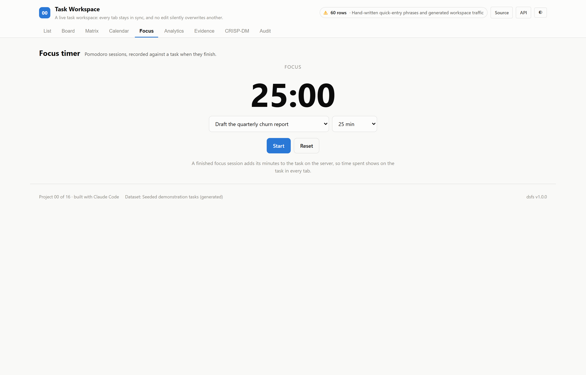
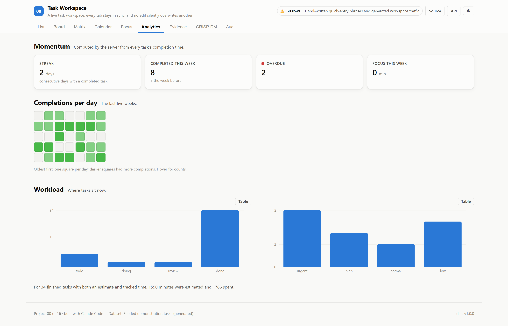
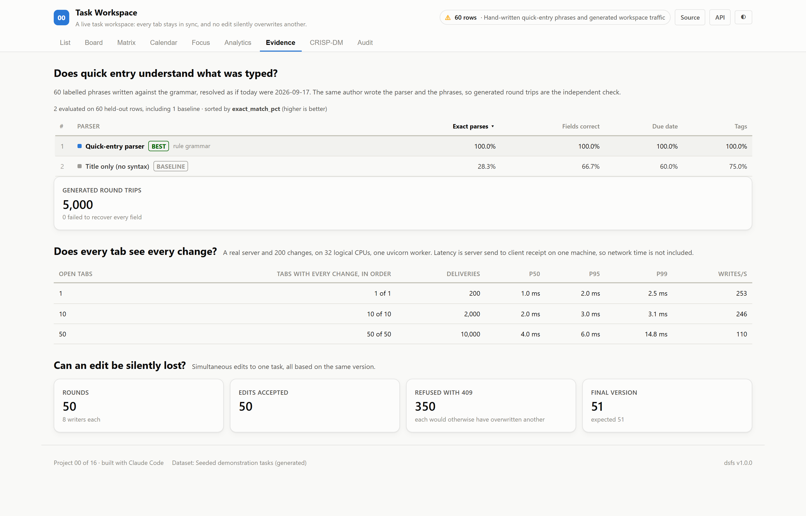

# 00 · Task Workspace

**A task workspace that keeps every open tab in sync, never lets one edit silently
overwrite another, and understands quick entry — with each of those promises
tested against the running application.**

There is no dataset. The demonstration tasks are generated, and the project's
provenance says so; the verification traffic is generated from fixed seeds.

| | |
|---|---|
| Stack | FastAPI, SQLite, server-sent events · React |
| Views | List · Kanban board · Eisenhower matrix · calendar · focus timer · analytics |
| Verified | Quick-entry parsing · delivery of every change to every tab · refusal of conflicting edits |
| Ports | API `8000` · Web `5100` |

---

## The decision that defines this project

A task app's most important behaviours are ones a screenshot cannot show, so
[`ml/train.py`](./ml/train.py) tests them against the real server, started on a
throwaway database:

1. **Quick entry understands what was typed.** `Draft the Q3 report !high #work @friday ~45m`
   becomes a high-priority task tagged `work`, due Friday, estimated at 45 minutes.
2. **Every tab sees every change, in order.** Each change is broadcast as a
   server-sent event with a global sequence number; a tab that sees a gap reloads.
3. **No edit is silently lost.** Every update names the version it was based on.
   If another tab changed the task first, the update is refused with `409 Conflict`
   and the tab shows the other change.

---

## Results

### Quick entry

<!-- dsfs:leaderboard -->
| # | Parser | Exact parses | Fields correct | Due date | Tags |
|---|---|---|---|---|---|
| 1 | **Quick-entry parser** 🏆 | 100.0% | 100.0% | 100.0% | 100.0% |
| 2 | Title only (no syntax) *(baseline)* | 28.3% | 66.7% | 60.0% | 75.0% |

Ranked by exact parses (higher is better). Split: hand-written labelled phrases; 60 evaluation rows. Generated from `artifacts/metrics.json`.
<!-- /dsfs:leaderboard -->

On 60 hand-written phrases, including email addresses, issue numbers such as
`#3`, impossible dates and trailing punctuation, the parser was exactly right on
100%, against 28% for treating everything typed as the title.

**That figure is weak evidence on its own:** the same author wrote the parser and
the phrases. The independent check is generated: 5,000 tasks with known
fields were rendered as quick-entry text with the markers in random positions, and
0 failed to parse back to exactly those fields. That test caught a mistake
in its own expectations while it was being written — it assumed tags come back in
the order they were chosen rather than the order they were typed.

### Live updates

The real server, 200 changes, and 1 to 50 tabs subscribed to the event stream:

| Open tabs | Tabs that received every change, in order | Deliveries | p50 | p95 | p99 |
|---|---|---|---|---|---|
| 1 | 1 of 1 | 200 | 1.0 ms | 2.0 ms | 2.5 ms |
| 10 | 10 of 10 | 2,000 | 2.0 ms | 3.0 ms | 3.1 ms |
| 50 | 50 of 50 | 10,000 | 4.0 ms | 6.0 ms | 14.8 ms |

Latency is from the server's send timestamp to receipt, with server and clients
on one machine (32 logical CPUs, one uvicorn worker), so it excludes network time; Windows timestamps
resolve to about a millisecond.

### Conflicting edits

In 50 rounds, 8 writers each sent an edit to the same task based on
the same version at the same moment. 50 edits were accepted — exactly one per
round — and 350 were refused with `409`. The task's final version is 51,
exactly one increment per round. Without the version check, each refused edit
would have replaced another without anyone knowing.

---

## Screenshot tour









> CRISP-DM, audit and dark variants of every view are in [`screenshots/`](./screenshots).

---

## Assertions that ran

<!-- dsfs:assertions -->
| Assertion | Result | What it measured |
|---|---|---|
| `assert_round_trips_recover_every_field` | ✅ passed | 5,000 generated tasks rendered as quick-entry text in random order; 0 did not parse back to exactly the fields they were built from. |
| `assert_every_tab_receives_every_change_in_order` | ✅ passed | 1 subscribers: 1 received all 200 changes in sequence; 10 subscribers: 10 received all 200 changes in sequence; 50 subscribers: 50 received all 200 changes in sequence. |
| `assert_exactly_one_concurrent_writer_wins` | ✅ passed | 50 rounds of 8 writers on the same version: 50 accepted, 350 refused with 409; final version 51 (expected 51). |

Recorded by the assertion ledger while training ran; generated from `artifacts/metrics.json`.
<!-- /dsfs:assertions -->

---

## Running it

```bash
pip install -e ../platform
npm install

python ml/train.py     # starts its own server on a temporary database; about ten seconds
python -m uvicorn main:app --app-dir server --port 8000     # creates and seeds data/tasks.db
npm run dev -w 00_task_workspace/client     # http://localhost:5100 -- open it in two tabs
```

Generated documents: [paper](./paper.md) · [abstract](./abstract.md) ·
[article](./article.md) · [design doc](./DESIGN_DOC.md) ·
[audit report](./audit_report.md) · [reproduction skill](./skills/reproduce/SKILL.md)
