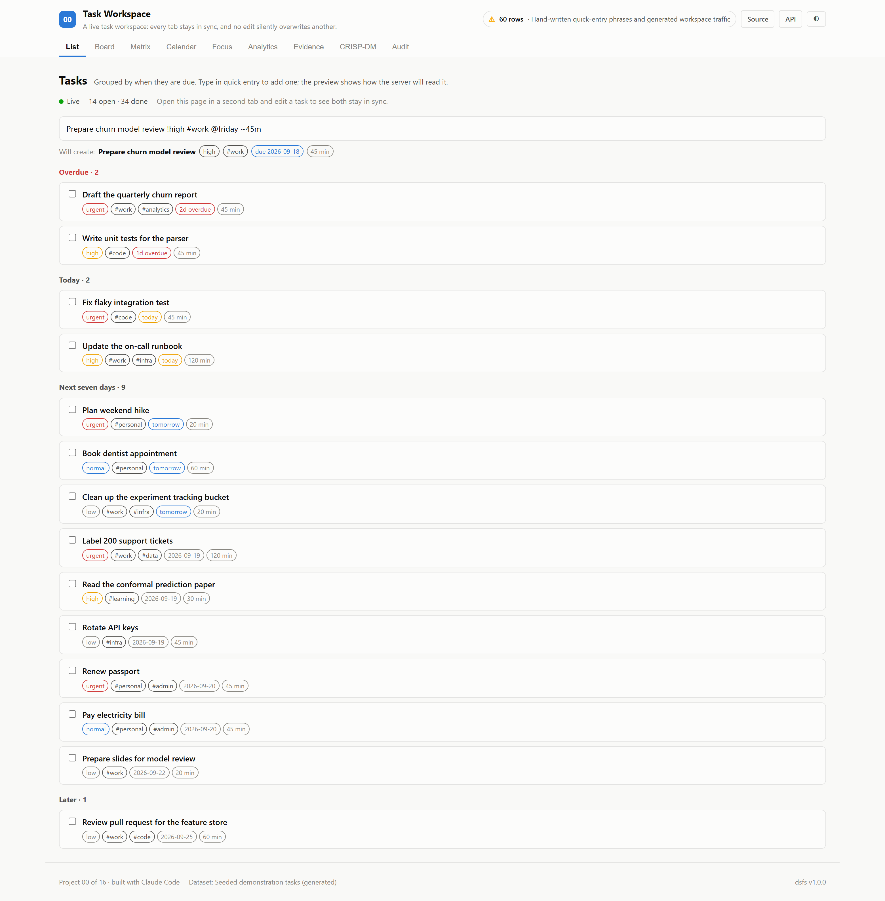

# A live task workspace: every tab stays in sync, and no edit silently overwrites another.

*Task Workspace — project 00 of a sixteen-project data science portfolio built with an AI coding assistant, on real data.*

## The question

Does the workspace understand quick entry, keep every tab in sync, and never lose an edit?

A task app earns trust through three behaviours users rarely see directly. What they type is understood. A change made in one tab appears in every other. And when two people change the same task at once, neither change vanishes without a trace. Each is tested here against the running application.

## The data

60 phrases were written by hand against the documented grammar, including awkward ones: email addresses, issue numbers such as #3, impossible dates and markers with trailing punctuation. Because the same author wrote the parser and the phrases, 5,000 generated round trips provide a check that no phrase was chosen to pass.

## What won

**Quick-entry parser**, at 100.0% on exact parses, against 28.3% for the best baseline, Title only (no syntax).

| # | Parser | Exact parses | Fields correct | Due date | Tags |
|---|---|---|---|---|---|
| 1 | **Quick-entry parser** 🏆 | 100.0% | 100.0% | 100.0% | 100.0% |
| 2 | Title only (no syntax) *(baseline)* | 28.3% | 66.7% | 60.0% | 75.0% |

Ranked by exact parses (higher is better). Split: hand-written labelled phrases; 60 evaluation rows. Generated from `artifacts/metrics.json`.

**Parsing.** 100.0% of labelled phrases were parsed exactly, against 28.3% for treating everything as the title; 0 of 5,000 round trips failed.

**Live updates.** With 50 tabs open, every tab received all 200 changes in order: yes. Delivery took 4.0 ms at the median and 14.8 ms at the 99th percentile.

**Conflicts.** In 50 rounds of 8 simultaneous edits, 50 were accepted and 350 refused; without the version check, each refused edit would have silently replaced another.

## What I took away

- Sequence numbers on live events turn 'did this tab miss something?' into a check the client can make and recover from.
- Sending the version an edit was based on is enough to make lost updates visible instead of silent.
- A generated round-trip test caught a mistake in its own expectations, which is why generated and hand-written tests are both worth having.
- A page that holds a live connection never becomes network-idle, so tooling that waits for idleness needs another signal.

## How it is built

The backend is FastAPI on port 8000 and the front end is React on port 5100. Most of the interface — the metrics panel, tournament table, CRISP-DM walkthrough, audit panel and charts — is shared across the portfolio and driven entirely by the training run's artifacts, so nothing on screen is typed by hand.

Code: [github.com/aniket-alt/ai-coding-assistant](https://github.com/aniket-alt/ai-coding-assistant/tree/main/00_task_workspace)

---

*Figures in this article are generated from the project's artifacts.*
