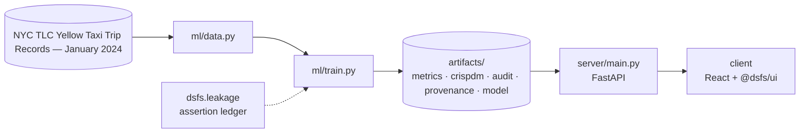

# Design document — NYC Taxi Trip Duration

| | |
|---|---|
| Project | 01 · `01_nyc_taxi_prediction` |
| Domain | Spatial regression · CRISP-DM |
| Task | regression |
| Ports | API 8001 · web 5101 |
| Dataset | NYC TLC Yellow Taxi, January 2024 (2.96M trips) |

## 1. Problem

When a rider requests a yellow cab in New York City, how long will the trip take?

Give riders a trustworthy arrival estimate at the moment they request a cab, using only what is knowable at that moment.

### Goals

- Give riders a trustworthy arrival estimate at the moment they request a cab, using only what is knowable at that moment.
- Establish what the raw TLC export actually contains, and what must be discarded.
- Build features that exist at booking time, fitted on the training window alone.
- Compare model families on identical features and an identical split.
- Decide whether the winner is good enough, and whether it was measured honestly.
- Serve the estimate behind an API the front end can call.

### Non-goals

- Live traffic or routing data. The estimate uses only what a booking knows, by design.
- Fare prediction. Duration is the target; fare is one of the excluded post-trip fields.

## 2. Architecture



Training is the only writer of results. The API serves the artifacts it wrote, and the client renders what the API returns, so a figure on screen always traces back to one run.

## 3. Components

| File | Lines | Responsibility |
|---|---:|---|
| `ml/build_zone_map.py` | 163 | Build the taxi-zone SVG map from the official TLC shapefile. |
| `ml/data.py` | 256 | Project 01 -- NYC Taxi trip duration: data acquisition and cleaning. |
| `ml/features.py` | 268 | Every feature here must be computable at the moment a rider requests a cab. |
| `ml/train.py` | 428 | Project 01 -- model tournament, audit, and artefact generation. |
| `server/inference.py` | 153 | Loads the persisted model together with the encoders it was trained with, so a prediction at request time is assembled exactly as it was during training. The zone statistics… |
| `server/main.py` | 81 | Thanks to the platform factory, this file contains only what is specific to taxi prediction. Health, metadata, CRISP-DM, metrics, provenance and audit endpoints all arrive from… |
| `client/src/App.tsx` | 226 | Almost everything here comes from @dsfs/ui. The only code specific to this project is the zone map and the trip estimator; the rest -- metrics, the tournament table, the… |
| `client/src/TripEstimator.tsx` | 159 | Composes the shared PredictionForm with this project's zone map, and renders the API's response. Every figure shown is a field of that response; nothing is recomputed here. |
| `client/src/ZoneMap.tsx` | 193 | Renders the 263 real TLC taxi zones as inline SVG. Geometry comes from the official TLC shapefile (EPSG:2263), simplified at build time by `ml/build_zone_map.py` -- so this is… |
| `client/src/main.tsx` | 10 | — |

Everything else — the FastAPI factory, dataset cache, provenance, CRISP-DM report, metrics record, leakage auditor and the six shared UI components — comes from `platform/`.

## 4. API

| Method | Path | Purpose |
|---|---|---|
| POST | `/api/predict` | Estimate duration for one booking, with an interval from measured error. |
| GET | `/api/zones` | The 263 taxi zones, for the origin and destination pickers. |
| GET | `/api/importance` | Which features the winning model actually leans on. |
| GET | `/api/health` | Liveness, version and whether artifacts are present. (platform) |
| GET | `/api/meta` | Project identity, ports and techniques. (platform) |
| GET | `/api/metrics` | The full run record: models, split, audit, environment. (platform) |
| GET | `/api/crispdm` | The six-phase CRISP-DM report written during training. (platform) |
| GET | `/api/audit` | Static leakage findings. (platform) |
| GET | `/api/provenance` | The dataset receipt. (platform) |
| GET | `/api/docs` | Interactive OpenAPI documentation. (platform) |

## 5. Data and evaluation

✅ **Real, third-party data**

| Field | Value |
|---|---|
| Dataset | NYC TLC Yellow Taxi Trip Records — January 2024 |
| Source | https://d37ci6vzurychx.cloudfront.net/trip-data/yellow_tripdata_2024-01.parquet |
| Licence | NYC Taxi & Limousine Commission open data (public domain) |
| Rows × columns (as downloaded) | 2,964,624 × 19 |
| SHA-256 | `c4d59da7bbc8abaeeeb1727947ee93d9891a71acb42854bd80db1571b2030510` |
| Rows after cleaning | 2,799,247 |
| Rows modelled | 600,000 |
| Sampling | systematic, preserving chronology |

**Split.** chronological with 1-day embargo. January 2024; train days 1-24, embargo day 25, test days 26-31.

## 6. Key decisions

- **Business understanding.** Target, constraint and success metric fixed before any data was loaded.
- **Data understanding.** 20.2% of raw records retained with a per-rule audit trail.
- **Data preparation.** Temporal ordering, split disjointness and target-correlation checks all executed as runtime assertions during this run.
- **Modeling.** 7 models trained; winner LightGBM.
- **Evaluation.** No critical leakage findings; metrics measured on a future window.
- **Deployment.** Model, encoders and feature order persisted together.

## 7. Verification

- 3 of 3 runtime leakage assertions passed.
- Static source audit: 0 critical, 0 warnings.
- 8 screenshots captured by `scripts/capture_screenshots.py`, which fails if any view does not render its expected content.

| Assertion | Result | What it measured |
|---|---|---|
| `assert_temporal_split` | ✅ passed | Last training timestamp 2024-01-24 23:59:55 precedes first test timestamp 2024-01-26 00:00:01 by 1 days 00:00:06; embargo of 12h required. |
| `assert_disjoint` | ✅ passed | 456,487 training and 121,130 test row indices compared; 0 appear in both. |
| `assert_no_target_leak` | ✅ passed | 22 numeric features correlated against the target; strongest was zp_median_distance at |r|=0.7821 (threshold 0.995). |

Recorded by the assertion ledger while training ran; generated from `artifacts/metrics.json`.

## 8. Risks

- One month of data. Seasonality across the year (summer traffic, holidays) is not represented.
- Distance is reconstructed per zone pair, so trips inside a large zone share one estimate of distance.
- The interval assumes roughly normal residuals; long delays such as accidents are heavier-tailed than that.

## 9. Reproducibility

Last trained at commit `e7b6737` on Python 3.11.6.

```bash
python ml/data.py
python ml/build_zone_map.py
python ml/train.py
python -m uvicorn main:app --app-dir server --port 8001
npm run dev -w 01_nyc_taxi_prediction/client
```

---

*Generated by `scripts/generate_docs.py`.*
