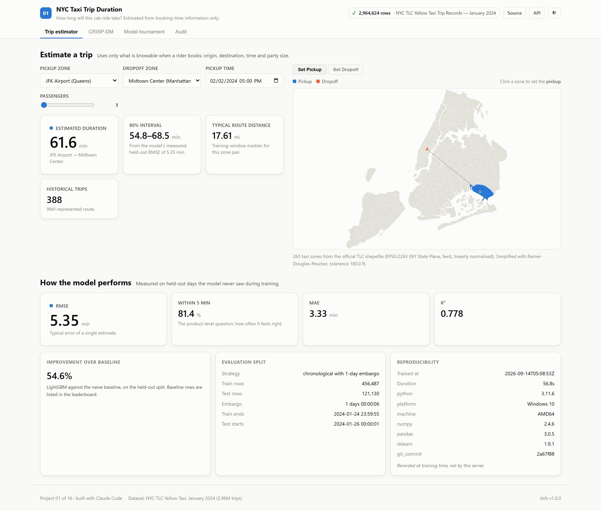
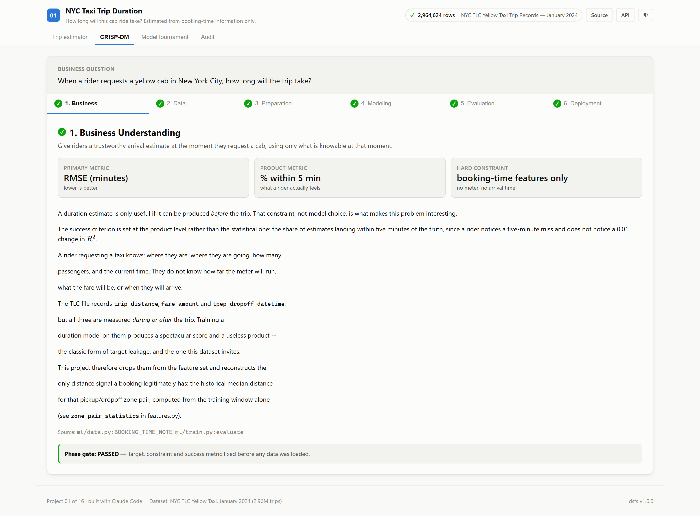
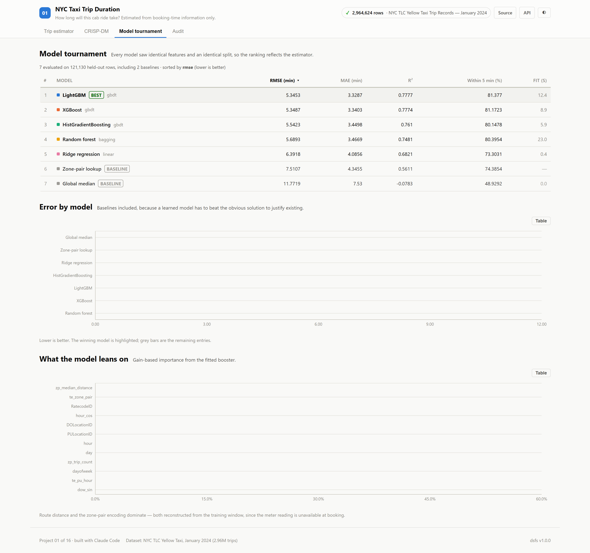
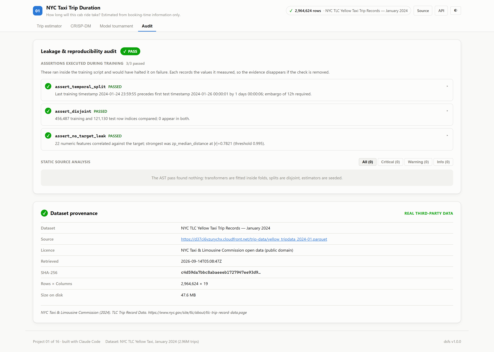

# 01 · NYC Taxi Trip Duration

**How long will this cab ride take?** — answered using only what a rider knows
at the moment they book.

Trained on **2,964,624 real NYC TLC yellow-cab records** from January 2024.

| | |
|---|---|
| Task | Regression (trip duration, minutes) |
| Dataset | [NYC TLC Yellow Taxi, Jan 2024](https://d37ci6vzurychx.cloudfront.net/trip-data/yellow_tripdata_2024-01.parquet) · public domain |
| Split | Chronological, 1-day embargo |
| Winner | LightGBM — **RMSE 5.35 min**, R² 0.778, **81.4% within 5 minutes** |
| Lift over lookup baseline | **28.8%** |
| Leakage audit | 0 critical · 3 runtime assertions passed |
| Ports | API `8001` · Web `5101` |

---

## The decision that defines this project

The TLC file contains `trip_distance`, `fare_amount` and
`tpep_dropoff_datetime`. Training a duration model on them pushes R² above 0.95.

It also produces a model that **cannot run**, because none of those values exist
when the rider is standing on the kerb asking how long the trip will take. The
meter has not started. This is the classic form of target leakage, and this
dataset invites it.

So all thirteen post-trip columns are excluded, and the distance signal is
reconstructed from something a booking legitimately has: **the median distance
for that origin/destination zone pair, learned from the training window only**.

The result is a lower score and a model that works. `ml/data.py` documents the
full reasoning in `BOOKING_TIME_NOTE`.

---

## Screenshot tour

### Trip estimator
Pick an origin and destination — from the dropdowns or by clicking the map — and
the estimate updates. The 80% interval is derived from the model's *measured*
held-out RMSE, not an assumed spread.



The map is the 263 real taxi zones from the official TLC shapefile (EPSG:2263),
simplified at build time with Ramer–Douglas–Peucker into a 100 KB asset. No
mapping library, no API key.

### CRISP-DM walkthrough
All six phases, with per-phase gates. The content is not written by hand — the
training run builds this report as it executes, so it cannot drift from what
actually happened.



### Model tournament
Seven models on identical features and an identical split. Two are baselines,
included deliberately: a learned model has to beat a plain lookup table to
justify existing.



### Leakage audit
The checks that **actually executed** during training, each carrying the values
it measured — not a hand-written list of checks someone intended to run.



> Every view also ships a validated dark theme — see `*_dark.png` in
> [`screenshots/`](./screenshots).

---

## Results

| # | Model | RMSE (min) | MAE | R² | Within 5 min |
|---|---|---|---|---|---|
| 1 | **LightGBM** 🏆 | **5.345** | 3.329 | 0.778 | 81.4% |
| 2 | XGBoost | 5.349 | 3.340 | 0.777 | 81.2% |
| 3 | HistGradientBoosting | 5.542 | 3.450 | 0.761 | 80.1% |
| 4 | Random forest | 5.689 | 3.467 | 0.748 | 80.4% |
| 5 | Ridge regression | 6.392 | 4.086 | 0.682 | 73.3% |
| 6 | *Zone-pair lookup* (baseline) | 7.511 | 4.346 | 0.561 | 74.4% |
| 7 | *Global median* (baseline) | 11.772 | 7.530 | −0.078 | 48.9% |

Evaluated on 121,130 held-out trips from days the model never saw.

**28.8% better than the lookup baseline** is the honest headline — it measures
what machine learning adds over the obvious non-ML solution. The 54.6%
improvement over a global median is the flattering number, and it mostly
measures that predicting one number for every trip is a bad idea.

### What the model leans on

| Feature | Share of gain |
|---|---|
| `zp_median_distance` | 48.0% |
| `te_zone_pair` | 24.3% |
| `RatecodeID` | 8.1% |
| `hour_cos` | 3.9% |
| `DOLocationID` | 3.1% |

Route distance dominates — which is the point. Denied the meter reading, the
model reconstructs distance from geography and leans on it exactly as you would
expect.

---

## Method

### Cleaning — 94.4% of raw records retained

| Rule | Removed |
|---|---|
| Pickup timestamp outside January 2024 | 18 |
| Duration outside [1, 180] minutes | 37,104 |
| Metered distance outside [0.1, 100] miles | 38,590 |
| Non-positive fare (voided record) | 31,753 |
| Passenger count outside [1, 6] | 30,499 |
| Unknown / out-of-city zone sentinel | 26,487 |
| Implied speed outside [1, 70] mph | 926 |

Those 18 stray records are real: the file is labelled January yet contains
trips timestamped outside it. A generated dataset never reproduces that.

### Splitting

Training ends 24 January; testing begins 26 January. The intervening day is an
**embargo**, so same-day autocorrelation cannot bleed across the boundary. A
random split would score better and would be measuring the wrong thing.

### Target encoding without the leak

Two encodings — zone pair, and origin zone × hour — are computed **out-of-fold**:
within training, each row's encoding comes from folds that exclude it, so no row
informs its own feature. Values are shrunk toward the global mean:

$$\text{enc}(g) = \frac{\sum_{i \in g} y_i + \alpha\bar{y}}{n_g + \alpha}, \quad \alpha = 20$$

so a zone pair seen twice does not receive a confident encoding.

### Assertions that run

Three checks execute inside `ml/train.py` and halt it on failure:

```
assert_temporal_split   train ends 2024-01-24 23:59:55, test starts
                        2024-01-26 00:00:01, gap 1 day; embargo 12h required
assert_disjoint         456,487 train and 121,130 test indices; 0 shared
assert_no_target_leak   22 features checked; strongest |r| = 0.7821
                        (zp_median_distance), threshold 0.995
```

These are recorded by an assertion ledger, so removing a check removes its
evidence from the audit rather than leaving the claim behind.

---

## Running it

```bash
pip install -e ../platform          # from the repo root
npm install

python ml/data.py                   # fetch + cache the real data (~48 MB)
python ml/build_zone_map.py         # build the SVG zone map from the shapefile
python ml/train.py                  # train, audit, write artifacts/

python -m uvicorn main:app --app-dir server --port 8001
npm run dev -w 01_nyc_taxi_prediction/client     # http://localhost:5101
```

Regenerate the screenshot tour:

```bash
python ../scripts/capture_screenshots.py 01_nyc_taxi_prediction
```

---

## Layout

```
01_nyc_taxi_prediction/
├── ml/
│   ├── data.py              fetch, clean, document what is knowable at booking
│   ├── features.py          calendar, zone geography, out-of-fold encoders
│   ├── build_zone_map.py    TLC shapefile -> simplified SVG paths
│   └── train.py             tournament, assertions, CRISP-DM report, artifacts
├── server/
│   ├── main.py              FastAPI; ~40 lines on the platform factory
│   └── inference.py         model + encoders loaded together, so serving
│                            reproduces training exactly
├── client/src/
│   ├── App.tsx              assembles the shared @dsfs/ui components
│   ├── TripEstimator.tsx    project-specific
│   └── ZoneMap.tsx          project-specific
└── artifacts/               metrics.json · crispdm.json · audit.json
                             provenance.json · model.joblib
```

Only `TripEstimator` and `ZoneMap` are specific to this project. The metrics
panel, tournament table, CRISP-DM walkthrough, audit panel, prediction form and
charts all come from [`@dsfs/ui`](../platform/web) and are shared across the
portfolio.

## API

| Endpoint | Purpose |
|---|---|
| `POST /api/predict` | Estimate duration for one booking |
| `GET /api/zones` | The 263 taxi zones |
| `GET /api/importance` | Gain-based feature importance |
| `GET /api/metrics` | The full run record |
| `GET /api/crispdm` | The six-phase report |
| `GET /api/audit` | Leakage findings |
| `GET /api/provenance` | The dataset receipt |
| `GET /api/health`, `/api/meta`, `/api/docs` | Platform standard |
