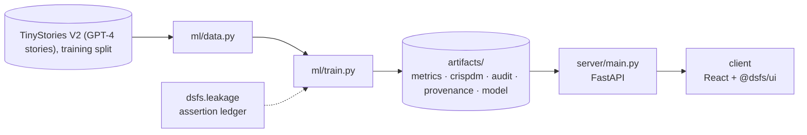

# Design document — Nano LLM Transformer

| | |
|---|---|
| Project | 02 · `02_nano_llm` |
| Domain | Language modelling · PyTorch · ablations |
| Task | next-token prediction (language modelling) |
| Ports | API 8002 · web 5102 |
| Dataset | TinyStories V2 (GPT-4 stories) |

## 1. Problem

How good a storyteller can a 8.7-million-parameter transformer become on one laptop GPU, and which of its modern components actually earn their place?

Train a small language model from scratch and measure it against baselines and ablations.

### Goals

- Train a small language model from scratch and measure it against baselines and ablations.
- Check what a generated corpus repeats, and keep repeats out of the score.
- Turn text into tokens with a vocabulary learned from the training stories only.
- Train the reference recipe, and each variant that removes one of its components.
- Compare against baselines, separate real ablation effects from seed noise, and verify the mechanics.
- Serve generation, tokenisation and attention maps from the trained checkpoint.

### Non-goals

- A general-purpose assistant. The model knows only the simple vocabulary and plots of children's stories.
- Instruction tuning or chat. The model continues text; it was not fine-tuned to follow requests.

## 2. Architecture



Training is the only writer of results. The API serves the artifacts it wrote, and the client renders what the API returns, so a figure on screen always traces back to one run.

## 3. Components

| File | Lines | Responsibility |
|---|---:|---|
| `ml/data.py` | 108 | Project 02 -- TinyStories: acquisition, deduplication and tokenisation. |
| `ml/model.py` | 220 | Project 02 -- a small decoder-only transformer, written from scratch. |
| `ml/train.py` | 470 | Project 02 -- train a small language model on TinyStories, and measure it honestly. |
| `server/inference.py` | 116 | Project 02 -- serving the trained language model. |
| `server/main.py` | 91 | Project 02 -- FastAPI application. |
| `client/src/App.tsx` | 197 | Studio, tokenizer and attention views call the live model; training, ablation and check views read the training run. |
| `client/src/Studio.tsx` | 214 | Project-02-specific views: the generation studio, the tokenizer and the attention map. Each renders exactly what one API call returned. |
| `client/src/main.tsx` | 10 | — |

Everything else — the FastAPI factory, dataset cache, provenance, CRISP-DM report, metrics record, leakage auditor and the six shared UI components — comes from `platform/`.

## 4. API

| Method | Path | Purpose |
|---|---|---|
| POST | `/api/generate` | Continue a prompt with nucleus sampling. |
| POST | `/api/tokenize` | Split text into the model's BPE tokens. |
| POST | `/api/attention` | Attention weights of every layer and head for a short prompt. |
| GET | `/api/training` | Loss curves, baselines and the deduplication counts. |
| GET | `/api/ablations` | Each component swapped for its older equivalent, beside a second seed of the reference. |
| GET | `/api/checks` | Executed mechanics checks, generation timings and fixed-seed samples. |
| GET | `/api/health` | Liveness, version and whether artifacts are present. (platform) |
| GET | `/api/meta` | Project identity, ports and techniques. (platform) |
| GET | `/api/metrics` | The full run record: models, split, audit, environment. (platform) |
| GET | `/api/crispdm` | The six-phase CRISP-DM report written during training. (platform) |
| GET | `/api/audit` | Static leakage findings. (platform) |
| GET | `/api/provenance` | The dataset receipt. (platform) |
| GET | `/api/docs` | Interactive OpenAPI documentation. (platform) |

## 5. Data and evaluation

✅ **Real, third-party data**

| Field | Value |
|---|---|
| Dataset | TinyStories V2 (GPT-4 stories), training split |
| Source | https://huggingface.co/datasets/roneneldan/TinyStories/resolve/main/TinyStoriesV2-GPT4-train.txt |
| Licence | Community Data License Agreement – Sharing, Version 1.0 (CDLA-Sharing-1.0) |
| Rows × columns (as downloaded) | 0 × 0 |
| SHA-256 | `6418d412de72888f52b5142c761ac21a582f7d1166f0bfbdb5f03ccfdec90443` |

**Split.** official TinyStories V2 split; validation stories seen in training removed. Counts are tokens.

## 6. Key decisions

- **Business understanding.** Validation perplexity on deduplicated stories fixed as the measure before training.
- **Data understanding.** Validation-training overlap measured and removed by an executed assertion.
- **Data preparation.** Tokenizer fitted on training stories only.
- **Modeling.** Main model and 6 ablation runs completed.
- **Evaluation.** Baselines, seed-noise comparison and executed mechanics checks.
- **Deployment.** Checkpoint and tokenizer persisted together.

## 7. Verification

- 3 of 3 runtime leakage assertions passed.
- Static source audit: 0 critical, 0 warnings.
- 16 screenshots captured by `scripts/capture_screenshots.py`, which fails if any view does not render its expected content.

| Assertion | Result | What it measured |
|---|---|---|
| `assert_validation_stories_unseen` | ✅ passed | 27,630 validation stories hashed against 2,717,495 training stories; 0 also appeared in training and were removed; 0 remain. |
| `assert_causal_mask` | ✅ passed | Tokens 40-63 of a 64-token sequence replaced; largest change in logits at positions 0-39 was 0.00e+00 (limit 1e-4). The model cannot see the future. |
| `assert_kv_cache_matches_recompute` | ✅ passed | Greedy 60-token continuations of 3 prompts generated with and without the KV cache; 3 of 3 identical. |

Recorded by the assertion ledger while training ran; generated from `artifacts/metrics.json`.

## 8. Risks

- Ablations are single short runs, and seed noise is estimated from only two runs of the reference.
- Perplexity depends on the tokenizer, so it is only comparable between models that share this one.
- TinyStories was itself generated by GPT-4, so fluency here says little about modelling human-written text.
- Generation timings depend on the GPU and on what else was running.

## 9. Reproducibility

Last trained at commit `1e3bb26` on Python 3.11.6.

```bash
python ml/train.py
python -m uvicorn main:app --app-dir server --port 8002
npm run dev -w 02_nano_llm/client
```

---

*Generated by `scripts/generate_docs.py`.*
