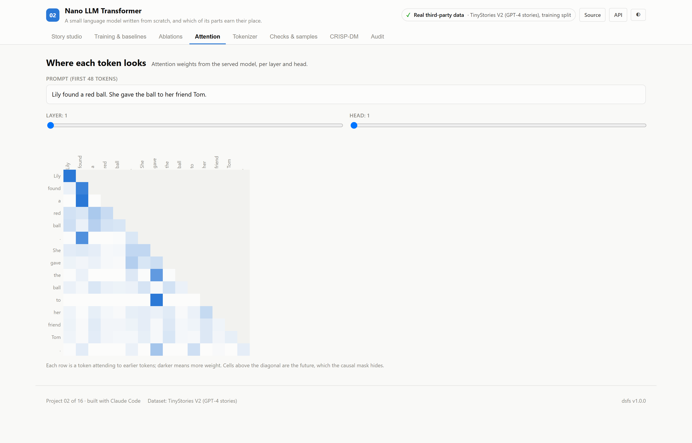
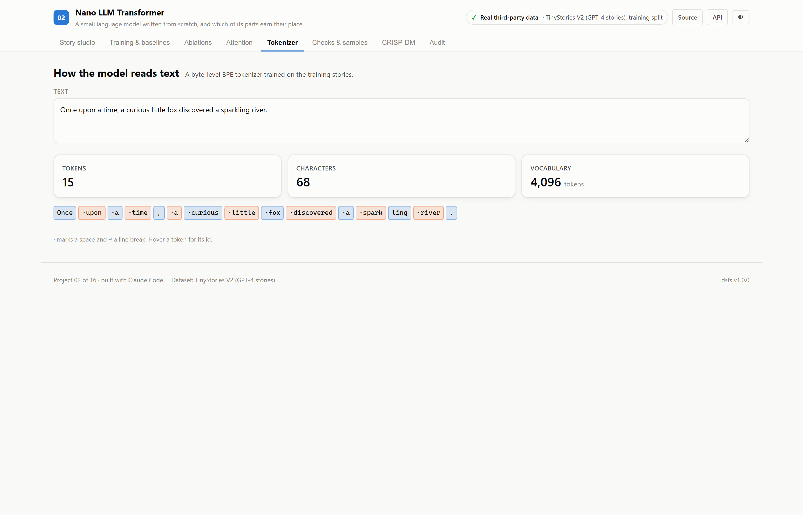
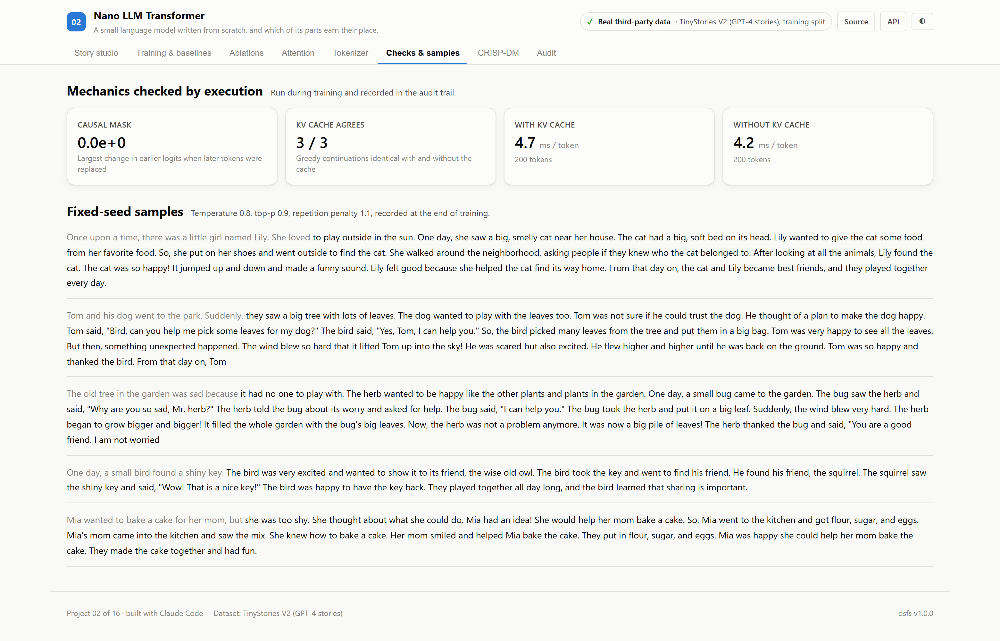

# 02 · Nano LLM Transformer

**A small decoder-only language model written from scratch in PyTorch and trained on
children's stories on one laptop GPU — measured against simple baselines, with each
modern component tested for whether it earns its place.**

Built on the real TinyStories V2 corpus: 2,717,495 training stories written by GPT-4 for
training very small language models, and 27,630 validation stories.

| | |
|---|---|
| Model | 8,685,760 parameters · 6 layers · 8 heads · width 320 · 256-token context |
| Recipe | Rotary position embeddings · SwiGLU · RMSNorm · tied embeddings · byte-level BPE, 4,096 tokens |
| Training | 12,000 steps, 197M tokens, 26 minutes on an NVIDIA GeForce RTX 5070 Laptop GPU |
| Result | Validation perplexity **4.03**, against 34.0 for a bigram model |
| Ports | API `8002` · Web `5102` |

---

## The decision that defines this project

A language-model demo usually shows generated text and stops. This one asks what
the text is worth and what each part of the model contributes:

1. **Baselines on the same tokens.** Perplexity is reported beside a unigram and an
   interpolated bigram model scored on exactly the same validation tokens.
2. **Ablations against seed noise.** Each modern component is swapped for its older
   equivalent and trained on a shorter budget. The reference was trained twice with
   different seeds, and a difference counts only if it is larger than that gap.
3. **Mechanics checked by execution.** Changing future tokens must leave earlier
   predictions untouched, and generation with the KV cache must produce exactly the
   tokens full recomputation does.
4. **No validation story is trained on.** Every story in both files is hashed:
   0 validation stories appear in the training file, and 1
   training story is an exact repeat of an earlier one, so on this corpus the check found nothing to remove.

---

## Results

<!-- dsfs:leaderboard -->
| # | Model | Validation perplexity | Loss (nats/token) | Bits per character |
|---|---|---|---|---|
| 1 | **NanoLM, RoPE · SwiGLU · RMSNorm** 🏆 | 4.029 | 1.3934 | 0.506 |
| 2 | Bigram, interpolated *(baseline)* | 34.037 | 3.5275 | 1.280 |
| 3 | Unigram frequencies *(baseline)* | 357.962 | 5.8804 | 2.134 |

Ranked by validation perplexity (lower is better). Split: official TinyStories V2 split; validation stories seen in training removed; 5,578,295 evaluation rows. Generated from `artifacts/metrics.json`.
<!-- /dsfs:leaderboard -->

The model's validation perplexity is 4.03: at each step it is, on average, as
uncertain as a fair choice among about 4 tokens. An interpolated bigram, which
predicts from the previous token alone, scores 34.0; unigram frequencies
358.0. In bits per character, 0.506 against
1.280.

### Which components earn their place?

Each variant trained for 3,000 steps from the same seed as the reference, and was
scored on every validation token:

| Variant | Parameters | Perplexity | Loss vs reference (nats/token) | Beyond seed noise? |
|---|---|---|---|---|
| Reference: RoPE · SwiGLU · RMSNorm | 8,685,760 | 4.953 | +0.0000 | — |
| Reference, second seed | 8,685,760 | 4.983 | +0.0060 | — |
| Learned positions instead of RoPE | 8,767,680 | 5.218 | +0.0522 | yes |
| GELU instead of SwiGLU | 8,687,680 | 5.148 | +0.0386 | yes |
| LayerNorm instead of RMSNorm | 8,689,920 | 4.957 | +0.0009 | no |
| GPT-2 style: learned · GELU · LayerNorm | 8,773,760 | 5.393 | +0.0852 | yes |

The two runs of the reference differ by **0.0060** nats per token. Changes larger than that: learned positions instead of rope was worse by 0.0522; gelu instead of swiglu was worse by 0.0386; gpt-2 style: learned · gelu · layernorm was worse by 0.0852. Within the noise: layernorm instead of rmsnorm. 
Each is a single run at a short budget, with a noise estimate from only two seeds,
so these results suggest rather than settle which components matter at this scale.

### Mechanics

| Check | Measured |
|---|---|
| Causal mask: tokens 40–63 replaced | largest change in the logits at positions 0–39: 0.0e+00 |
| KV cache: greedy 60-token continuations | 3 of 3 identical with and without the cache |
| Generation speed, 200 tokens | 4.7 ms per token with the cache, 4.2 ms without |

**The KV cache did not make generation faster here.** It is correct — the outputs match. A likely reason, not separately measured: at a 256-token context a GPU recomputes every position in one parallel pass about as cheaply as it processes one new token, so the work of extending the cache is not repaid. The cache matters more as contexts grow.

---

## Samples

Recorded at the end of training with temperature 0.8, top-p 0.9 and repetition
penalty 1.1, fixed seeds. The prompt is in bold.

> **Once upon a time, there was a little girl named Lily. She loved**to play outside in the sun. One day, she saw a big, smelly cat near her house. The cat had a big, soft bed on its head.
Lily wanted to give the cat some food from her favorite food. So, she put on her shoes and went outside to find the cat. She walked around the neighborhood, asking people if they knew who the cat belonged to.
After looking at all the animals, Lily found the cat. The cat was so happy! It jumped up and down and made a funny sound. Lily felt good because she helped the cat find its way home. From that day on, the cat and Lily became best friends, and they played together every day.

> **Tom and his dog went to the park. Suddenly,**they saw a big tree with lots of leaves. The dog wanted to play with the leaves too. Tom was not sure if he could trust the dog. He thought of a plan to make the dog happy.
Tom said, "Bird, can you help me pick some leaves for my dog?" The bird said, "Yes, Tom, I can help you." So, the bird picked many leaves from the tree and put them in a big bag. Tom was very happy to see all the leaves.
But then, something unexpected happened. The wind blew so hard that it lifted Tom up into the sky! He was scared but also excited. He flew higher and higher until he was back on the ground. Tom was so happy and thanked the bird. From that day on, Tom

> **The old tree in the garden was sad because**it had no one to play with. The herb wanted to be happy like the other plants and plants in the garden.
One day, a small bug came to the garden. The bug saw the herb and said, "Why are you so sad, Mr. herb?" The herb told the bug about its worry and asked for help. The bug said, "I can help you."
The bug took the herb and put it on a big leaf. Suddenly, the wind blew very hard. The herb began to grow bigger and bigger! It filled the whole garden with the bug's big leaves. Now, the herb was not a problem anymore. It was now a big pile of leaves!
The herb thanked the bug and said, "You are a good friend. I am not worried

---

## Screenshot tour






> CRISP-DM, audit and dark variants of every view are in [`screenshots/`](./screenshots).

---

## Assertions that ran

<!-- dsfs:assertions -->
| Assertion | Result | What it measured |
|---|---|---|
| `assert_validation_stories_unseen` | ✅ passed | 27,630 validation stories hashed against 2,717,495 training stories; 0 also appeared in training and were removed; 0 remain. |
| `assert_causal_mask` | ✅ passed | Tokens 40-63 of a 64-token sequence replaced; largest change in logits at positions 0-39 was 0.00e+00 (limit 1e-4). The model cannot see the future. |
| `assert_kv_cache_matches_recompute` | ✅ passed | Greedy 60-token continuations of 3 prompts generated with and without the KV cache; 3 of 3 identical. |

Recorded by the assertion ledger while training ran; generated from `artifacts/metrics.json`.
<!-- /dsfs:assertions -->

---

## Running it

```bash
pip install -e ../platform
pip install torch --index-url https://download.pytorch.org/whl/cu128   # or the CPU build
pip install tokenizers
npm install

python ml/train.py     # downloads 2.2 GB of stories; about 65 minutes on the GPU above
python -m uvicorn main:app --app-dir server --port 8002
npm run dev -w 02_nano_llm/client     # http://localhost:5102
```

Generated documents: [paper](./paper.md) · [abstract](./abstract.md) ·
[article](./article.md) · [design doc](./DESIGN_DOC.md) ·
[audit report](./audit_report.md) · [reproduction skill](./skills/reproduce/SKILL.md)
