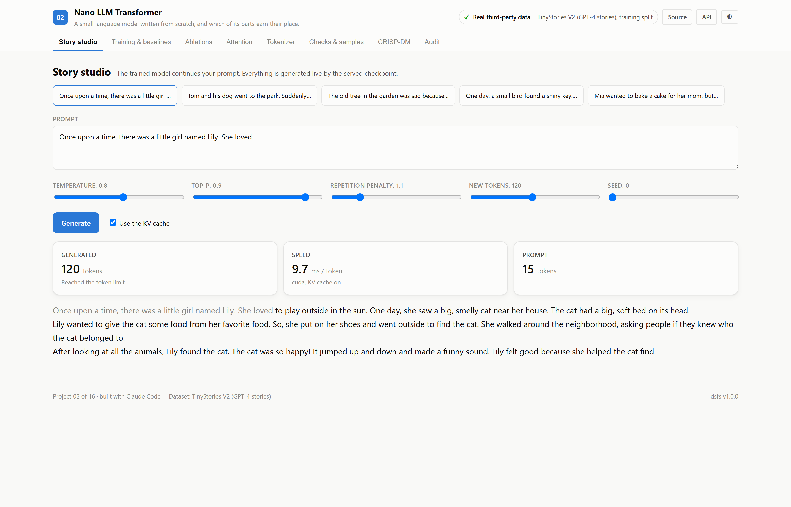

# A small language model written from scratch, and which of its parts earn their place.

*Nano LLM Transformer — project 02 of a sixteen-project data science portfolio built with an AI coding assistant, on real data.*

## The question

How good a storyteller can a 8.7-million-parameter transformer become on one laptop GPU, and which of its modern components actually earn their place?

Modern language models share a recipe: rotary position embeddings, gated feed-forward layers and RMSNorm. This project implements that recipe from scratch, trains it on children's stories, and asks two questions a demo usually skips. How much better is it than simple word statistics? And does each piece of the recipe help at this scale, or is it carried along by habit?

## The data

2,717,495 training stories and 27,630 validation stories. Because the stories were generated, some repeat: 1 training stories are exact copies (after whitespace normalisation) of an earlier one, and **0 validation stories also appear in the training file**. Those are removed, leaving 27,630 validation stories the model has never seen.

## What won

**NanoLM, RoPE · SwiGLU · RMSNorm**, at 4.029 on validation perplexity, against 34.037 for the best baseline, Bigram, interpolated.

| # | Model | Validation perplexity | Loss (nats/token) | Bits per character |
|---|---|---|---|---|
| 1 | **NanoLM, RoPE · SwiGLU · RMSNorm** 🏆 | 4.029 | 1.3934 | 0.506 |
| 2 | Bigram, interpolated *(baseline)* | 34.037 | 3.5275 | 1.280 |
| 3 | Unigram frequencies *(baseline)* | 357.962 | 5.8804 | 2.134 |

Ranked by validation perplexity (lower is better). Split: official TinyStories V2 split; validation stories seen in training removed; 5,578,295 evaluation rows. Generated from `artifacts/metrics.json`.

Validation perplexity is **4.03**, against 34.0 for an interpolated bigram and 358.0 for unigram frequencies.

Of the 4 ablations, 3 moved validation loss by more than the seed-to-seed gap: Learned positions instead of RoPE (+0.0522); GELU instead of SwiGLU (+0.0386); GPT-2 style: learned · GELU · LayerNorm (+0.0852). Every one of these is a single run at 3,000 steps, so the ranking is indicative rather than settled.

Two mechanics are checked by execution: changing future tokens leaves earlier logits unchanged, and generation with the KV cache produces exactly the tokens full recomputation does, at 4.7 ms per token against 4.2 ms.

## What I took away

- Under half an hour of training on one laptop GPU took an 8.7-million-parameter model far beyond n-gram statistics on the same tokens.
- Replacing rotary position embeddings or SwiGLU with their older equivalents cost more than the seed-to-seed gap; replacing RMSNorm with LayerNorm did not.
- A second seed is the cheapest way to know whether an ablation result is a result at all.
- A correct KV cache is not automatically a faster one: at a short context on a GPU, recomputation was as quick.
- Measuring overlap between training and validation data is worth doing even when, as here, it finds none.

## How it is built

The backend is FastAPI on port 8002 and the front end is React on port 5102. Most of the interface — the metrics panel, tournament table, CRISP-DM walkthrough, audit panel and charts — is shared across the portfolio and driven entirely by the training run's artifacts, so nothing on screen is typed by hand.

Code: [github.com/aniket-alt/ai-coding-assistant](https://github.com/aniket-alt/ai-coding-assistant/tree/main/02_nano_llm)

---

*Figures in this article are generated from the project's artifacts.*
