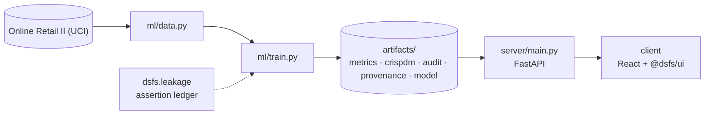

# Design document — Customer Segmentation

| | |
|---|---|
| Project | 03 · `03_customer_segmentation` |
| Domain | Clustering · judged on future behaviour |
| Task | customer segmentation (clustering) |
| Ports | API 8003 · web 5103 |
| Dataset | Online Retail II, UCI, 2009-2011 (1,067,371 lines) |

## 1. Problem

Which groups of customers behave differently enough to be treated differently, and do those groups still mean anything a year later?

Find segments a retailer could act on, and prove they are more than an artefact of the algorithm.

### Goals

- Find segments a retailer could act on, and prove they are more than an artefact of the algorithm.
- Reduce two years of raw transaction lines to genuine product sales by known customers.
- Describe each customer by first-year behaviour only.
- Compare partitioning, probabilistic, hierarchical and density-based methods against two baselines.
- Decide whether any learned segmentation earns its place over the marketing rule.
- Assign a new customer to a segment and show what that segment did next.

### Non-goals

- Naming segments for a marketing audience. Segment tags are derived mechanically from medians.
- Predicting an individual customer's spend. Segments are judged on how well they separate groups.

## 2. Architecture



Training is the only writer of results. The API serves the artifacts it wrote, and the client renders what the API returns, so a figure on screen always traces back to one run.

## 3. Components

| File | Lines | Responsibility |
|---|---:|---|
| `ml/features.py` | 71 | Project 03 -- customer features and future outcomes. |
| `ml/train.py` | 442 | Project 03 -- segmentation tournament, audit, and artefact generation. |
| `server/inference.py` | 82 | Assigns a customer to the nearest segment of the winning segmentation and returns what that segment went on to do. Every profile figure comes from the training run's… |
| `server/main.py` | 69 | Project 03 -- FastAPI application. |
| `client/src/App.tsx` | 154 | SegmentExplorer is the only project-specific view. The customer assignment form is the shared schema-driven PredictionForm, with slider bounds taken from the training data's… |
| `client/src/SegmentExplorer.tsx` | 147 | Choosing a row in the shared leaderboard loads that segmentation's profiles, so the comparison is between whole segmentations rather than one winner. Every figure is a field of… |
| `client/src/main.tsx` | 10 | — |

Everything else — the FastAPI factory, dataset cache, provenance, CRISP-DM report, metrics record, leakage auditor and the six shared UI components — comes from `platform/`.

## 4. API

| Method | Path | Purpose |
|---|---|---|
| GET | `/api/segments` | Segment profiles for one segmentation, defaulting to the winner. |
| GET | `/api/feature-ranges` | 5th percentile, median and 95th percentile of each feature, for input bounds. |
| POST | `/api/assign` | Assign a customer to the nearest segment of the winning segmentation. |
| GET | `/api/health` | Liveness, version and whether artifacts are present. (platform) |
| GET | `/api/meta` | Project identity, ports and techniques. (platform) |
| GET | `/api/metrics` | The full run record: models, split, audit, environment. (platform) |
| GET | `/api/crispdm` | The six-phase CRISP-DM report written during training. (platform) |
| GET | `/api/audit` | Static leakage findings. (platform) |
| GET | `/api/provenance` | The dataset receipt. (platform) |
| GET | `/api/docs` | Interactive OpenAPI documentation. (platform) |

## 5. Data and evaluation

✅ **Real, third-party data**

| Field | Value |
|---|---|
| Dataset | Online Retail II (UCI) |
| Source | https://archive.ics.uci.edu/static/public/502/online+retail+ii.zip |
| Licence | Creative Commons Attribution 4.0 (CC BY 4.0) |
| Rows × columns (as downloaded) | 1,067,371 × 8 |
| SHA-256 | `572e36277c2390fbfde10664750731e0a86f55e33470d91919085f0408e67bfb` |
| Customers in first year | 4,239 |
| Product lines after cleaning | 776,577 |

**Split.** features from year one, outcomes from year two. Every first-year customer is scored on their second-year revenue.

## 6. Key decisions

- **Business understanding.** Outcome, stability test and baselines fixed before clustering.
- **Data understanding.** 776,577 product lines retained, each removal rule recorded.
- **Data preparation.** Features and outcome drawn from disjoint, ordered periods; assertions executed.
- **Modeling.** 11 segmentations scored on outcome, stability and geometry.
- **Evaluation.** No critical findings; every segment scored on behaviour it never saw.
- **Deployment.** Scaler, segment centres and profiles persisted together.

## 7. Verification

- 3 of 3 runtime leakage assertions passed.
- Static source audit: 0 critical, 0 warnings.
- 8 screenshots captured by `scripts/capture_screenshots.py`, which fails if any view does not render its expected content.

| Assertion | Result | What it measured |
|---|---|---|
| `assert_temporal_split` | ✅ passed | Last training timestamp 2010-11-30 19:35:00 precedes first test timestamp 2010-12-01 08:26:00 by 0 days 12:51:00; no embargo required. |
| `assert_disjoint` | ✅ passed | 385,427 training and 391,150 test row indices compared; 0 appear in both. |
| `assert_no_target_leak` | ✅ passed | 7 numeric features correlated against the target; strongest was recency_days at |r|=0.4046 (threshold 0.995). |

Recorded by the assertion ledger while training ran; generated from `artifacts/metrics.json`.

## 8. Risks

- One retailer, two years, mostly UK gift buyers. Segments may not transfer to other businesses.
- Second-year behaviour is observed for a single following year only.
- Customers without an ID, over a fifth of lines, are excluded, and they may differ systematically from those with one.

## 9. Reproducibility

Last trained at commit `799695b` on Python 3.11.6.

```bash
python ml/train.py
python -m uvicorn main:app --app-dir server --port 8003
npm run dev -w 03_customer_segmentation/client
```

---

*Generated by `scripts/generate_docs.py`.*
