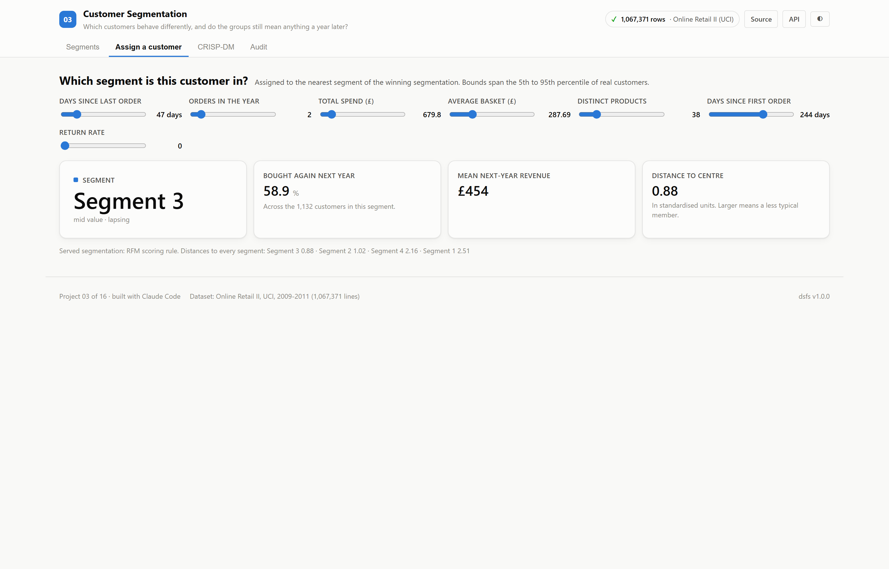
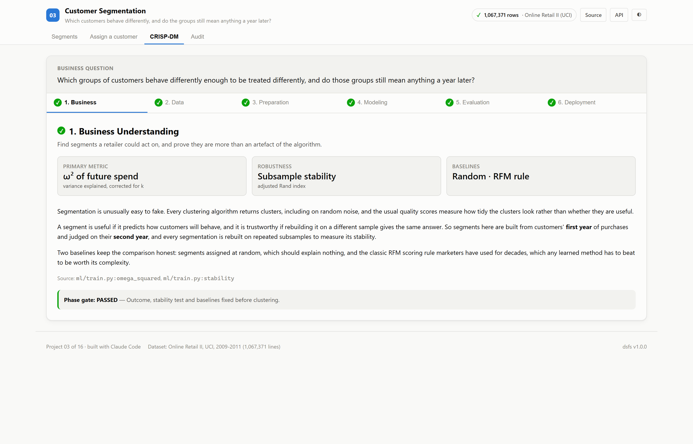
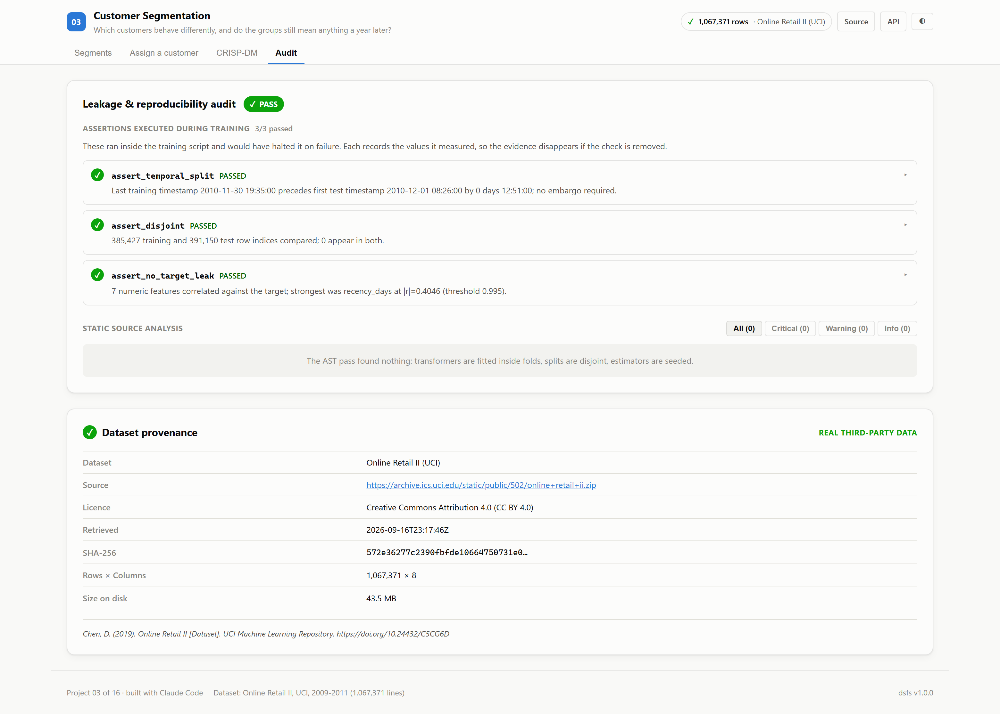

# 03 · Customer Segmentation

**Which customers behave differently enough to be treated differently, and do
those groups still mean anything a year later?**

Built on the real UCI Online Retail II dataset: every transaction of a UK online
gift retailer from December 2009 to December 2011.

| | |
|---|---|
| Task | Customer segmentation (clustering) |
| Dataset | [Online Retail II](https://archive.ics.uci.edu/dataset/502/online+retail+ii) · CC BY 4.0 |
| Evaluation | Segments built from year one, judged on year two |
| Winner | **RFM scoring rule**, a baseline |
| Ports | API `8003` · Web `5103` |

---

## The decision that defines this project

**Clustering always finds clusters.** Run k-means on random noise and it returns
k tidy groups. The usual quality score, silhouette, measures how compact and
separated the groups look, not whether they are useful.

So every segmentation here is judged on two things that can genuinely fail:

1. **Does it predict behaviour it never saw?** Segments are built only from each
   customer's first year of purchases. They are scored on how much of the
   variation in *second-year* spending they explain, using ω², which corrects
   for the number of segments so that splitting into more groups is not
   rewarded for its own sake.
2. **Is it stable?** Each method is rebuilt on ten pairs of overlapping 80%
   subsamples, and the segment assignments are compared with the adjusted Rand
   index.

Two baselines keep this honest: random segments, which should explain nothing,
and the classic RFM scoring rule marketers have used for decades.

---

## Results

<!-- dsfs:leaderboard -->
| # | Segmentation | ω² next-year spend | Stability (ARI) | Silhouette | Retention spread (pts) | k |
|---|---|---|---|---|---|---|
| 1 | **RFM scoring rule** 🏆 *(baseline)* | 0.3062 | 0.970 | 0.085 | 58.3 | 4 |
| 2 | k-means (k=8) | 0.2856 | 0.734 | 0.225 | 64.0 | 8 |
| 3 | k-means (k=5) | 0.2842 | 0.946 | 0.246 | 61.0 | 5 |
| 4 | k-means (k=6) | 0.2837 | 0.906 | 0.238 | 58.0 | 6 |
| 5 | Gaussian mixture (k=6) | 0.2765 | 0.811 | 0.059 | 55.8 | 6 |
| 6 | Gaussian mixture (k=4) | 0.2623 | 0.640 | 0.101 | 53.4 | 4 |
| 7 | Agglomerative (ward, k=5) | 0.2552 | 0.411 | 0.191 | 56.6 | 5 |
| 8 | k-means (k=3) | 0.2363 | 0.966 | 0.288 | 48.1 | 3 |
| 9 | k-means (k=4) | 0.2322 | 0.970 | 0.301 | 48.9 | 4 |
| 10 | HDBSCAN | 0.0367 | 0.855 | −0.212 | 51.7 | 4 |
| 11 | Random segments *(baseline)* | −0.0001 | 0.000 | −0.009 | 3.1 | 4 |

Ranked by ω² next-year spend (higher is better). Split: features from year one, outcomes from year two; 4,239 evaluation rows. Generated from `artifacts/metrics.json`.
<!-- /dsfs:leaderboard -->

**The marketing rule won.** A rule with no learning at all, which ranks customers
by recency, order count and spend, separated next-year spending better than
every clustering algorithm, and rebuilt almost identically on every subsample.

**Silhouette would have chosen differently.** k-means with four segments has the
tidiest geometry in the tournament (silhouette 0.301)
yet explains less future spend (ω² 0.2322) than the
RFM rule, which has one of the lowest silhouettes (0.085).
Ranked the usual way, the tournament would have picked a worse segmentation.

**Random segments score close to zero**, confirming the metric is not rewarding
the act of splitting.

### What the winning segments did next

| Segment | Profile | Customers | Bought again | Mean next-year revenue |
|---|---|---:|---:|---:|
| Segment 1 | high value · recent | 883 | 94.9% | £5,387 |
| Segment 2 | mid value · recent | 1,012 | 76.3% | £1,387 |
| Segment 3 | mid value · lapsing | 1,132 | 58.9% | £454 |
| Segment 4 | low value · lapsing | 1,212 | 36.6% | £287 |

The two right-hand columns describe a year that played no part in building the
segments. Figures are taken from `artifacts/metrics.json`.

---

## Screenshot tour

### Segments
Choosing a row in the tournament loads that segmentation's profiles, so whole
segmentations can be compared rather than only the winner.


### Assign a customer
The shared prediction form, with slider bounds taken from the 5th and 95th
percentiles of real customers.



### CRISP-DM · Audit



> Dark variants of every view are in [`screenshots/`](./screenshots).

---

## What the data required

The export ships as two yearly spreadsheets that **overlap by nine days** (1 to 9
December 2010). Concatenating them naively counts those orders twice; the
duplicate rule removed 34,335 lines, including that overlap.

Lines without a customer ID, cancellations, and more than six thousand
non-product lines (postage, bank charges, marketplace fees, manual adjustments,
gift vouchers) are removed from sales. Cancellations are kept aside rather than
discarded, because a customer's return rate is behaviour and becomes a feature.
The loader lives in [`datasets/loaders/online_retail.py`](../datasets/loaders/online_retail.py)
and is shared with project 04.

## Assertions that ran

<!-- dsfs:assertions -->
| Assertion | Result | What it measured |
|---|---|---|
| `assert_temporal_split` | ✅ passed | Last training timestamp 2010-11-30 19:35:00 precedes first test timestamp 2010-12-01 08:26:00 by 0 days 12:51:00; no embargo required. |
| `assert_disjoint` | ✅ passed | 385,427 training and 391,150 test row indices compared; 0 appear in both. |
| `assert_no_target_leak` | ✅ passed | 7 numeric features correlated against the target; strongest was recency_days at |r|=0.4046 (threshold 0.995). |

Recorded by the assertion ledger while training ran; generated from `artifacts/metrics.json`.
<!-- /dsfs:assertions -->

---

## Running it

```bash
pip install -e ../platform
npm install

python ml/train.py     # downloads the data on first run, then trains and audits
python -m uvicorn main:app --app-dir server --port 8003
npm run dev -w 03_customer_segmentation/client     # http://localhost:5103
```

Generated documents: [paper](./paper.md) · [abstract](./abstract.md) ·
[article](./article.md) · [design doc](./DESIGN_DOC.md) ·
[audit report](./audit_report.md) · [reproduction skill](./skills/reproduce/SKILL.md)
