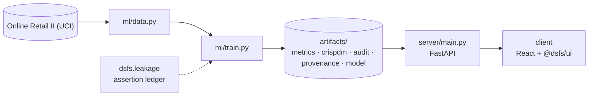

# Design document — Market Basket Mining

| | |
|---|---|
| Project | 04 · `04_market_basket` |
| Domain | Association rules · recommendation |
| Task | association rule mining and recommendation |
| Ports | API 8004 · web 5104 |
| Dataset | Online Retail II, UCI, 2009-2011 (1,067,371 lines) |

## 1. Problem

Which products go together strongly enough to recommend, and do those associations still hold next season?

Recommend a next item to add to a basket, using associations that hold up over time.

### Goals

- Recommend a next item to add to a basket, using associations that hold up over time.
- Turn transaction lines into baskets, keeping orders from customers without an ID.
- Build an evaluation no method can pass by seeing the answer.
- Compare mined rules at three thresholds with baselines that need no mining.
- Establish whether mined rules add anything a retailer could not get from a bestseller list.
- Recommend for a basket, and show which rules justify each suggestion.

### Non-goals

- Personalised recommendation. Suggestions depend only on the current basket, not on a customer's history.
- Pricing or promotion effects. The data records what was bought, not what was offered.

## 2. Architecture



Training is the only writer of results. The API serves the artifacts it wrote, and the client renders what the API returns, so a figure on screen always traces back to one run.

## 3. Components

| File | Lines | Responsibility |
|---|---:|---|
| `ml/baskets.py` | 279 | Project 04 -- baskets, association rules and recommenders. |
| `ml/train.py` | 371 | Project 04 -- market basket tournament, rule survival, and artefacts. |
| `server/inference.py` | 84 | Recommends products for a basket with the tournament's winning method, and explains each suggestion by the basket item that most strongly implies it. Rules and their… |
| `server/main.py` | 60 | Project 04 -- FastAPI application. |
| `client/src/App.tsx` | 168 | RuleTable is the only project-specific view. The basket builder is the shared PredictionForm with a multiselect fed by /api/items, and the tournament is the shared… |
| `client/src/RuleTable.tsx` | 103 | The strongest mined rules, each shown with its statistics in the training period beside what it did in the following season. A rule's training confidence alone says little;… |
| `client/src/main.tsx` | 10 | — |

Everything else — the FastAPI factory, dataset cache, provenance, CRISP-DM report, metrics record, leakage auditor and the six shared UI components — comes from `platform/`.

## 4. API

| Method | Path | Purpose |
|---|---|---|
| GET | `/api/items` | The 300 most frequently bought products, for building a basket. |
| GET | `/api/rules` | Strongest rules, with their statistics in training and in the following season. |
| POST | `/api/recommend` | Five product suggestions for a basket, each with the reason it was suggested. |
| GET | `/api/health` | Liveness, version and whether artifacts are present. (platform) |
| GET | `/api/meta` | Project identity, ports and techniques. (platform) |
| GET | `/api/metrics` | The full run record: models, split, audit, environment. (platform) |
| GET | `/api/crispdm` | The six-phase CRISP-DM report written during training. (platform) |
| GET | `/api/audit` | Static leakage findings. (platform) |
| GET | `/api/provenance` | The dataset receipt. (platform) |
| GET | `/api/docs` | Interactive OpenAPI documentation. (platform) |

## 5. Data and evaluation

✅ **Real, third-party data**

| Field | Value |
|---|---|
| Dataset | Online Retail II (UCI) |
| Source | https://archive.ics.uci.edu/static/public/502/online+retail+ii.zip |
| Licence | Creative Commons Attribution 4.0 (CC BY 4.0) |
| Rows × columns (as downloaded) | 1,067,371 × 8 |
| SHA-256 | `572e36277c2390fbfde10664750731e0a86f55e33470d91919085f0408e67bfb` |
| Products in training | 4,604 |
| Test baskets | 7,012 |
| Training baskets | 32,126 |

**Split.** chronological with 7-day embargo, one item hidden per test basket. 9.9% of hidden products never appear in training and count as misses.

## 6. Key decisions

- **Business understanding.** Held-out test, survival definition and baselines fixed before mining.
- **Data understanding.** 32,126 training and 7,012 test baskets.
- **Data preparation.** Temporal, disjointness, invoice and hidden-item assertions all executed.
- **Modeling.** 7 recommenders scored on 6,548 held-out baskets.
- **Evaluation.** No critical findings; every recommendation judged on a later season.
- **Deployment.** Winning recommender, bestseller fallback and product names persisted.

## 7. Verification

- 4 of 4 runtime leakage assertions passed.
- Static source audit: 0 critical, 0 warnings.
- 10 screenshots captured by `scripts/capture_screenshots.py`, which fails if any view does not render its expected content.

| Assertion | Result | What it measured |
|---|---|---|
| `assert_temporal_split` | ✅ passed | Last training timestamp 2011-08-31 17:30:00 precedes first test timestamp 2011-09-08 08:56:00 by 7 days 15:26:00; embargo of 6D required. |
| `assert_disjoint` | ✅ passed | 789,736 training and 203,765 test row indices compared; 0 appear in both. |
| `assert_no_shared_invoices` | ✅ passed | 32,126 training and 7,012 test invoices compared; 0 in both. |
| `assert_hidden_item_not_visible` | ✅ passed | 6,548 test baskets checked; the hidden item was visible to the model in 0. |

Recorded by the assertion ledger while training ran; generated from `artifacts/metrics.json`.

## 8. Risks

- The test season is Christmas, so seasonal products are over-represented among the hidden items.
- One hidden item per basket is chosen at random, which weights every product in a basket equally.
- Lift above one is a lenient definition of a rule surviving; confidence retained is the stronger evidence.

## 9. Reproducibility

Last trained at commit `3d7f8d5` on Python 3.11.6.

```bash
python ml/train.py
python -m uvicorn main:app --app-dir server --port 8004
npm run dev -w 04_market_basket/client
```

---

*Generated by `scripts/generate_docs.py`.*
