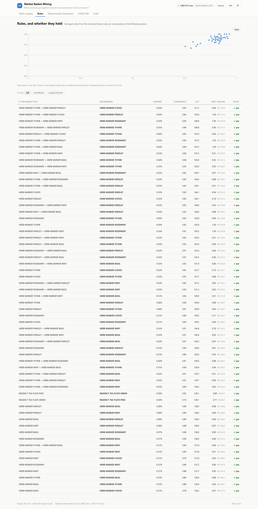
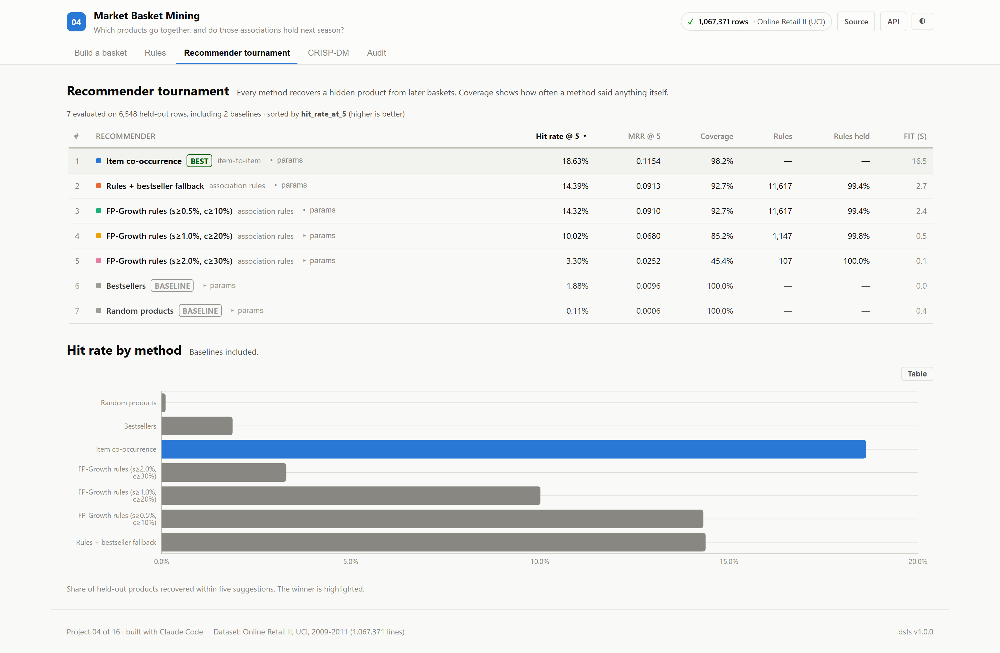
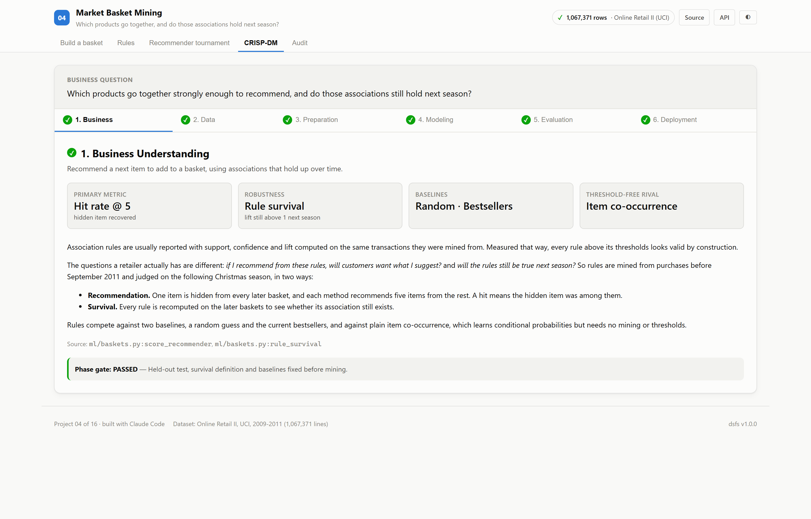
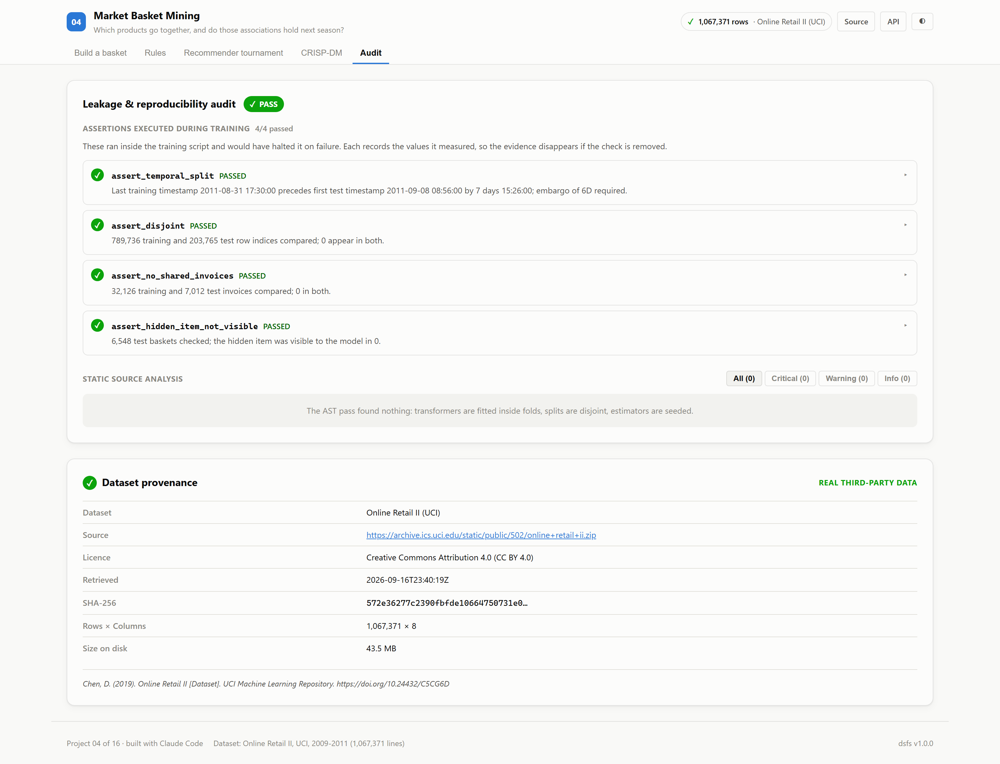

# 04 · Market Basket Mining

**Which products go together strongly enough to recommend, and do those
associations still hold next season?**

Built on the real UCI Online Retail II dataset, sharing its cleaned transactions
with project 03.

| | |
|---|---|
| Task | Association rule mining and recommendation |
| Dataset | [Online Retail II](https://archive.ics.uci.edu/dataset/502/online+retail+ii) · CC BY 4.0 |
| Evaluation | Mined before September 2011, judged on the following Christmas season |
| Winner | **Item co-occurrence**, with no mining at all |
| Ports | API `8004` · Web `5104` |

---

## The decision that defines this project

Association rules are almost always reported with support, confidence and lift
computed on the same baskets they were mined from. Measured that way, every
rule above its thresholds is valid by construction.

A retailer's real questions are different, so this project asks them directly:

1. **Would recommending from these rules work?** Rules are mined from
   32,126 baskets before September 2011. From each basket
   in the following Christmas season, one product is hidden and every method
   suggests five products from the rest. A hit means the hidden product was
   suggested.
2. **Do the rules still hold?** Every mined rule is recomputed on the later
   baskets.

Mined rules compete against a random guess, the current bestsellers, and plain
item co-occurrence, which needs no mining and no thresholds.

---

## Results

<!-- dsfs:leaderboard -->
| # | Recommender | Hit rate @ 5 | MRR @ 5 | Coverage | Rules | Rules held next season |
|---|---|---|---|---|---|---|
| 1 | **Item co-occurrence** 🏆 | 18.6% | 0.1154 | 98.2% | — | — |
| 2 | Rules + bestseller fallback | 14.4% | 0.0913 | 92.7% | 11,617 | 99.4% |
| 3 | FP-Growth rules (s≥0.5%, c≥10%) | 14.3% | 0.0910 | 92.7% | 11,617 | 99.4% |
| 4 | FP-Growth rules (s≥1.0%, c≥20%) | 10.0% | 0.0680 | 85.2% | 1,147 | 99.8% |
| 5 | FP-Growth rules (s≥2.0%, c≥30%) | 3.3% | 0.0252 | 45.4% | 107 | 100.0% |
| 6 | Bestsellers *(baseline)* | 1.9% | 0.0096 | 100.0% | — | — |
| 7 | Random products *(baseline)* | 0.1% | 0.0006 | 100.0% | — | — |

Ranked by hit rate @ 5 (higher is better). Split: chronological with 7-day embargo, one item hidden per test basket; 6,548 evaluation rows. Generated from `artifacts/metrics.json`.
<!-- /dsfs:leaderboard -->

**The simplest learned method won.** Item co-occurrence recovered the hidden
product in 18.6% of later baskets, against
14.3% for the best FP-Growth rule set.

**Bestsellers barely beat chance** (1.88%
against 0.11% for random products).
The catalogue is too long-tailed for a bestseller list to say much about any
particular basket.

**Strict thresholds buy strength at the cost of silence.** The strictest rule set
(107 rules) produced a suggestion for only
45% of baskets. Coverage is reported beside
hit rate for that reason.

**The rules held, but read that carefully.** Of the rules whose antecedents were
common enough to judge, 99.4% still showed a positive
association the following season, and the median rule kept
101% of its confidence. But the strongest
rules explain why: the top rule by lift is *HERB MARKER THYME + HERB MARKER PARSLEY* →
*HERB MARKER CHIVES*. Many durable associations link variants of one product
line. They survive because they are obvious, not because mining found something
a merchandiser could not.

---

## Screenshot tour

### Build a basket
The shared prediction form with a product picker. Each suggestion names the
basket product that most strongly implies it.


### Rules
Each rule's confidence when mined, plotted against its confidence the following
season, with a sortable table including the rules that declined most.



### Recommender tournament


### CRISP-DM · Audit



> Dark variants of every view are in [`screenshots/`](./screenshots).

---

## What this project caught

**Results changed between identical runs.** Python randomises string hashing per
process, and iterating a set of product codes follows that hash. Tied products
were therefore ranked in a different order each run, which changed the random
baseline and the co-occurrence results despite a fixed seed. Every tie is now
broken explicitly by product code, and two runs under different hash seeds
produce byte-identical metrics and rules.

**The shared leaderboard crashed.** Baselines have no rule count, and the
leaderboard passed that missing value to a column formatter. The fix is in the
shared component, so every project benefits.

## Assertions that ran

Beyond the standard temporal and disjointness checks, two assertions are specific
to this evaluation: no invoice appears in both periods, and no hidden product is
visible to the recommender.

<!-- dsfs:assertions -->
| Assertion | Result | What it measured |
|---|---|---|
| `assert_temporal_split` | ✅ passed | Last training timestamp 2011-08-31 17:30:00 precedes first test timestamp 2011-09-08 08:56:00 by 7 days 15:26:00; embargo of 6D required. |
| `assert_disjoint` | ✅ passed | 789,736 training and 203,765 test row indices compared; 0 appear in both. |
| `assert_no_shared_invoices` | ✅ passed | 32,126 training and 7,012 test invoices compared; 0 in both. |
| `assert_hidden_item_not_visible` | ✅ passed | 6,548 test baskets checked; the hidden item was visible to the model in 0. |

Recorded by the assertion ledger while training ran; generated from `artifacts/metrics.json`.
<!-- /dsfs:assertions -->

---

## Running it

```bash
pip install -e ../platform
npm install

python ml/train.py     # downloads the data on first run, then mines, tests and audits
python -m uvicorn main:app --app-dir server --port 8004
npm run dev -w 04_market_basket/client     # http://localhost:5104
```

Generated documents: [paper](./paper.md) · [abstract](./abstract.md) ·
[article](./article.md) · [design doc](./DESIGN_DOC.md) ·
[audit report](./audit_report.md) · [reproduction skill](./skills/reproduce/SKILL.md)
