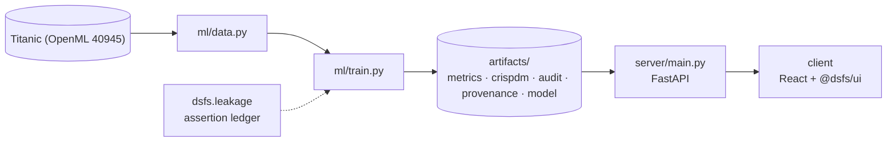

# Design document — Data Science Skills Lab

| | |
|---|---|
| Project | 05 · `05_skills_lab` |
| Domain | Course · measured practice · leakage |
| Task | measured comparison of careless and careful practice, per skill |
| Ports | API 8005 · web 5105 |
| Dataset | Titanic, German Credit, Pima Diabetes and Blood Transfusion (OpenML) |

## 1. Problem

For each technique in a working data scientist's catalogue, does doing it the careless way change the result -- and by how much, on real data?

Turn a catalogue of techniques into a catalogue of measured differences.

### Goals

- Turn a catalogue of techniques into a catalogue of measured differences.
- Choose datasets small enough to re-run live and real enough to be worth measuring.
- Give every skill the same shape so they can be compared and browsed.
- Implement both versions of each technique faithfully.
- Report which differences the experiment can resolve, and which it cannot.
- Serve the catalogue, and let any entry be re-run live.

### Non-goals

- A ranking of techniques in general. Each number is what happened on one small dataset with one model family.
- A complete catalogue. Eleven entries cover the mistakes that were cheap to measure honestly, not every mistake worth knowing.

## 2. Architecture



Training is the only writer of results. The API serves the artifacts it wrote, and the client renders what the API returns, so a figure on screen always traces back to one run.

## 3. Components

| File | Lines | Responsibility |
|---|---:|---|
| `ml/data.py` | 119 | Project 05 -- four small, real datasets for the skills catalogue. |
| `ml/skills.py` | 459 | Project 05 -- the skills catalogue, as executable comparisons. |
| `ml/train.py` | 227 | Project 05 -- run the skills catalogue and record what it measured. |
| `server/inference.py` | 80 | Recorded results are read from the training run. A skill can also be re-run on request, through the same code the training run used, so a reader can watch an interval narrow as… |
| `server/main.py` | 57 | Project 05 -- FastAPI application. |
| `client/src/App.tsx` | 166 | Browse the entries, open one to see its measured comparison, and run any of them again. Nothing here computes a result: every number is returned by the API, from the training… |
| `client/src/Catalogue.tsx` | 135 | Project-05-specific views: the catalogue list, one skill's comparison, and the live re-run. Every number shown is returned by the API; the client only decides how many decimals… |
| `client/src/main.tsx` | 10 | — |

Everything else — the FastAPI factory, dataset cache, provenance, CRISP-DM report, metrics record, leakage auditor and the six shared UI components — comes from `platform/`.

## 4. API

| Method | Path | Purpose |
|---|---|---|
| GET | `/api/catalogue` | Every skill's recorded comparison, the datasets behind them, and the auditor's warnings. |
| GET | `/api/skills/{skill_id}` | One skill's recorded comparison. |
| POST | `/api/skills/{skill_id}/rerun` | Run this skill again now, on a chosen number of seeds, beside what the training run recorded. |
| GET | `/api/health` | Liveness, version and whether artifacts are present. (platform) |
| GET | `/api/meta` | Project identity, ports and techniques. (platform) |
| GET | `/api/metrics` | The full run record: models, split, audit, environment. (platform) |
| GET | `/api/crispdm` | The six-phase CRISP-DM report written during training. (platform) |
| GET | `/api/audit` | Static leakage findings. (platform) |
| GET | `/api/provenance` | The dataset receipt. (platform) |
| GET | `/api/docs` | Interactive OpenAPI documentation. (platform) |

## 5. Data and evaluation

✅ **Real, third-party data**

| Field | Value |
|---|---|
| Dataset | Titanic (OpenML 40945) |
| Source | https://openml.org/data/v1/download/16826755/Titanic.arff |
| Licence | Public (OpenML) |
| Rows × columns (as downloaded) | 1,309 × 9 |
| SHA-256 | `c56e3785c96cd8aceac85f11bff21c2bf72841426f50903a6f27be8f334a7d03` |

**Split.** each skill repeats its own design over 25 seeds. Splits differ by skill; the pairing is by seed within a skill.

## 6. Key decisions

- **Business understanding.** Every entry must execute on a real dataset and report a paired interval.
- **Data understanding.** Provenance recorded for each; an assertion rejects synthetic data.
- **Data preparation.** One record shape for every skill.
- **Modeling.** 12 skills implemented in both versions.
- **Evaluation.** Verdicts checked against the intervals by an executed assertion.
- **Deployment.** Live re-runs use the same code path as this script.

## 7. Verification

- 3 of 3 runtime leakage assertions passed.
- Static source audit: 0 critical, 0 warnings.
- 10 screenshots captured by `scripts/capture_screenshots.py`, which fails if any view does not render its expected content.

| Assertion | Result | What it measured |
|---|---|---|
| `assert_every_dataset_is_real` | ✅ passed | 4 datasets downloaded and checksummed: titanic 1,309 rows, sha256 c56e3785; credit_g 1,000 rows, sha256 768be84e; diabetes 768 rows, sha256 4eddd5b2; blood 748 rows, sha256 ee1304ca. Marked synthetic: none. |
| `assert_every_skill_paired_on_the_same_seeds` | ✅ passed | 12 skills, each run on the same 25 seeds, careless and careful on every seed; seed counts seen: [25]. |
| `assert_claims_match_intervals` | ✅ passed | 7 of 12 skills have a bootstrap interval that excludes zero and may state an effect; entries claiming one without it: none. |

Recorded by the assertion ledger while training ran; generated from `artifacts/metrics.json`.

## 8. Risks

- Every result is specific to its dataset, its model and its metric; the same mistake can cost far more or far less elsewhere.
- Twenty-five seeds resolve differences of roughly a hundredth in AUC, and no more; smaller effects are reported as unresolved rather than absent.
- The datasets are small, so a few hundred rows decide each estimate.
- Titanic, German Credit and Pima Diabetes carry the biases of their collection, and German Credit in particular encodes judgements about applicants that should not be read as ground truth about people.

## 9. Reproducibility

Last trained at commit `4b4031a` on Python 3.11.6.

```bash
python ml/train.py
python -m uvicorn main:app --app-dir server --port 8005
npm run dev -w 05_skills_lab/client
```

---

*Generated by `scripts/generate_docs.py`.*
