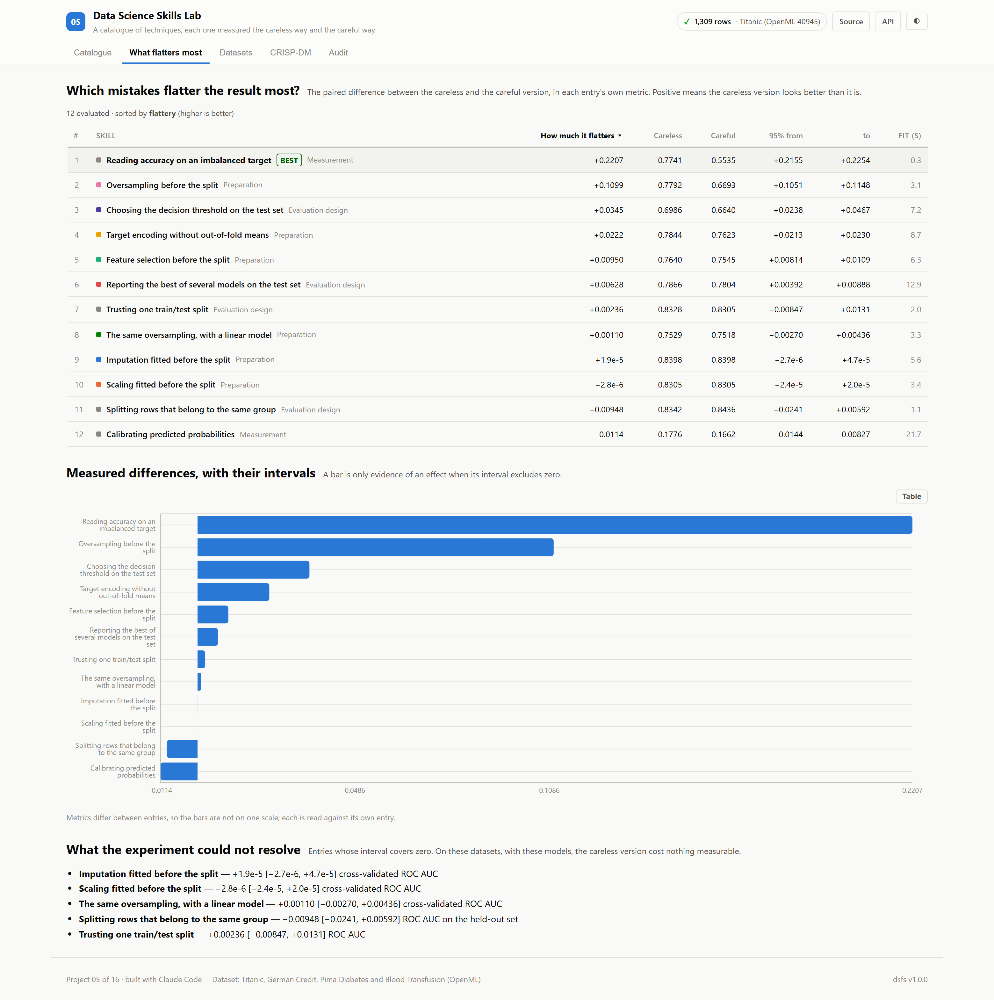
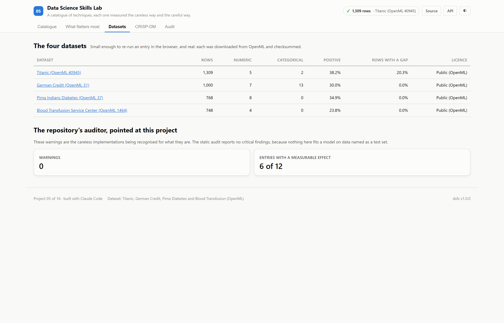

# 05 · Data Science Skills Lab

**A catalogue of techniques where every entry is a measurement, not advice: each
one runs the careless way and the careful way on real data, and reports the
difference with an interval.**

Eleven entries across 3 categories, each repeated over 25 seeds on one of four
OpenML datasets.

| | |
|---|---|
| Question per entry | Does this choice change the result, and by how much? |
| Datasets | Blood Transfusion Service Center · German Credit · Pima Indians Diabetes · Titanic |
| Method | Paired over seeds, 25 per entry, with a 2,000-sample bootstrap interval on the difference |
| Result | 6 entries flatter the careless version · 5 show no difference this experiment can resolve |
| Ports | API `8005` · Web `5105` |

---

## The decision that defines this project

A skills catalogue usually lists techniques and warns about pitfalls. A warning
cannot say whether a pitfall costs anything on the data in front of you, and
some cost nothing at all. **So each entry here executes both versions and
reports the paired difference.** An entry may only claim an effect when its
bootstrap interval excludes zero, and an assertion checks that before the
results are published:

> 7 of 12 skills have a bootstrap interval that excludes zero and may state an effect; entries claiming one without it: none.

The datasets are real. The version of this project in the source repository
generates its "Kaggle Titanic benchmark" with `numpy.random` and reports
accuracy against it; these are the actual files from OpenML, downloaded and
checksummed:

> 4 datasets downloaded and checksummed: titanic 1,309 rows, sha256 c56e3785; credit_g 1,000 rows, sha256 768be84e; diabetes 768 rows, sha256 4eddd5b2; blood 748 rows, sha256 ee1304ca. Marked synthetic: none.

---

## Results

<!-- dsfs:leaderboard -->
| # | Skill | How much it flatters | Careless | Careful | 95% from | to |
|---|---|---|---|---|---|---|
| 1 | **Reading accuracy on an imbalanced target** 🏆 | 0.2207 | 0.7741 | 0.5535 | 0.2155 | 0.2254 |
| 2 | Oversampling before the split | 0.1099 | 0.7792 | 0.6693 | 0.1051 | 0.1148 |
| 3 | Choosing the decision threshold on the test set | 0.0345 | 0.6986 | 0.6640 | 0.0238 | 0.0467 |
| 4 | Target encoding without out-of-fold means | 0.0222 | 0.7844 | 0.7623 | 0.0213 | 0.0230 |
| 5 | Feature selection before the split | 0.0095 | 0.7640 | 0.7545 | 0.0081 | 0.0109 |
| 6 | Reporting the best of several models on the test set | 0.0063 | 0.7866 | 0.7804 | 0.0039 | 0.0089 |
| 7 | Trusting one train/test split | 0.0024 | 0.8328 | 0.8305 | −0.0085 | 0.0131 |
| 8 | The same oversampling, with a linear model | 0.0011 | 0.7529 | 0.7518 | −0.0027 | 0.0044 |
| 9 | Imputation fitted before the split | 0.0000 | 0.8398 | 0.8398 | −0.0000 | 0.0000 |
| 10 | Scaling fitted before the split | −0.0000 | 0.8305 | 0.8305 | −0.0000 | 0.0000 |
| 11 | Splitting rows that belong to the same group | −0.0095 | 0.8342 | 0.8436 | −0.0241 | 0.0059 |
| 12 | Calibrating predicted probabilities | −0.0114 | 0.1776 | 0.1662 | −0.0144 | −0.0083 |

Ranked by how much it flatters (higher is better). Split: each skill repeats its own design over 25 seeds. Generated from `artifacts/metrics.json`.
<!-- /dsfs:leaderboard -->

| Entry | Dataset | Metric | Careless | Careful | Difference | 95% interval |
|---|---|---|---|---|---|---|
| Reading accuracy on an imbalanced target | blood | accuracy against balanced accuracy | 0.7741 | 0.5535 | +0.2207 | [+0.2155, +0.2254] |
| Oversampling before the split | blood | cross-validated ROC AUC | 0.7792 | 0.6693 | +0.1099 | [+0.1051, +0.1148] |
| Choosing the decision threshold on the test set | diabetes | F1 on the held-out set | 0.6986 | 0.6640 | +0.0345 | [+0.0238, +0.0467] |
| Target encoding without out-of-fold means | credit_g | cross-validated ROC AUC | 0.7844 | 0.7623 | +0.0222 | [+0.0213, +0.0230] |
| Feature selection before the split | credit_g | cross-validated ROC AUC | 0.7640 | 0.7545 | +0.00950 | [+0.00814, +0.0109] |
| Reporting the best of several models on the test set | credit_g | ROC AUC on the held-out set | 0.7866 | 0.7804 | +0.00628 | [+0.00392, +0.00888] |
| Trusting one train/test split | diabetes | ROC AUC | 0.8328 | 0.8305 | +0.00236 | [−0.00847, +0.0131] |
| The same oversampling, with a linear model | blood | cross-validated ROC AUC | 0.7529 | 0.7518 | +0.00110 | [−0.00270, +0.00436] |
| Imputation fitted before the split | titanic | cross-validated ROC AUC | 0.8398 | 0.8398 | +1.9e-05 | [−2.7e-06, +4.7e-05] |
| Scaling fitted before the split | diabetes | cross-validated ROC AUC | 0.8305 | 0.8305 | −2.8e-06 | [−2.4e-05, +2.0e-05] |
| Splitting rows that belong to the same group | titanic | ROC AUC on the held-out set | 0.8342 | 0.8436 | −0.00948 | [−0.0241, +0.00592] |
| Calibrating predicted probabilities | credit_g | Brier score (lower is better) | 0.1776 | 0.1662 | +0.0114 | [+0.00827, +0.0144] |

### What flatters most

**Reading accuracy on an imbalanced target** is the largest: 0.7741 against
0.5535, a difference of +0.2207.
Fewer than a quarter of donors gave again, so predicting 'no' for everyone is right most of the time.

**Duplicated rows cost what the model can memorise.** Two entries make the
identical mistake on the identical data and differ only in the model. With
five-nearest-neighbours, which finds a duplicate at distance zero, oversampling
before the split adds +0.1099 AUC. With a logistic
regression, which has nowhere to store an individual row, the same mistake is worth
+0.00110 — and its interval covers zero.
How much a leak costs is a property of the whole pipeline, not of the mistake alone.

**Choosing anything on the test set costs more than choosing a model badly.**
Picking the threshold against the held-out labels adds +0.0345 F1,
while reporting the best of twelve models on the test set adds +0.00628 AUC.

### What the experiment could not resolve

5 entries report no measurable difference, which is a result rather than a gap:

- **Trusting one train/test split** — +0.00236 ROC AUC, interval [−0.00847, +0.0131].
- **The same oversampling, with a linear model** — +0.00110 cross-validated ROC AUC, interval [−0.00270, +0.00436].
- **Imputation fitted before the split** — +1.9e-05 cross-validated ROC AUC, interval [−2.7e-06, +4.7e-05].
- **Scaling fitted before the split** — −2.8e-06 cross-validated ROC AUC, interval [−2.4e-05, +2.0e-05].
- **Splitting rows that belong to the same group** — −0.00948 ROC AUC on the held-out set, interval [−0.0241, +0.00592].

Imputing before the split is the clearest case. A fifth of Titanic ages are
missing, so there is something to leak, but the median of four fifths of the rows
is the same 28.0 in four folds out of five, so almost nothing moves. Standardising
before the split is an affine change the model undoes, and the two versions agree
to floating-point precision.

### Where the careful version genuinely wins

- **Calibrating predicted probabilities** — 0.1776 against 0.1662 Brier score, +0.0114.

---

## The auditor, pointed at this project

The repository's own static audit reports **0 warnings** against this
project's source and no critical findings. The warnings are the careless
implementations being recognised for what they are: a transformer fitted before
a split, a frame encoded before cross-validation. In every other project a
warning here would be a defect; in this one it is the subject.

## Screenshot tour





> CRISP-DM, audit and dark variants of every view are in [`screenshots/`](./screenshots).

Any entry can be run again from the browser on a chosen number of seeds, through
the same code the recorded run used, so the interval can be watched as it
narrows.

---

## Assertions that ran

<!-- dsfs:assertions -->
| Assertion | Result | What it measured |
|---|---|---|
| `assert_every_dataset_is_real` | ✅ passed | 4 datasets downloaded and checksummed: titanic 1,309 rows, sha256 c56e3785; credit_g 1,000 rows, sha256 768be84e; diabetes 768 rows, sha256 4eddd5b2; blood 748 rows, sha256 ee1304ca. Marked synthetic: none. |
| `assert_every_skill_paired_on_the_same_seeds` | ✅ passed | 12 skills, each run on the same 25 seeds, careless and careful on every seed; seed counts seen: [25]. |
| `assert_claims_match_intervals` | ✅ passed | 7 of 12 skills have a bootstrap interval that excludes zero and may state an effect; entries claiming one without it: none. |

Recorded by the assertion ledger while training ran; generated from `artifacts/metrics.json`.
<!-- /dsfs:assertions -->

---

## Running it

```bash
pip install -e ../platform
npm install

python ml/train.py     # downloads four small datasets on first run; about 1 minutes
python -m uvicorn main:app --app-dir server --port 8005
npm run dev -w 05_skills_lab/client     # http://localhost:5105
```

Generated documents: [paper](./paper.md) · [abstract](./abstract.md) ·
[article](./article.md) · [design doc](./DESIGN_DOC.md) ·
[audit report](./audit_report.md) · [reproduction skill](./skills/reproduce/SKILL.md)
