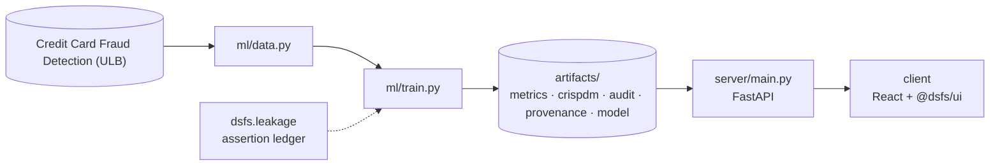

# Design document — Credit Card Fraud Detection

| | |
|---|---|
| Project | 06 · `06_anomaly_detection` |
| Domain | Anomaly detection · extreme class imbalance |
| Task | anomaly detection |
| Ports | API 8006 · web 5106 |
| Dataset | ULB credit card fraud, 284,807 transactions (492 fraudulent) |

## 1. Problem

Out of hundreds of thousands of card transactions, which handful should a fraud analyst look at today?

Rank transactions by suspicion so a limited analyst team spends its review budget on the transactions most likely to be fraud.

### Goals

- Rank transactions by suspicion so a limited analyst team spends its review budget on the transactions most likely to be fraud.
- Understand the shape of the imbalance and where fraud actually sits.
- Split by time, and scale without letting the test window inform the scaler.
- Compare unsupervised detectors against supervised classifiers on identical data.
- Decide whether the ranking is good enough to put in front of an analyst.
- Serve a suspicion score, and let an operator see the cost of their threshold.

### Non-goals

- Real-time blocking decisions. The output is a ranked review queue, not an automatic decline.
- Explaining individual features. V1 to V28 are anonymised PCA components with no published meaning.

## 2. Architecture



Training is the only writer of results. The API serves the artifacts it wrote, and the client renders what the API returns, so a figure on screen always traces back to one run.

## 3. Components

| File | Lines | Responsibility |
|---|---:|---|
| `ml/data.py` | 187 | Project 06 -- Credit card fraud detection: data acquisition. |
| `ml/train.py` | 531 | Project 06 -- fraud detection tournament, audit, and artefact generation. |
| `server/inference.py` | 140 | Scores a transaction and, more usefully, says where that score sits. A raw suspicion score is close to meaningless on its own: what an analyst needs to know is whether this… |
| `server/main.py` | 84 | Only the fraud-specific endpoints live here; health, meta, metrics, CRISP-DM, provenance and audit arrive from the platform factory. |
| `client/src/App.tsx` | 293 | The only project-specific view is TransactionScorer. Metrics, the detector tournament, the CRISP-DM walkthrough, the audit and every chart come from @dsfs/ui unchanged -- which… |
| `client/src/main.tsx` | 10 | — |
| `client/src/TransactionScorer.tsx` | 208 | Scores real held-out transactions. The true label travels with each sample, so the view can show when the model gets one wrong -- which it does, for about a third of the fraud.… |

Everything else — the FastAPI factory, dataset cache, provenance, CRISP-DM report, metrics record, leakage auditor and the six shared UI components — comes from `platform/`.

## 4. API

| Method | Path | Purpose |
|---|---|---|
| POST | `/api/score` | Score a transaction and locate it in the held-out distribution. |
| GET | `/api/samples` | Real held-out transactions the UI can load as presets. |
| GET | `/api/budget-curve` | Precision and recall at each analyst review budget. |
| GET | `/api/eda` | Fraud rate by hour and by transaction amount band. |
| GET | `/api/health` | Liveness, version and whether artifacts are present. (platform) |
| GET | `/api/meta` | Project identity, ports and techniques. (platform) |
| GET | `/api/metrics` | The full run record: models, split, audit, environment. (platform) |
| GET | `/api/crispdm` | The six-phase CRISP-DM report written during training. (platform) |
| GET | `/api/audit` | Static leakage findings. (platform) |
| GET | `/api/provenance` | The dataset receipt. (platform) |
| GET | `/api/docs` | Interactive OpenAPI documentation. (platform) |

## 5. Data and evaluation

✅ **Real, third-party data**

| Field | Value |
|---|---|
| Dataset | Credit Card Fraud Detection (ULB) |
| Source | https://openml.org/data/v1/download/1673544/creditcard.arff |
| Licence | Public (Open Database License) — OpenML dataset 1597 |
| Rows × columns (as downloaded) | 284,807 × 31 |
| SHA-256 | `fdaf12730dc1fc426f318b71349f24f5c5fd00aa1152940be7e7509ae3d89d2a` |

**Split.** chronological with 1-hour embargo. 48-hour window; 361 fraud in train, 125 in test.

## 6. Key decisions

- **Business understanding.** Ranking metric and review budget fixed before any model was fitted.
- **Data understanding.** Imbalance quantified; the accuracy trap documented before modelling.
- **Data preparation.** Temporal ordering, disjointness and target-correlation assertions all executed.
- **Modeling.** 8 detectors evaluated; winner Logistic regression.
- **Evaluation.** No critical findings; measured on a future time window.
- **Deployment.** Model and feature order persisted; budget curve precomputed from held-out scores.

## 7. Verification

- 3 of 3 runtime leakage assertions passed.
- Static source audit: 0 critical, 0 warnings.
- 10 screenshots captured by `scripts/capture_screenshots.py`, which fails if any view does not render its expected content.

| Assertion | Result | What it measured |
|---|---|---|
| `assert_temporal_split` | ✅ passed | Last training timestamp 1 days 09:59:57 precedes first test timestamp 1 days 11:00:00 by 0 days 01:00:03; embargo of 30min required. |
| `assert_disjoint` | ✅ passed | 175,582 training and 100,915 test row indices compared; 0 appear in both. |
| `assert_no_target_leak` | ✅ passed | 30 numeric features correlated against the target; strongest was V17 at |r|=0.4096 (threshold 0.995). |

Recorded by the assertion ledger while training ran; generated from `artifacts/metrics.json`.

## 8. Risks

- Two days of data from 2013. Fraud patterns drift, and a model like this needs retraining on recent labels.
- The test window holds only a small number of frauds, so metrics carry wide uncertainty.
- Labels are confirmed fraud only. Undetected fraud in the legitimate class would make every detector look better than it is.

## 9. Reproducibility

Last trained at commit `3d83606` on Python 3.11.6.

```bash
python ml/data.py
python ml/train.py
python -m uvicorn main:app --app-dir server --port 8006
npm run dev -w 06_anomaly_detection/client
```

---

*Generated by `scripts/generate_docs.py`.*
