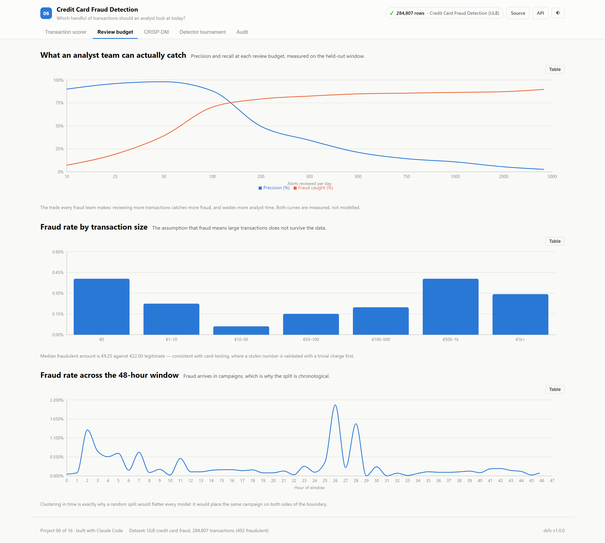
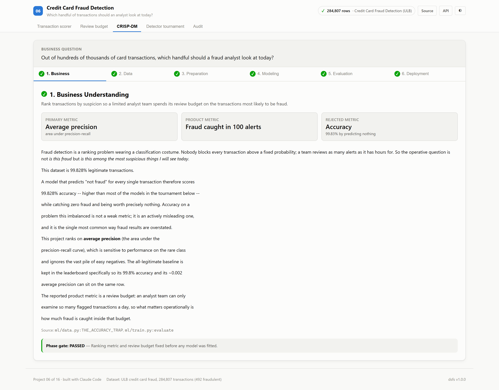
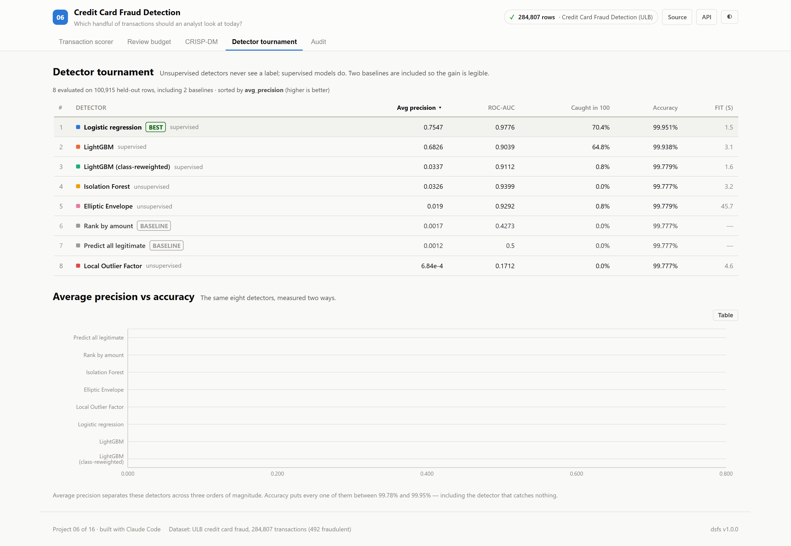
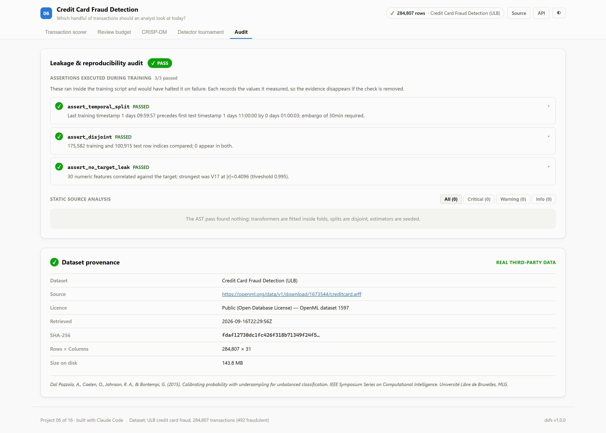

# 06 · Credit Card Fraud Detection

**Which handful of transactions should an analyst look at today?**

Trained on the real ULB dataset: **284,807 card transactions, 492 fraudulent
(0.173%)**, recorded over 48 hours in September 2013.

| | |
|---|---|
| Task | Anomaly detection · extreme class imbalance (1 : 578) |
| Dataset | [ULB credit card fraud](https://openml.org/d/1597) · Open Database Licence |
| Split | Chronological, 1-hour embargo |
| Winner | Logistic regression — **average precision 0.755**, ROC-AUC 0.978 |
| Product result | **88 of 125 frauds caught** inside a 100-alert daily budget |
| Leakage audit | 0 critical · 3 runtime assertions passed |
| Ports | API `8006` · Web `5106` |

---

## The decision that defines this project

**This dataset is 99.83% legitimate.**

So a model that predicts "not fraud" for every transaction scores **99.83%
accuracy** — higher than several models in the tournament below — while
catching zero fraud and being worth nothing at all.

Accuracy here is not a weak metric. It is an actively misleading one, and it is
the most common way fraud results get overstated. Every detector in the table
below scores between 99.78% and 99.95%, including the one that catches nothing.
The column separates none of them.

This project ranks on **average precision** instead, and reports a product
metric an operations manager can act on: *how much fraud gets caught inside the
number of alerts a team can actually review*.

---

## Screenshot tour

### Transaction scorer
Real held-out transactions, with the true label shown — so the view displays
misses, not just hits. About a third of fraud ranks below the review budget,
and hiding that would make the demo look better and the evaluation worse.


### Review budget
The trade every fraud team actually makes. Both curves are measured on the
held-out window, not modelled.



The crossover is the useful part: at ~100 alerts precision is still 88% while
recall has reached 70%. Past ~200 alerts precision collapses and each extra
analyst hour buys very little.

### CRISP-DM walkthrough
Six phases, built by the training run as it executed.



### Detector tournament
Unsupervised detectors that never see a label, against supervised models that
do, plus two baselines.



### Leakage audit
The assertions that actually ran, with the values they measured.



> Dark variants of every view are in [`screenshots/`](./screenshots).

---

## Results

<!-- dsfs:leaderboard -->
| # | Detector | Avg precision | ROC-AUC | Fraud caught in 100 alerts | Precision in 100 alerts | Accuracy |
|---|---|---|---|---|---|---|
| 1 | **Logistic regression** 🏆 | 0.7547 | 0.9776 | 70.4% | 88.0% | 99.951% |
| 2 | LightGBM | 0.6826 | 0.9039 | 64.8% | 81.0% | 99.938% |
| 3 | LightGBM (class-reweighted) | 0.0337 | 0.9112 | 0.8% | 1.0% | 99.779% |
| 4 | Isolation Forest | 0.0326 | 0.9399 | 0.0% | 0.0% | 99.777% |
| 5 | Elliptic Envelope | 0.0190 | 0.9292 | 0.8% | 1.0% | 99.779% |
| 6 | Rank by amount *(baseline)* | 0.0017 | 0.4273 | 0.0% | 0.0% | 99.777% |
| 7 | Predict all legitimate *(baseline)* | 0.0012 | 0.5000 | 0.0% | 0.0% | 99.777% |
| 8 | Local Outlier Factor | 0.0007 | 0.1712 | 0.0% | 0.0% | 99.777% |

Ranked by avg precision (higher is better). Split: chronological with 1-hour embargo; 100,915 evaluation rows. Generated from `artifacts/metrics.json`.
<!-- /dsfs:leaderboard -->

**Read the last two columns together.** Average precision spans three orders of
magnitude across these detectors. Accuracy spans 0.17 percentage points.

---

## Three results worth not smoothing over

### 1. The textbook imbalance fix made things much worse

Setting `scale_pos_weight=486` — the standard remedy for 1:578 imbalance, and
the first thing most tutorials reach for — takes LightGBM from **0.683 to
0.034** average precision. A twentyfold collapse.

The reweighting optimises for a balanced *decision threshold*, while average
precision measures *ranking*. Inflating 361 positives several-hundred-fold lets
the booster memorise them, and it pays with confident false positives at the
very top of the ranking — the only part of the ranking anyone reads.

Both variants are kept in the tournament rather than the loser being quietly
deleted.

### 2. Row subsampling also hurt, for a related reason

`subsample=0.9` is close to free on most problems. Here it cost ~0.4 average
precision: with only 361 positives in the training window, dropping 10% of rows
per tree starves individual trees of the minority class entirely.

### 3. Local Outlier Factor scores *below random*

ROC-AUC 0.17 is not "uninformative" — it is systematically inverted. LOF asks
whether a point sits in a sparser neighbourhood than its neighbours do. In this
PCA space the frauds resemble *each other*, forming their own dense pocket, so
LOF reads them as comfortably normal.

Density-based detection fails precisely when anomalies form a cluster rather
than scattered outliers. This dataset is that case, and the result is reported
rather than dropped.

---

## What the data actually says

**Fraud is small, not large.** Median fraudulent amount is **€9.25** against
**€22.00** for legitimate transactions, and 27 frauds are for exactly €0. This
is consistent with card-testing: a stolen number is validated with a trivial
charge before being used in earnest. The "rank by amount" baseline exists to
test the opposite intuition, and scores *worse than random* (ROC 0.427).

**Fraud arrives in campaigns.** The hourly profile shows sharp clusters — a
compromised batch of cards exercised over a few hours. That is why the split is
chronological: a random split would place the same campaign on both sides of
the boundary and flatter every model.

Total value at stake across the window: **€60,128**.

---

## Method

Training covers the first 34 hours, testing the last 13, with the intervening
hour embargoed — leaving **361 frauds to learn from and 125 to be judged on**.

Only `Time` and `Amount` are scaled, with a `RobustScaler` fitted inside the
pipeline on training rows alone. V1–V28 are already PCA components on a common
scale. Because the scaler lives in the pipeline rather than being applied to the
frame up front, it cannot see the test window.

Three assertions execute inside `ml/train.py` and halt it on failure:

<!-- dsfs:assertions -->
| Assertion | Result | What it measured |
|---|---|---|
| `assert_temporal_split` | ✅ passed | Last training timestamp 1 days 09:59:57 precedes first test timestamp 1 days 11:00:00 by 0 days 01:00:03; embargo of 30min required. |
| `assert_disjoint` | ✅ passed | 175,582 training and 100,915 test row indices compared; 0 appear in both. |
| `assert_no_target_leak` | ✅ passed | 30 numeric features correlated against the target; strongest was V17 at |r|=0.4096 (threshold 0.995). |

Recorded by the assertion ledger while training ran; generated from `artifacts/metrics.json`.
<!-- /dsfs:assertions -->

The API serves whichever model actually won the tournament, rather than a
hardcoded estimator — otherwise the leaderboard could crown a model the
service never uses.

---

## Running it

```bash
pip install -e ../platform
npm install

python ml/data.py      # fetch + cache the real dataset (~151 MB)
python ml/train.py     # train, audit, write artifacts/

python -m uvicorn main:app --app-dir server --port 8006
npm run dev -w 06_anomaly_detection/client     # http://localhost:5106
```

## API

| Endpoint | Purpose |
|---|---|
| `POST /api/score` | Score a transaction; returns its rank in the held-out distribution |
| `GET /api/samples` | Real held-out transactions, with labels |
| `GET /api/budget-curve` | Precision and recall at each review budget |
| `GET /api/eda` | Fraud rate by hour and by amount band |
| `GET /api/metrics`, `/api/crispdm`, `/api/audit`, `/api/provenance` | Platform standard |

## Layout

Only `TransactionScorer.tsx` is specific to this project. The metrics panel,
detector tournament, CRISP-DM walkthrough, audit panel and every chart come
from [`@dsfs/ui`](../platform/web) unchanged — this project is the test of
whether components designed against a regression problem survive contact with
ranking under extreme imbalance. They did, with one fix: `Chart` gained axis
labels, which the screenshot assertion caught as missing.
