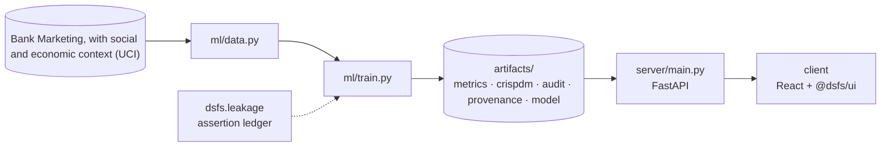

# Design document — AutoML Stacking

| | |
|---|---|
| Project | 07 · `07_automl_stacking` |
| Domain | Classification · AutoML · ensembles |
| Task | binary classification, ranking clients to call |
| Ports | API 8007 · web 5107 |
| Dataset | UCI Bank Marketing calls, May 2008 to November 2010 |

## 1. Problem

Which clients should a bank call about a term deposit, and does an automated stacked ensemble choose them better than one well-tuned model?

Rank clients by their chance of subscribing, using only what is known before the call.

### Goals

- Rank clients by their chance of subscribing, using only what is known before the call.
- Find what the data's time order and documentation imply for evaluation.
- Split by time and keep every transformation inside the model pipelines.
- Build the same kind of ensemble AutoML builds, by hand, beside a tuned single model.
- Score every contestant on the deployment year, and check each against its own promise.
- Serve the stronger of the two servable models, with the stack's parts visible beside it.

### Non-goals

- Choosing the best AutoML system. One AutoGluon configuration was run once, with one time limit, on one dataset.
- A deployable call-centre model. Scores are ranked, not calibrated, and the 2010 success rate differs sharply from the training years.

## 2. Architecture



Training is the only writer of results. The API serves the artifacts it wrote, and the client renders what the API returns, so a figure on screen always traces back to one run.

## 3. Components

| File | Lines | Responsibility |
|---|---:|---|
| `ml/autogluon_run.py` | 82 | ../.venv-automl/Scripts/python ml/autogluon_run.py |
| `ml/data.py` | 86 | Project 07 -- bank telemarketing calls: acquisition and dating. |
| `ml/features.py` | 43 | Project 07 -- preprocessing shared by every hand-built contestant. |
| `ml/train.py` | 517 | Project 07 -- does automated stacking beat one well-tuned model? |
| `server/inference.py` | 119 | Project 07 -- serving the tournament's servable winner, with the stack beside it. |
| `server/main.py` | 69 | Project 07 -- FastAPI application. |
| `client/src/App.tsx` | 323 | Every figure comes from the training run or the prediction API. The only project-specific pieces are the call form's field list and the tables of bootstrap verdicts and… |
| `client/src/main.tsx` | 10 | — |

Everything else — the FastAPI factory, dataset cache, provenance, CRISP-DM report, metrics record, leakage auditor and the six shared UI components — comes from `platform/`.

## 4. API

| Method | Path | Purpose |
|---|---|---|
| GET | `/api/form` | Recorded values of each categorical feature, numeric ranges, and a starting client. |
| POST | `/api/predict` | Chance a client subscribes, with every stacked model's score and weight. |
| GET | `/api/tournament` | Paired bootstrap verdicts, AutoGluon's own leaderboard and the estimate check. |
| GET | `/api/stacking` | Level-one models, the Caruana selection trajectory and the tuning trace. |
| GET | `/api/shift` | Success rate over time, the duration leak and permutation importance. |
| GET | `/api/health` | Liveness, version and whether artifacts are present. (platform) |
| GET | `/api/meta` | Project identity, ports and techniques. (platform) |
| GET | `/api/metrics` | The full run record: models, split, audit, environment. (platform) |
| GET | `/api/crispdm` | The six-phase CRISP-DM report written during training. (platform) |
| GET | `/api/audit` | Static leakage findings. (platform) |
| GET | `/api/provenance` | The dataset receipt. (platform) |
| GET | `/api/docs` | Interactive OpenAPI documentation. (platform) |

## 5. Data and evaluation

✅ **Real, third-party data**

| Field | Value |
|---|---|
| Dataset | Bank Marketing, with social and economic context (UCI) |
| Source | https://archive.ics.uci.edu/static/public/222/bank+marketing.zip |
| Licence | Creative Commons Attribution 4.0 (CC BY 4.0) |
| Rows × columns (as downloaded) | 41,188 × 21 |
| SHA-256 | `e0bf5f5de5b846e2f18e9d90606637267d46dfa260e0f17bb12e605db5efbeb4` |

**Split.** chronological: calls before 2010 train, calls in 2010 test. 

## 6. Key decisions

- **Business understanding.** Target, ranking metric and a before-the-call feature rule fixed before modelling.
- **Data understanding.** Time order, regime change and the leaking column documented.
- **Data preparation.** Chronological split, leak exclusion and target-correlation checks executed.
- **Modeling.** 8 contestants scored on the same 2010 calls.
- **Evaluation.** Paired bootstrap on the test year; believed scores compared with actual.
- **Deployment.** Served models persisted with the preprocessing they were trained with.

## 7. Verification

- 3 of 3 runtime leakage assertions passed.
- Static source audit: 0 critical, 0 warnings.
- 12 screenshots captured by `scripts/capture_screenshots.py`, which fails if any view does not render its expected content.

| Assertion | Result | What it measured |
|---|---|---|
| `assert_temporal_split` | ✅ passed | Last training timestamp 2009-12-01 00:00:00 precedes first test timestamp 2010-03-01 00:00:00 by 90 days 00:00:00; no embargo required. |
| `assert_duration_excluded` | ✅ passed | 19 model inputs; `duration` (known only after the call) absent. |
| `assert_no_target_leak` | ✅ passed | 63 numeric features correlated against the target; strongest was emp.var.rate at |r|=0.2634 (threshold 0.995). |

Recorded by the assertion ledger while training ran; generated from `artifacts/metrics.json`.

## 8. Risks

- The test year is 2,058 calls from a single year of unusual conditions; the ranking may not hold in another period.
- AutoGluon ran without its neural-network models, because PyTorch was not installed in its environment.
- Years are reconstructed from the file's date order, which the dataset's documentation states but does not encode.
- Each contestant was trained once with one seed; run-to-run variation of the tuned and AutoML models was not measured.

## 9. Reproducibility

Last trained at commit `1e3bb26` on Python 3.11.6.

```bash
../.venv-automl/Scripts/python ml/autogluon_run.py
python ml/train.py
python -m uvicorn main:app --app-dir server --port 8007
npm run dev -w 07_automl_stacking/client
```

---

*Generated by `scripts/generate_docs.py`.*
