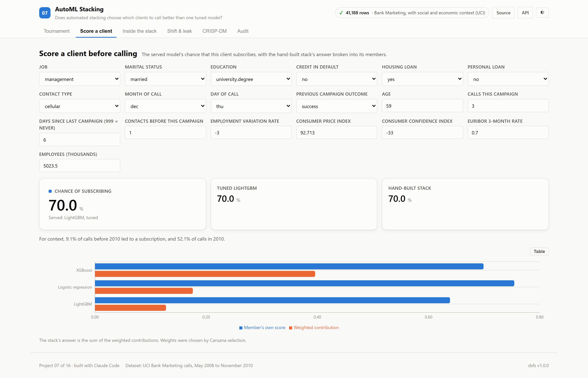
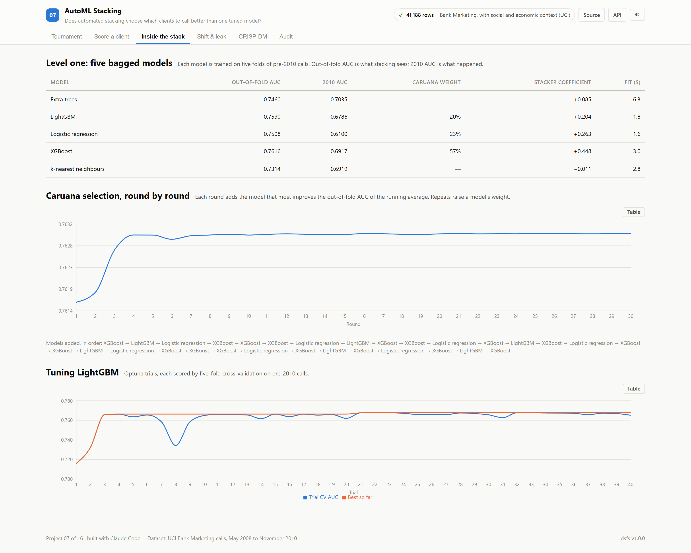
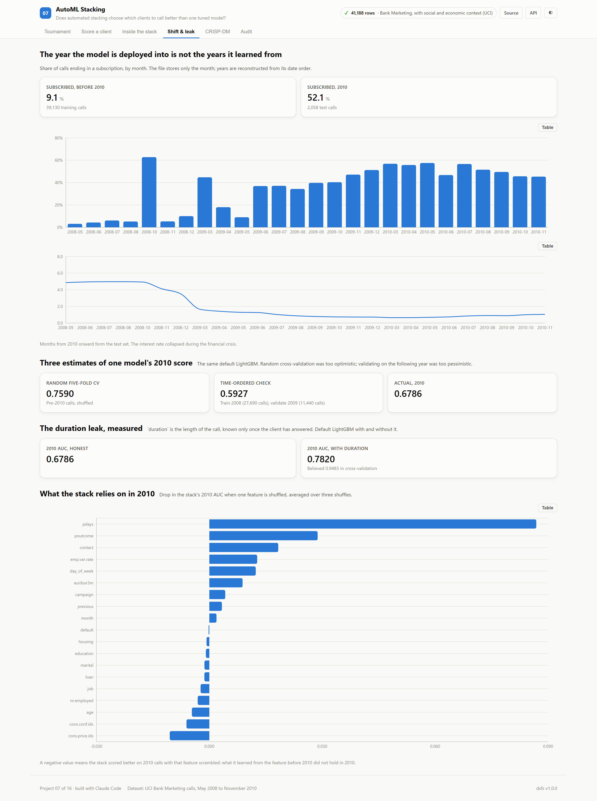
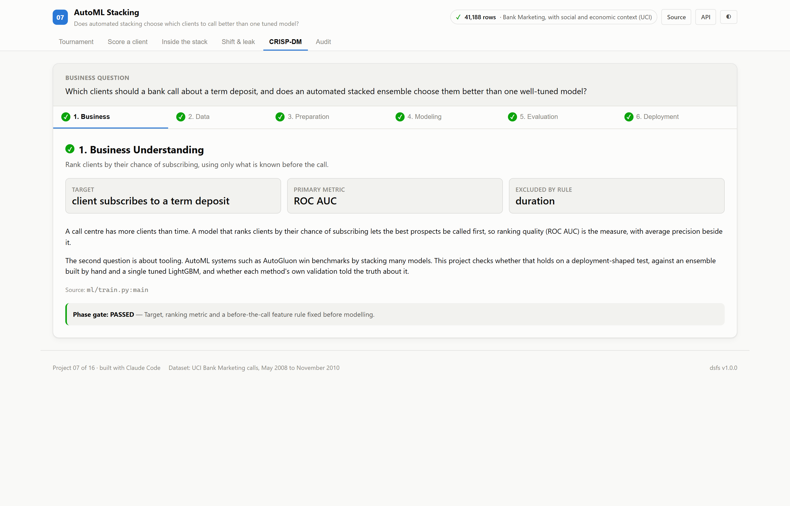
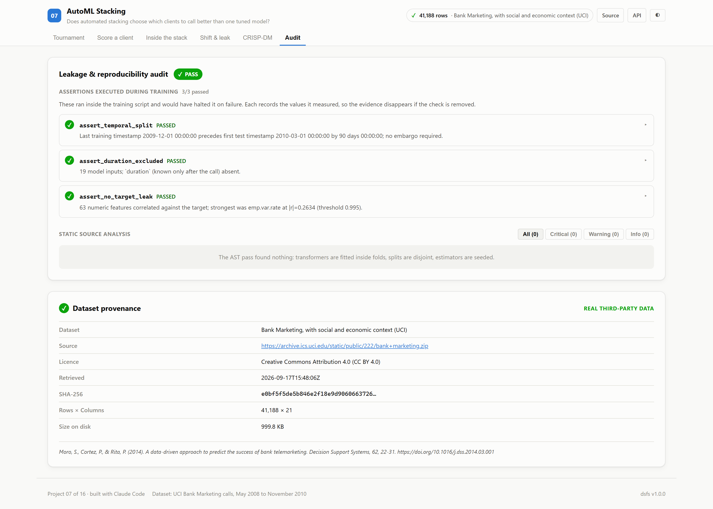

# 07 · AutoML Stacking

**A bank has more clients than time to call them. Does an automated stacked
ensemble pick the right ones better than a single tuned model — on the year it
would actually be used?**

Built on the real UCI Bank Marketing data: 41,188 phone calls
made by a Portuguese bank from 2008-05 to 2010-11, each ending in whether
the client subscribed to a term deposit.

| | |
|---|---|
| Task | Rank clients by their chance of subscribing, before calling |
| Dataset | [UCI Bank Marketing](https://archive.ics.uci.edu/dataset/222/bank+marketing) · CC BY 4.0 |
| Evaluation | Trained on calls before 2010, tested on every call in 2010 |
| Winner | **LightGBM, tuned**, ROC AUC 0.6969 |
| Ports | API `8007` · Web `5107` |

---

## The decision that defines this project

**The test set is the future, not a random sample.** The calls span the
financial crisis: 9.1% of calls before 2010 ended in a subscription,
against 52.1% in 2010. A random split would mix those years and
hide the change a deployed model meets. Every contestant, AutoGluon included,
trains on the same 39,130 pre-2010 calls with the same
19 columns and is scored on the same 2,058 calls from 2010.

Each contestant is also asked what it expected. Its **believed AUC** comes from
its own validation on pre-2010 calls, and the gap to its 2010 AUC measures how
far that validation could be trusted.

`duration`, the length of the call, is left out. It is only known once the client
has already answered, and the dataset's documentation says to discard it for a
realistic model. An assertion confirms it is absent, and its effect is measured
separately below.

---

## Results

<!-- dsfs:leaderboard -->
| # | Contestant | ROC AUC, 2010 | Avg precision | Believed AUC | Overestimate |
|---|---|---|---|---|---|
| 1 | **LightGBM, tuned** 🏆 | 0.6969 | 0.7008 | 0.7679 | 0.071 |
| 2 | Hand-built stack, logistic stacker | 0.6837 | 0.6875 | 0.7623 | 0.079 |
| 3 | AutoGluon, best_quality | 0.6830 | 0.6989 | 0.7697 | 0.087 |
| 4 | Hand-built stack, Caruana selection | 0.6797 | 0.6889 | 0.7630 | 0.083 |
| 5 | LightGBM, defaults | 0.6786 | 0.6728 | 0.7590 | 0.080 |
| 6 | Previous-campaign outcome rule *(baseline)* | 0.6337 | 0.6463 | — | — |
| 7 | Logistic regression | 0.6100 | 0.6324 | 0.7508 | 0.141 |
| 8 | Constant score *(baseline)* | 0.5000 | 0.5214 | 0.5000 | 0.000 |

Ranked by roc auc, 2010 (higher is better). Split: chronological: calls before 2010 train, calls in 2010 test; 2,058 evaluation rows. Generated from `artifacts/metrics.json`.
<!-- /dsfs:leaderboard -->

**A single tuned LightGBM beat both ensembles.** Against it, with a paired
bootstrap over the 2010 calls:

- AutoGluon: -0.0140 AUC (95% interval -0.0224 to -0.0051), **worse**
- Hand-built stack, Caruana selection: -0.0172 AUC (95% interval -0.0279 to -0.0060), **worse**
- Hand-built stack, logistic stacker: -0.0132 AUC (95% interval -0.0233 to -0.0029), **worse**

AutoGluon against the hand-built Caruana stack: +0.0032 AUC (95% interval -0.0108 to +0.0170), **inconclusive**.
AutoGluon ran for 900 seconds and trained 13 models; the
tuned LightGBM took 51 seconds, including 40 Optuna trials.
Tuning itself was worth having: +0.0184 AUC (95% interval +0.0103 to +0.0267), **better** over LightGBM's defaults.

**Every method overestimated itself.** The believed-minus-actual gap ranged from
+0.071 (LightGBM, tuned) to +0.141 (Logistic regression). Among the boosted and
ensemble methods, AutoGluon's own estimate, 0.7697, was the
highest, and it delivered 0.6830.

**One sign of why stacking did not help.** Stacking picks members by how well they fit
held-out folds of the *training* years. Caruana selection settled on XGBoost 57%, Logistic regression 23%, LightGBM 20%.
It gave no weight to Extra trees, which had the best 2010 AUC of the five
level-one models (0.7035) but a lower out-of-fold score
(0.7460). Here, what fitted 2008–2009 best was not what held up best in 2010.

---

## Three estimates of one model's future

The same default LightGBM, estimated three ways:

| Estimate | ROC AUC |
|---|---|
| Random five-fold cross-validation on pre-2010 calls | 0.7590 |
| Train on 2008 (27,690 calls), validate on 2009 (11,440 calls) | 0.5927 |
| **Actual, 2010** | **0.6786** |

Random cross-validation was too optimistic;
the time-ordered check was too pessimistic.
Neither matched what happened, and they erred in opposite directions.

## The duration leak, measured

| LightGBM, defaults | Believed (CV) | 2010 |
|---|---|---|
| Without `duration` | 0.7590 | 0.6786 |
| With `duration` | 0.9483 | 0.7820 |

With the leak, cross-validation would have reported 0.948: a model that
looks close to perfect, and cannot be used, because nobody knows how long a call
will last before making it.

## What the hand-built stack relies on

Permutation importance on 2010 calls: `pdays`
matters most (shuffling it costs 0.087 AUC), then
`poutcome` (0.029) and `contact`
(0.018).
Shuffling `job`, `nr.employed`, `age`, `cons.conf.idx`, `cons.price.idx` *raised* 2010 AUC by more than twice the spread across shuffles: what the stack learned from them before 2010 did not hold in 2010.

---

## Screenshot tour

### Tournament
Leaderboard with believed and actual AUC, the bootstrap verdicts and AutoGluon's own leaderboard.


### Score a client · Inside the stack · Shift & leak




### CRISP-DM · Audit



> Dark variants of every view are in [`screenshots/`](./screenshots).

---

## Two environments

AutoGluon 1.6.2 pins pandas 2.3 and an older pyarrow, while the rest of the
repository runs pandas 3. Installing it into the shared environment would have
changed the libraries every other project's results were produced with, so it
runs in its own `.venv-automl` and hands over its test-set probabilities in
`artifacts/autogluon.json`. `train.py` checks those rows match its own test set
before scoring them. PyTorch was not installed in that environment, so AutoGluon
trained no neural-network models.

## Assertions that ran

<!-- dsfs:assertions -->
| Assertion | Result | What it measured |
|---|---|---|
| `assert_temporal_split` | ✅ passed | Last training timestamp 2009-12-01 00:00:00 precedes first test timestamp 2010-03-01 00:00:00 by 90 days 00:00:00; no embargo required. |
| `assert_duration_excluded` | ✅ passed | 19 model inputs; `duration` (known only after the call) absent. |
| `assert_no_target_leak` | ✅ passed | 63 numeric features correlated against the target; strongest was emp.var.rate at |r|=0.2634 (threshold 0.995). |

Recorded by the assertion ledger while training ran; generated from `artifacts/metrics.json`.
<!-- /dsfs:assertions -->

---

## Running it

```bash
pip install -e ../platform
npm install

# AutoGluon, in its own environment (about 15 minutes)
python -m venv ../.venv-automl
../.venv-automl/Scripts/pip install "autogluon.tabular[lightgbm,catboost,xgboost]==1.6.2" -e ../platform
../.venv-automl/Scripts/python ml/autogluon_run.py

python ml/train.py     # every other contestant; about two minutes
python -m uvicorn main:app --app-dir server --port 8007
npm run dev -w 07_automl_stacking/client     # http://localhost:5107
```

Generated documents: [paper](./paper.md) · [abstract](./abstract.md) ·
[article](./article.md) · [design doc](./DESIGN_DOC.md) ·
[audit report](./audit_report.md) · [reproduction skill](./skills/reproduce/SKILL.md)
