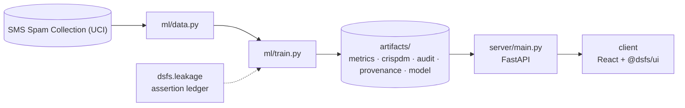

# Design document — DS Visual Foundations

| | |
|---|---|
| Project | 08 · `08_visual_foundations` |
| Domain | Course · interactive simulators |
| Task | SMS spam classification (lesson 1 and 2) |
| Ports | API 8008 · web 5108 |
| Dataset | UCI SMS Spam Collection and Combined Cycle Power Plant |

## 1. Problem

Can the foundations of machine learning -- probability, evaluation, gradient descent and backpropagation -- be taught on real data, with every mechanism checked?

Teach four foundations interactively, each on a real dataset and verified against a reference.

### Goals

- Teach four foundations interactively, each on a real dataset and verified against a reference.
- Find what in each dataset would mislead a naive lesson.
- Split so that no message is tested on after being trained on.
- Write out each algorithm and check it against a trusted implementation.
- Report what each lesson's analysis actually found.
- Serve the lessons live from the checked implementations.

### Non-goals

- A production spam filter. The SMS collection is from 2011 and small, and spam has changed since.
- A forecast of the power plant's output. The regression exists to teach optimisation, and its rows are split at random.

## 2. Architecture



Training is the only writer of results. The API serves the artifacts it wrote, and the client renders what the API returns, so a figure on screen always traces back to one run.

## 3. Components

| File | Lines | Responsibility |
|---|---:|---|
| `ml/data.py` | 72 | Project 08 -- the two real datasets behind the visual lessons. |
| `ml/lessons.py` | 221 | Project 08 -- the algorithms the lessons teach, written out in full. |
| `ml/train.py` | 339 | Project 08 -- visual foundations, computed from real data. |
| `server/inference.py` | 127 | Project 08 -- serving the lessons from the checked implementations. |
| `server/main.py` | 110 | Project 08 -- FastAPI application. |
| `client/src/App.tsx` | 223 | Four lessons on real data, a quiz, and the shared CRISP-DM and audit views. Every figure comes from the API: live computations by the checked implementations, or the recorded… |
| `client/src/Lessons.tsx` | 223 | Project-08-specific lesson views. Each calls one API endpoint and draws what it returns; the probabilities, confusion counts, loss curves and gradients are all computed on the… |
| `client/src/Quiz.tsx` | 76 | Quiz -- the same server-checked quiz as project 10, over this course's lessons. |
| `client/src/main.tsx` | 10 | — |

Everything else — the FastAPI factory, dataset cache, provenance, CRISP-DM report, metrics record, leakage auditor and the six shared UI components — comes from `platform/`.

## 4. API

| Method | Path | Purpose |
|---|---|---|
| POST | `/api/classify` | Spam probability of a message, with every word's contribution to the log-odds. |
| GET | `/api/spam` | Dataset facts, the duplicate-leak experiment and the precision-recall curve. |
| GET | `/api/threshold` | Confusion matrix on the held-out messages at a threshold. |
| GET | `/api/gradient-descent` | Recorded runs, stability limits and condition numbers. |
| POST | `/api/gradient-descent` | Run gradient descent now, at any learning rate, with or without feature scaling. |
| GET | `/api/backprop` | One training row through the trained network, with every chain-rule factor. |
| GET | `/api/backprop/training` | Loss curve, gradient checks and test error of the network. |
| GET | `/api/quiz` |  |
| POST | `/api/quiz/{question_id}` |  |
| GET | `/api/health` | Liveness, version and whether artifacts are present. (platform) |
| GET | `/api/meta` | Project identity, ports and techniques. (platform) |
| GET | `/api/metrics` | The full run record: models, split, audit, environment. (platform) |
| GET | `/api/crispdm` | The six-phase CRISP-DM report written during training. (platform) |
| GET | `/api/audit` | Static leakage findings. (platform) |
| GET | `/api/provenance` | The dataset receipt. (platform) |
| GET | `/api/docs` | Interactive OpenAPI documentation. (platform) |

## 5. Data and evaluation

✅ **Real, third-party data**

| Field | Value |
|---|---|
| Dataset | SMS Spam Collection (UCI) |
| Source | https://archive.ics.uci.edu/static/public/228/sms+spam+collection.zip |
| Licence | Creative Commons Attribution 4.0 (CC BY 4.0) |
| Rows × columns (as downloaded) | 5,574 × 3 |
| SHA-256 | `1587ea43e58e82b14ff1f5425c88e17f8496bfcdb67a583dbff9eefaf9963ce3` |

**Split.** deduplicated messages, stratified random 80/20. 

## 6. Key decisions

- **Business understanding.** Four lessons, two datasets and three reference checks fixed before building.
- **Data understanding.** Duplicates counted; feature scales recorded.
- **Data preparation.** Executed assertion: no message text in both splits.
- **Modeling.** Three executed reference checks.
- **Evaluation.** Baselines beside every result.
- **Deployment.** Interactive views call the same functions the checks covered.

## 7. Verification

- 4 of 4 runtime leakage assertions passed.
- Static source audit: 0 critical, 0 warnings.
- 14 screenshots captured by `scripts/capture_screenshots.py`, which fails if any view does not render its expected content.

| Assertion | Result | What it measured |
|---|---|---|
| `assert_no_message_in_both_splits` | ✅ passed | 4,136 training and 1,035 test messages after removing 403 duplicates; 0 message texts appear in both. |
| `assert_naive_bayes_matches_sklearn` | ✅ passed | Spam probabilities for 1,035 test messages from the written-out Naive Bayes and scikit-learn's MultinomialNB; largest difference 1.6e-14 (limit 1e-9). |
| `assert_gradient_descent_reaches_least_squares` | ✅ passed | Gradient descent (learning rate 0.1, 3,000 steps, scaled features) against the exact least-squares solution: largest coefficient difference 1.1e-16 relative (limit 1e-6). |
| `assert_backprop_matches_finite_differences` | ✅ passed | All 49 parameter gradients compared with central finite differences, before and after training; largest relative error 1.1e-07 (limit 1e-5). |

Recorded by the assertion ledger while training ran; generated from `artifacts/metrics.json`.

## 8. Risks

- Duplicates are detected by exact text only; near-copies that differ by a word or a number remain on both sides of the split.
- The duplicate-leak experiment uses one model, Naive Bayes, over twenty splits; other models may be affected differently.
- The stable learning rate is exact for batch gradient descent on squared error only; stochastic or adaptive optimisers behave differently.
- The neural network is deliberately tiny, so its comparison with linear regression says little about larger networks.

## 9. Reproducibility

Last trained at commit `1e3bb26` on Python 3.11.6.

```bash
python ml/train.py
python -m uvicorn main:app --app-dir server --port 8008
npm run dev -w 08_visual_foundations/client
```

---

*Generated by `scripts/generate_docs.py`.*
