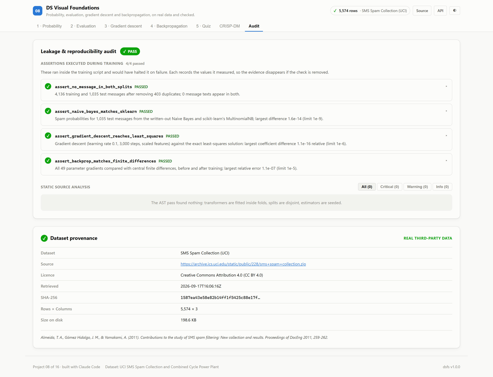

# 08 · DS Visual Foundations

**Probability, evaluation, gradient descent and backpropagation, taught on real
data — with every algorithm written out and checked against a trusted reference.**

Built on two real UCI datasets: the SMS Spam Collection (5,574 text messages)
and the Combined Cycle Power Plant readings (9,568 hours of weather against
electrical output).

| | |
|---|---|
| Task | An interactive course: four lessons, each a live simulator backed by the server |
| Datasets | [SMS Spam Collection](https://archive.ics.uci.edu/dataset/228/sms+spam+collection) · [Combined Cycle Power Plant](https://archive.ics.uci.edu/dataset/294/combined+cycle+power+plant) · both CC BY 4.0 |
| Evaluation | Deduplicated SMS messages, stratified 80/20; power-plant readings, random 80/20 |
| Checks | Naive Bayes vs scikit-learn · gradient descent vs least squares · backpropagation vs finite differences |
| Ports | API `8008` · Web `5108` |

---

## The decision that defines this project

Foundations are usually taught on invented numbers, which never have the
problems real data has. **Every lesson here runs on a real dataset, and every
algorithm is written out in [`ml/lessons.py`](./ml/lessons.py) and checked while
training:**

| Check | Measured |
|---|---|
| Written-out Naive Bayes against scikit-learn's `MultinomialNB`, on 1,035 test messages | largest probability difference 1.6e-14 |
| Gradient descent against the exact least-squares solution | largest relative coefficient difference 1.1e-16 |
| Hand-written backpropagation against central finite differences, all 49 parameters | largest relative error 1.1e-07 |

The API imports the same module, so every interactive view runs code those
checks covered.

---

## Lesson 1 · Probability: Naive Bayes

Type any message and see each word's evidence, as a log-likelihood ratio, add up
to a spam probability. Words the model never saw are ignored rather than
guessed at.

## Lesson 2 · Evaluation

<!-- dsfs:leaderboard -->
| # | Spam filter | Average precision | F1 at 0.5 | Precision | Recall |
|---|---|---|---|---|---|
| 1 | **Logistic regression, TF-IDF** 🏆 | 0.9729 | 0.911 | 96.6% | 86.3% |
| 2 | Naive Bayes, written out | 0.9654 | 0.941 | 96.8% | 91.6% |
| 3 | Contains a 5+ digit number *(baseline)* | 0.8333 | 0.895 | 100.0% | 80.9% |
| 4 | Everything is ham *(baseline)* | 0.1266 | 0.000 | 0.0% | 0.0% |

Ranked by average precision (higher is better). Split: deduplicated messages, stratified random 80/20; 1,035 evaluation rows. Generated from `artifacts/metrics.json`.
<!-- /dsfs:leaderboard -->

**Logistic regression, TF-IDF** has the highest average precision, 0.973; the written-out Naive
Bayes reaches 0.965, and has the higher recall at a 0.5 threshold
(91.6% against 86.3%). A one-line hand-written rule — flag any
message containing a number of five or more digits, as shortcodes and phone numbers are — reaches
100% precision and 80.9% recall on its own.

A threshold slider shows the confusion matrix on the held-out messages at any
cut-off.

**Duplicated messages.** 403 messages are exact copies of earlier ones, and
26% of duplicated messages are spam against 13.4% overall. Over
20 random splits with Naive Bayes:

| Split | Test messages already in training | Average precision | F1 | Recall |
|---|---|---|---|---|
| random split, duplicates kept | 10.5% | 0.967 ± 0.008 | 0.950 ± 0.012 | 0.928 ± 0.016 |
| deduplicated first | 0.0% | 0.961 ± 0.010 | 0.943 ± 0.013 | 0.917 ± 0.019 |

Keeping duplicates put 10.5% of test messages in training, and raised
average precision by 0.006 — less than one standard deviation across splits. On this
data the leak is small; the only way to know that was to measure it.

## Lesson 3 · Gradient descent

Linear regression of the plant's output on temperature, vacuum, pressure and
humidity, run live at any learning rate, with or without standardised features.

| | Scaled features | Raw features |
|---|---|---|
| Condition number | 4.9 | 212,235 |
| Largest stable learning rate, 2 / λ<sub>max</sub> | 0.4099 | 9.66e-07 |
| At 99% of that rate, after 500 steps | MSE 20.89 | MSE 177.80 |
| At 101% of that rate | diverged | diverged |

The exact least-squares minimum is MSE 20.89. The limit computed from the largest
eigenvalue held in practice on both sides: just under it gradient descent
converged, just over it the loss grew until the run was stopped. With raw
features the limit is so small that 500 steps leave the error at
177.8, against 20.89 with scaling.

## Lesson 4 · Backpropagation

A 4–8–1 tanh network trained by hand-written backpropagation. Pick any training
row to see its forward values in each unit and every chain-rule factor beside
them, all returned by the server's backward pass. The network's test RMSE is
4.13 MW against 4.50 MW for linear least squares and
17.03 MW for predicting the mean.

## Lesson 5 · Quiz

5 questions whose answers are checked on the server and explained with this run's figures.

---

## Screenshot tour

### Probability · Evaluation


### Gradient descent · Backpropagation


### Quiz · CRISP-DM · Audit




> Dark variants of every view are in [`screenshots/`](./screenshots).

---

## Assertions that ran

<!-- dsfs:assertions -->
| Assertion | Result | What it measured |
|---|---|---|
| `assert_no_message_in_both_splits` | ✅ passed | 4,136 training and 1,035 test messages after removing 403 duplicates; 0 message texts appear in both. |
| `assert_naive_bayes_matches_sklearn` | ✅ passed | Spam probabilities for 1,035 test messages from the written-out Naive Bayes and scikit-learn's MultinomialNB; largest difference 1.6e-14 (limit 1e-9). |
| `assert_gradient_descent_reaches_least_squares` | ✅ passed | Gradient descent (learning rate 0.1, 3,000 steps, scaled features) against the exact least-squares solution: largest coefficient difference 1.1e-16 relative (limit 1e-6). |
| `assert_backprop_matches_finite_differences` | ✅ passed | All 49 parameter gradients compared with central finite differences, before and after training; largest relative error 1.1e-07 (limit 1e-5). |

Recorded by the assertion ledger while training ran; generated from `artifacts/metrics.json`.
<!-- /dsfs:assertions -->

---

## Running it

```bash
pip install -e ../platform
npm install

python ml/train.py     # downloads both datasets on first run; about ten seconds
python -m uvicorn main:app --app-dir server --port 8008
npm run dev -w 08_visual_foundations/client     # http://localhost:5108
```

Generated documents: [paper](./paper.md) · [abstract](./abstract.md) ·
[article](./article.md) · [design doc](./DESIGN_DOC.md) ·
[audit report](./audit_report.md) · [reproduction skill](./skills/reproduce/SKILL.md)
