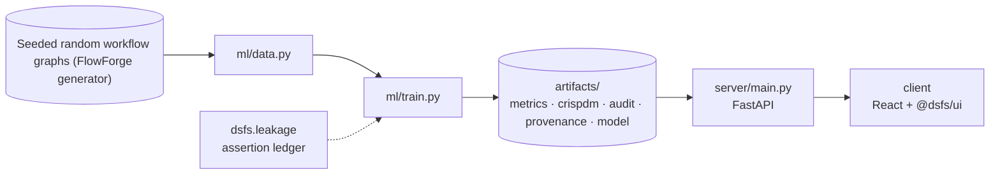

# Design document — FlowForge DAG Engine

| | |
|---|---|
| Project | 09 · `09_flowforge_dag` |
| Domain | TypeScript · graph algorithms · verification |
| Task | graph ordering: time to order a random DAG |
| Ports | API 8009 · web 5109 |
| Dataset | Seeded random workflow graphs (generated) |

## 1. Problem

Can a workflow engine's ordering and scheduling be shown correct and fast, rather than assumed to be?

Build a typed workflow engine and produce evidence that it is correct and scales.

### Goals

- Build a typed workflow engine and produce evidence that it is correct and scales.
- Define the graphs the engine is tested and measured on.
- Represent graphs so the algorithms run in linear time.
- Implement ordering, cycle reporting, levels and an incremental scheduler.
- Show the engine is correct, that the tests could have caught it being wrong, and how it scales.
- Run the same engine in the browser.

### Non-goals

- A distributed scheduler. Work is simulated in one process with virtual time; there are no workers, queues or persistence.
- Fastest possible ordering. The benchmarks establish growth rates and relative cost, not records.

## 2. Architecture



Training is the only writer of results. The API serves the artifacts it wrote, and the client renders what the API returns, so a figure on screen always traces back to one run.

## 3. Components

| File | Lines | Responsibility |
|---|---:|---|
| `ml/train.py` | 294 | Project 09 -- verify and measure the FlowForge engine. |
| `server/main.py` | 72 | Project 09 -- FastAPI application: the engine's recorded evidence. |
| `client/src/App.tsx` | 182 | Project 09 client -- the engine and its evidence. |
| `client/src/Canvas.tsx` | 266 | The workflow canvas and run replay -- project-09-specific. |
| `client/src/main.tsx` | 10 | — |

Everything else — the FastAPI factory, dataset cache, provenance, CRISP-DM report, metrics record, leakage auditor and the six shared UI components — comes from `platform/`.

## 4. API

| Method | Path | Purpose |
|---|---|---|
| GET | `/api/evidence` | Unit, property, type and mutation test results from the recorded run. |
| GET | `/api/benchmarks` | Ordering and executor timings from the recorded run. |
| GET | `/api/source/{name}` | The engine's own source for the type-design view, read from disk. |
| GET | `/api/health` | Liveness, version and whether artifacts are present. (platform) |
| GET | `/api/meta` | Project identity, ports and techniques. (platform) |
| GET | `/api/metrics` | The full run record: models, split, audit, environment. (platform) |
| GET | `/api/crispdm` | The six-phase CRISP-DM report written during training. (platform) |
| GET | `/api/audit` | Static leakage findings. (platform) |
| GET | `/api/provenance` | The dataset receipt. (platform) |
| GET | `/api/docs` | Interactive OpenAPI documentation. (platform) |

## 5. Data and evaluation

⚠️ **Synthetic data**

| Field | Value |
|---|---|
| Dataset | Seeded random workflow graphs (FlowForge generator) |
| Source | https://github.com/aniket-alt/ai-coding-assistant/blob/main/09_flowforge_dag/engine/src/random.ts |
| Licence | MIT (generated by this repository) |
| Rows × columns (as downloaded) | 0 × 0 |
| SHA-256 | `23553d2cab4236ff7ba92f1bedf1eaab4a95d358726118c8e80e316f63feb98c` |

**Split.** seeded random graphs; every method timed on the same graphs. Median of 5 runs after a warm-up; Node v24.13.0.

## 6. Key decisions

- **Business understanding.** Correctness properties and scaling measures fixed before implementation.
- **Data understanding.** Generator seeded and checksummed; marked synthetic in provenance.
- **Data preparation.** Validation returns a Result; no exception paths.
- **Modeling.** Both executors present; the reference is the oracle for the fast one.
- **Evaluation.** Tests, type tests, properties and mutation testing all executed and recorded.
- **Deployment.** One engine source shared by tests, benchmarks and the UI.

## 7. Verification

- 4 of 4 runtime leakage assertions passed.
- Static source audit: 0 critical, 0 warnings.
- 14 screenshots captured by `scripts/capture_screenshots.py`, which fails if any view does not render its expected content.

| Assertion | Result | What it measured |
|---|---|---|
| `assert_engine_tests_pass` | ✅ passed | node --test ran 11 tests: 11 passed, 0 failed. |
| `assert_type_tests_pass` | ✅ passed | tsc over the engine, its tests and type-tests: 0 errors, including 0 @ts-expect-error lines that no longer fail. |
| `assert_properties_hold` | ✅ passed | 5 properties over 5,000 random graphs and workflows: 77,531 checks, 0 failures. |
| `assert_every_mutant_killed` | ✅ passed | 10 planted bugs; the test suites caught 10. |

Recorded by the assertion ledger while training ran; generated from `artifacts/metrics.json`.

## 8. Risks

- Timings depend on the machine and on what else was running; the scaling exponents are more stable than the milliseconds.
- Random graphs have uniform structure, while real pipelines are shallower and more branched.
- Mutation testing only shows that the planted bugs are caught, not that no other bug exists.
- The executor's failure model is independent per attempt; correlated failures are not simulated.

## 9. Reproducibility

Last trained at commit `1e3bb26` on Python 3.11.6.

```bash
npm install
node --test "engine/test/*.test.ts"
python ml/train.py
python -m uvicorn main:app --app-dir server --port 8009
npm run dev -w 09_flowforge_dag/client
```

---

*Generated by `scripts/generate_docs.py`.*
