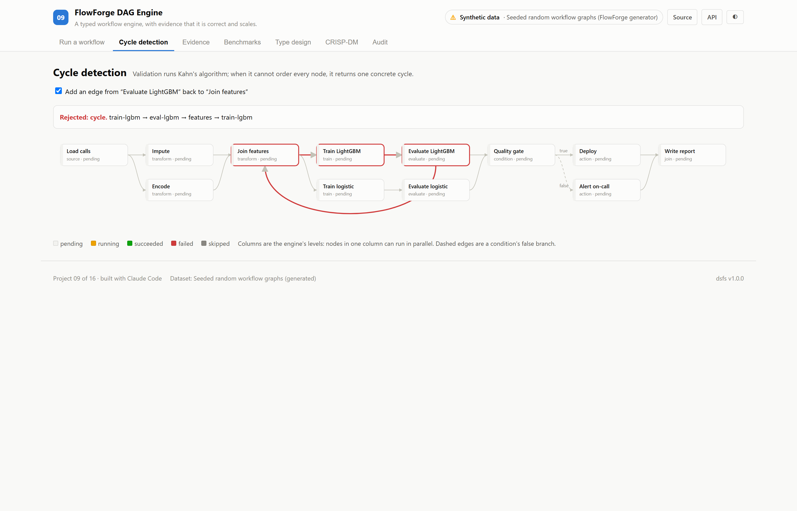
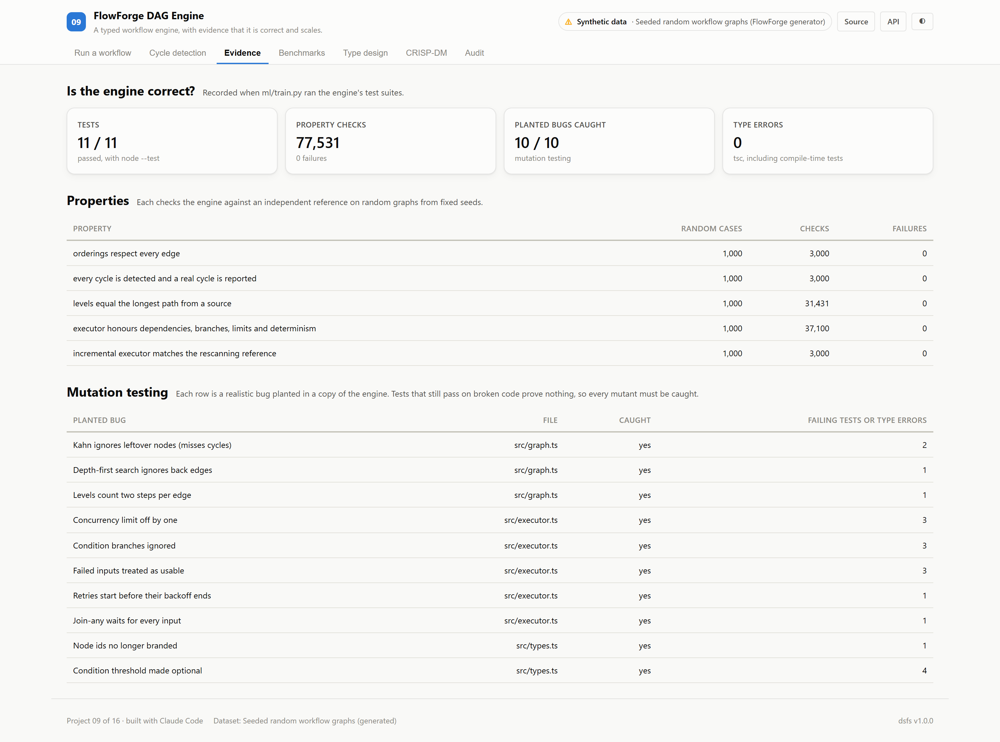
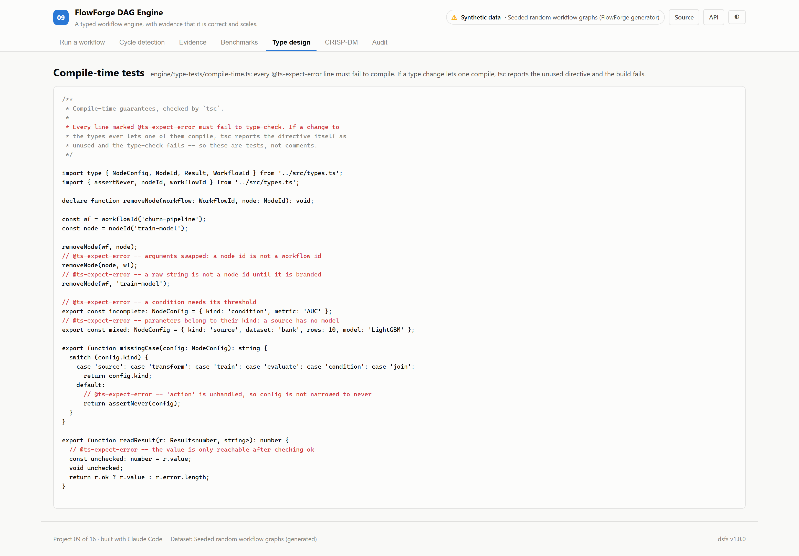

# 09 · FlowForge DAG Engine

**A typed workflow engine for data pipelines — and the evidence that it orders,
schedules and fails correctly, rather than an assurance that it does.**

The engine is TypeScript, run directly by Node v24.13.0 in tests and benchmarks and by the
browser in the app, from one source. There is no dataset: it is measured on
seeded random graphs, and its provenance is marked synthetic.

| | |
|---|---|
| Task | Order, validate and schedule workflow graphs with retries, branches and concurrency limits |
| Data | Seeded random graphs from [`engine/src/random.ts`](./engine/src/random.ts) (synthetic) |
| Evidence | Unit, property, differential, compile-time and mutation tests; scaling benchmarks |
| Result | 11 of 11 tests, 77,531 property checks with 0 failures, 10 of 10 planted bugs caught |
| Ports | API `8009` · Web `5109` |

---

## The decision that defines this project

**Tests only count once they have been seen to fail.** Four kinds of evidence,
all run by [`ml/train.py`](./ml/train.py) and recorded as executed assertions:

1. **Properties against independent references**, on random graphs from fixed seeds:

   | Property | Random cases | Checks | Failures |
   |---|---|---|---|
   | orderings respect every edge | 1,000 | 3,000 | 0 |
   | every cycle is detected and a real cycle is reported | 1,000 | 3,000 | 0 |
   | levels equal the longest path from a source | 1,000 | 31,431 | 0 |
   | executor honours dependencies, branches, limits and determinism | 1,000 | 37,100 | 0 |
   | incremental executor matches the rescanning reference | 1,000 | 3,000 | 0 |

2. **Mutation testing.** Realistic bugs are planted in copies of the engine, and
   the tests must fail on each. 10 of 10 were caught:

   | Planted bug | Caught by |
   |---|---|
   | Kahn ignores leftover nodes (misses cycles) | 2 failing tests |
   | Depth-first search ignores back edges | 1 failing test |
   | Levels count two steps per edge | 1 failing test |
   | Concurrency limit off by one | 3 failing tests |
   | Condition branches ignored | 3 failing tests |
   | Failed inputs treated as usable | 3 failing tests |
   | Retries start before their backoff ends | 1 failing test |
   | Join-any waits for every input | 1 failing test |
   | Node ids no longer branded | 1 type error |
   | Condition threshold made optional | 4 type errors |

3. **Compile-time tests.** [`type-tests/compile-time.ts`](./engine/type-tests/compile-time.ts)
   holds lines that must *not* compile — swapped branded ids, a missing case in an
   exhaustive switch, reading a `Result` without checking it. If a type change lets
   one compile, `tsc` reports the unused `@ts-expect-error` and fails.

4. **Scaling benchmarks**, below.

---

## A bug the evidence found

The first executor rescanned every node after every event. It was correct, and
the benchmark showed it was not linear. The rewrite keeps, for each node, counts
of inputs still open, usable or dead, and a heap of ready nodes.

The first executor was kept as a reference, and a differential property requires
both to produce the same run. **It failed.** In the rewrite, a node waiting out a
retry backoff had the same state as a node never started, so an unrelated event
could start it early — and its retry timer then started it a second time. The fix
is covered by the mutant "Retries start before their backoff ends".

---

## Results

<!-- dsfs:leaderboard -->
| # | Ordering method | ms at 8,000 nodes | Scaling exponent | Largest graph | ms at largest |
|---|---|---|---|---|---|
| 1 | **Kahn's algorithm** 🏆 | 0.18 | 1.06 | 1,000,000 | 37.3 |
| 2 | Depth-first search | 0.21 | 1.01 | 1,000,000 | 43.5 |
| 3 | Naive repeated scan *(baseline)* | 172.20 | 2.10 | 8,000 | 169.8 |

Ranked by ms at 8,000 nodes (lower is better). Split: seeded random graphs; every method timed on the same graphs; 0 evaluation rows. Generated from `artifacts/metrics.json`.
<!-- /dsfs:leaderboard -->

**Ordering.** Kahn's algorithm's time grows with an exponent of 1.06 and orders a
1,000,000-node graph in 37 ms. Depth-first search is its
equal (1.01). The naive repeated scan grows with an exponent of 2.10, and at
8,000 nodes takes 172 ms against 0.18 ms.

**Scheduling.** On the same random workflows with a concurrency limit of 8:

| Nodes | Incremental executor | Rescanning reference |
|---|---|---|
| 300 | 0.5 ms | 9.2 ms |
| 1,000 | 1.2 ms | 174.1 ms |
| 3,000 | 2.9 ms | 4,318.6 ms |
| 10,000 | 11.0 ms | not run |
| 30,000 | 41.4 ms | not run |

Growth exponents: 0.96 for the incremental executor, 2.67 for the
reference. At 3,000 nodes the rewrite is 1,500× faster. Timings were
measured on one machine, median of 5 runs after a warm-up; the exponents are more
stable than the milliseconds.

---

## The app

- **Run a workflow** — a nightly retraining pipeline scheduled live by the engine:
  concurrency limit, a flaky training step with retries and backoff, and a quality
  gate whose failing branch is skipped. Durations are simulated; every scheduling
  decision is the engine's.
- **Cycle detection** — add a back edge and see the concrete cycle validation returns.
- **Evidence, Benchmarks, Type design** — the recorded results above.

## Screenshot tour







> CRISP-DM, audit and dark variants of every view are in [`screenshots/`](./screenshots).

---

## Assertions that ran

<!-- dsfs:assertions -->
| Assertion | Result | What it measured |
|---|---|---|
| `assert_engine_tests_pass` | ✅ passed | node --test ran 11 tests: 11 passed, 0 failed. |
| `assert_type_tests_pass` | ✅ passed | tsc over the engine, its tests and type-tests: 0 errors, including 0 @ts-expect-error lines that no longer fail. |
| `assert_properties_hold` | ✅ passed | 5 properties over 5,000 random graphs and workflows: 77,531 checks, 0 failures. |
| `assert_every_mutant_killed` | ✅ passed | 10 planted bugs; the test suites caught 10. |

Recorded by the assertion ledger while training ran; generated from `artifacts/metrics.json`.
<!-- /dsfs:assertions -->

---

## Running it

```bash
npm install                                  # from the repository root
node --test "engine/test/*.test.ts"          # Node 24 runs TypeScript directly
npx tsc --noEmit -p engine                   # includes the compile-time tests

pip install -e ../platform
python ml/train.py     # tests, type tests, benchmarks and mutation testing; a few minutes
python -m uvicorn main:app --app-dir server --port 8009
npm run dev -w 09_flowforge_dag/client     # http://localhost:5109
```

Generated documents: [paper](./paper.md) · [abstract](./abstract.md) ·
[article](./article.md) · [design doc](./DESIGN_DOC.md) ·
[audit report](./audit_report.md) · [reproduction skill](./skills/reproduce/SKILL.md)
