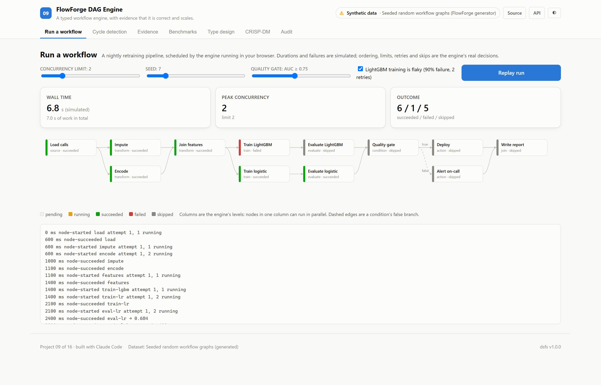

# A typed workflow engine, with evidence that it is correct and scales.

*FlowForge DAG Engine — project 09 of a sixteen-project data science portfolio built with an AI coding assistant, on real data.*

## The question

Can a workflow engine's ordering and scheduling be shown correct and fast, rather than assumed to be?

Data pipelines are directed acyclic graphs: load, transform, train, evaluate, decide, deploy. An engine that runs them must order steps so none runs before its inputs, detect cycles, respect a concurrency limit, retry failures and skip the branch a condition did not take.

Engines like this are usually trusted because they seem to work. This project asks for evidence instead: properties checked against independent references on thousands of random graphs, mutation testing to show those checks can fail, compile-time tests of the type design, and measured scaling.

## The data

There is no external dataset. Graphs are generated from fixed seeds: nodes are shuffled and edges only run forward in the hidden shuffle, so every graph is acyclic without the algorithms being able to read that from node numbers. A cyclic variant adds one back edge along an existing edge. Random workflows assign node kinds, durations, failure rates, retry budgets and condition branches.

## What won

**Kahn's algorithm**, at 0.18 on ms at 8,000 nodes, against 172.20 for the best baseline, Naive repeated scan.

| # | Ordering method | ms at 8,000 nodes | Scaling exponent | Largest graph | ms at largest |
|---|---|---|---|---|---|
| 1 | **Kahn's algorithm** 🏆 | 0.18 | 1.06 | 1,000,000 | 37.3 |
| 2 | Depth-first search | 0.21 | 1.01 | 1,000,000 | 43.5 |
| 3 | Naive repeated scan *(baseline)* | 172.20 | 2.10 | 8,000 | 169.8 |

Ranked by ms at 8,000 nodes (lower is better). Split: seeded random graphs; every method timed on the same graphs; 0 evaluation rows. Generated from `artifacts/metrics.json`.

**Correctness.** 77,531 property checks over 5,000 random graphs and workflows, with 0 failures, plus 11 tests in all.

**The tests can fail.** 10 of 10 planted bugs were caught, 8 in behaviour and 2 in the types.

**Scaling.** Kahn's algorithm orders a 1,000,000-node graph in 37 ms with a scaling exponent of 1.06; the naive repeated scan's exponent is 2.10, and at 8,000 nodes it takes 172 ms against 0.18 ms.

## What I took away

- Keeping the slow, obviously correct implementation as an oracle found a real bug in the fast rewrite.
- Tests that pass on correct code are only evidence once they have been shown to fail on broken code.
- A benchmark can expose a scaling problem that no correctness test will: the first executor was correct and quadratic.
- Types can be tested too: an @ts-expect-error that stops failing is a regression the compiler reports.

## How it is built

The backend is FastAPI on port 8009 and the front end is React on port 5109. Most of the interface — the metrics panel, tournament table, CRISP-DM walkthrough, audit panel and charts — is shared across the portfolio and driven entirely by the training run's artifacts, so nothing on screen is typed by hand.

Code: [github.com/aniket-alt/ai-coding-assistant](https://github.com/aniket-alt/ai-coding-assistant/tree/main/09_flowforge_dag)

---

*Figures in this article are generated from the project's artifacts.*
