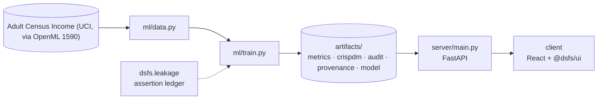

# Design document — CRISP-DM Curriculum

| | |
|---|---|
| Project | 10 · `10_crispdm_curriculum` |
| Domain | Course · classification · fairness |
| Task | binary classification with a fairness audit |
| Ports | API 8010 · web 5110 |
| Dataset | Adult census income, 1994 US Census (48,842 people) |

## 1. Problem

Who earns more than $50,000 a year in the 1994 US Census, and can a model predict it without treating men and women unequally?

Teach every CRISP-DM phase on one real dataset, with a fairness question at its centre.

### Goals

- Teach every CRISP-DM phase on one real dataset, with a fairness question at its centre.
- Establish the base rates, gaps and quirks before any model.
- Prepare features inside pipelines so nothing is learned from the test set.
- Fit models with and without sex and race, and find what still carries them.
- Judge the models on accuracy and on how they treat men and women.
- Publish the course: lessons, interactive results and quizzes answered by the data.

### Non-goals

- A fairness intervention. The course measures what removing sensitive attributes does; it does not reweight, post-process or claim to fix the gap.
- A statement about incomes today. The census is from 1994 and its income threshold is not inflation-adjusted.

## 2. Architecture



Training is the only writer of results. The API serves the artifacts it wrote, and the client renders what the API returns, so a figure on screen always traces back to one run.

## 3. Components

| File | Lines | Responsibility |
|---|---:|---|
| `ml/data.py` | 69 | 48,842 records from the 1994 US Census, extracted by Barry Becker, with the classic question of whether a person's income exceeds $50,000 a year. The dataset is also a standard… |
| `ml/train.py` | 494 | Project 10 -- a CRISP-DM curriculum on the Adult census data. |
| `server/inference.py` | 72 | Every lesson is read from the training run's metrics.json. Quiz questions are sent without their answers; a choice is checked on the server, so the answer cannot be read from… |
| `server/main.py` | 87 | Project 10 -- FastAPI application. |
| `client/src/App.tsx` | 225 | One tab per lesson, built from shared components reading the training run, plus the quiz. The fairness lesson is the centre of the course. |
| `client/src/Quiz.tsx` | 76 | Questions arrive without answers. Each choice is checked by the server, whose explanation quotes figures from the training run, so the quiz teaches what this data actually showed. |
| `client/src/main.tsx` | 10 | — |

Everything else — the FastAPI factory, dataset cache, provenance, CRISP-DM report, metrics record, leakage auditor and the six shared UI components — comes from `platform/`.

## 4. API

| Method | Path | Purpose |
|---|---|---|
| GET | `/api/eda` | Base rates by sex, race and age, missing values and data quirks. |
| GET | `/api/unsupervised` | k-means cluster profiles and what the isolation forest flagged. |
| GET | `/api/fairness` | Accuracy and fairness of each model, with and without sex and race. |
| GET | `/api/rules` | Strongest association rules for high income, rechecked on test people. |
| GET | `/api/lsh` | Recall and speed of locality-sensitive hashing against exact search. |
| GET | `/api/quiz` | Quiz questions, without their answers. |
| POST | `/api/quiz/{question_id}` | Check one answer; the explanation is computed from this run. |
| GET | `/api/health` | Liveness, version and whether artifacts are present. (platform) |
| GET | `/api/meta` | Project identity, ports and techniques. (platform) |
| GET | `/api/metrics` | The full run record: models, split, audit, environment. (platform) |
| GET | `/api/crispdm` | The six-phase CRISP-DM report written during training. (platform) |
| GET | `/api/audit` | Static leakage findings. (platform) |
| GET | `/api/provenance` | The dataset receipt. (platform) |
| GET | `/api/docs` | Interactive OpenAPI documentation. (platform) |

## 5. Data and evaluation

✅ **Real, third-party data**

| Field | Value |
|---|---|
| Dataset | Adult Census Income (UCI, via OpenML 1590) |
| Source | https://openml.org/data/v1/download/1595261/adult.arff |
| Licence | Public (OpenML); originally UCI Machine Learning Repository, CC BY 4.0 |
| Rows × columns (as downloaded) | 48,842 × 16 |
| SHA-256 | `77aa1703717a29f0b5642e94c3ba1defd2486f0b34d4d8eccc1b37a5f7d226b0` |

**Split.** stratified random 75/25 (cross-sectional census). 

## 6. Key decisions

- **Business understanding.** Prediction target, fairness criteria and lessons fixed before modelling.
- **Data understanding.** Base rates, missingness and duplicated columns documented.
- **Data preparation.** Disjoint split and target-correlation check executed.
- **Modeling.** 5 classifiers, including two fairness-through-unawareness variants.
- **Evaluation.** Fairness reported beside accuracy; unawareness shown not to remove disparity.
- **Deployment.** Every lesson and quiz answer served from the run record.

## 7. Verification

- 3 of 3 runtime leakage assertions passed.
- Static source audit: 0 critical, 0 warnings.
- 16 screenshots captured by `scripts/capture_screenshots.py`, which fails if any view does not render its expected content.

| Assertion | Result | What it measured |
|---|---|---|
| `assert_disjoint` | ✅ passed | 36,631 training and 12,211 test row indices compared; 0 appear in both. |
| `assert_no_target_leak` | ✅ passed | 85 numeric features correlated against the target; strongest was cat__marital-status_Married-civ-spouse at |r|=0.4493 (threshold 0.995). |
| `assert_unaware_model_excludes_sensitive_attributes` | ✅ passed | 11 features in the unaware models; sensitive attributes present: []. |

Recorded by the assertion ledger while training ran; generated from `artifacts/metrics.json`.

## 8. Risks

- Sex is recorded as a binary field, and race in five coarse groups, as the 1994 census defined them.
- Fairness metrics are computed at a single 0.5 threshold; a different operating point changes them.
- Capital gains are top-coded at 99,999, so the largest incomes are indistinguishable.
- Association rules and clusters describe this sample, and the rules were rechecked on held-out people but not tested for significance.

## 9. Reproducibility

Last trained at commit `1e3bb26` on Python 3.11.6.

```bash
python ml/train.py
python -m uvicorn main:app --app-dir server --port 8010
npm run dev -w 10_crispdm_curriculum/client
```

---

*Generated by `scripts/generate_docs.py`.*
