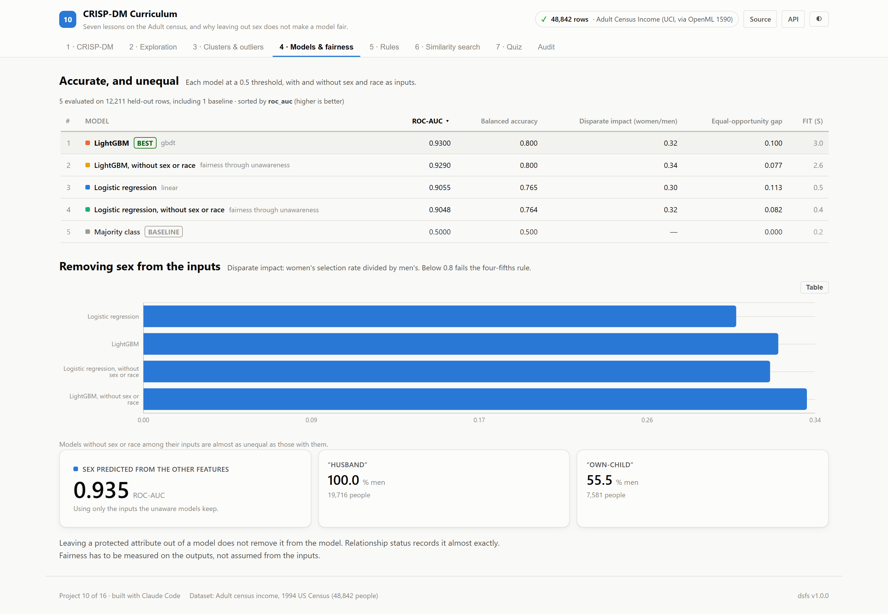
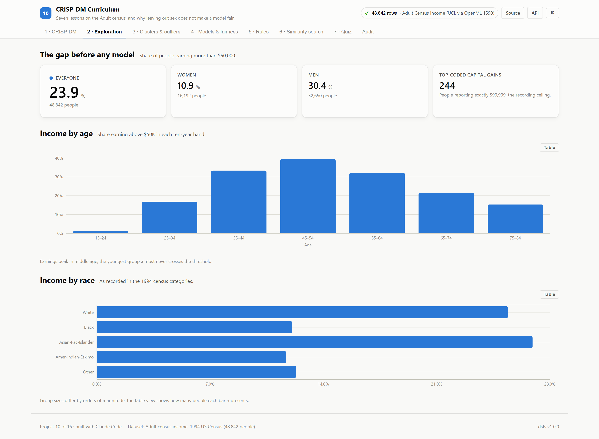
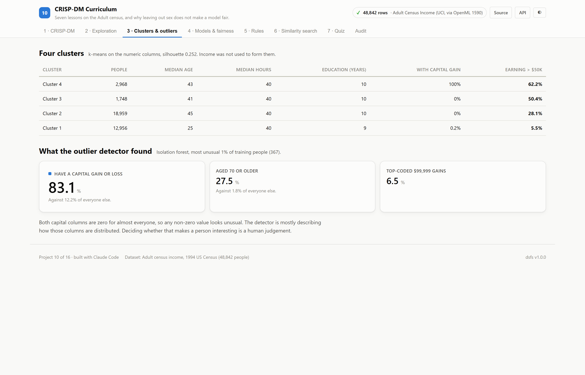
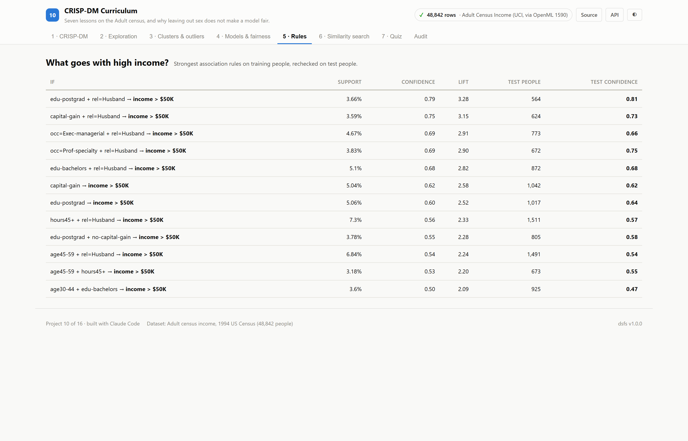
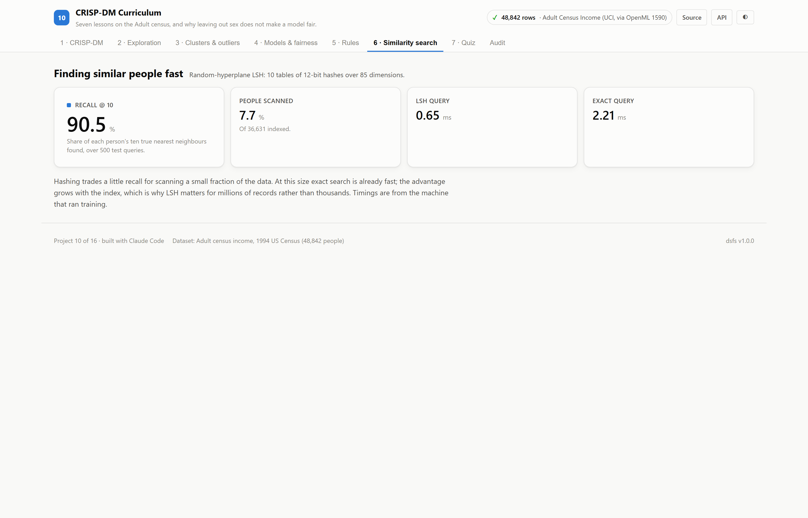
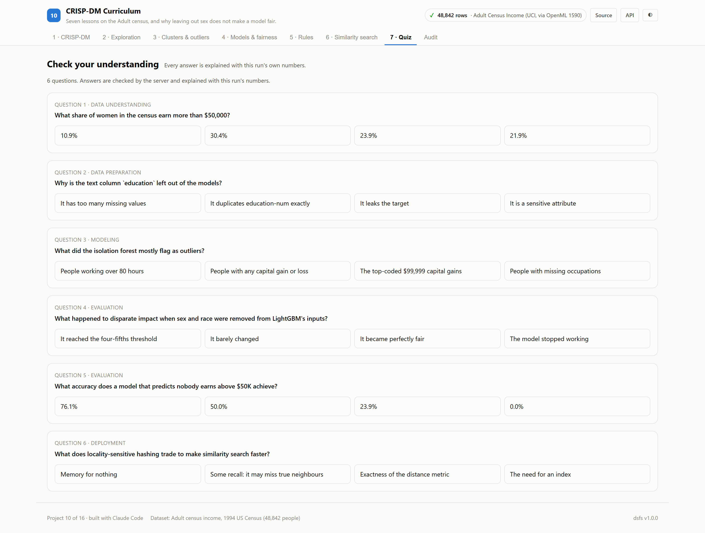
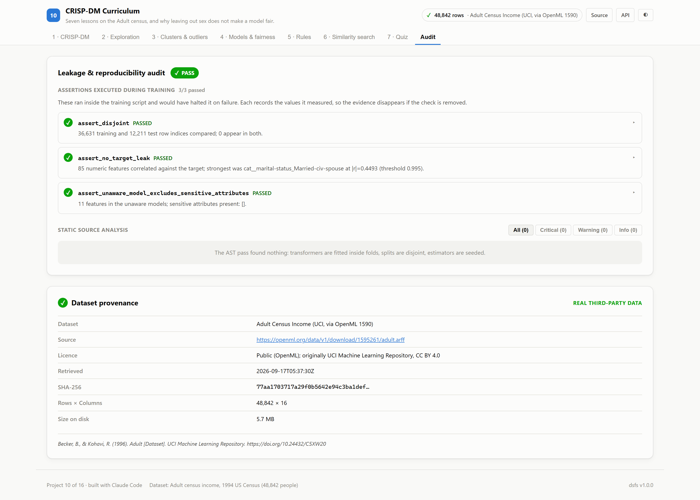

# 10 · CRISP-DM Curriculum

**Seven lessons on one real dataset, each ending in a question the data answers.
The central one: if a model never sees a person's sex, is it fair to women?**

Built on the real Adult census income dataset: 48,842 people from the
1994 US Census, of whom 23.9% earned more than $50,000.

| | |
|---|---|
| Task | A CRISP-DM course: exploration, clustering, outliers, classification, fairness, rules, similarity search |
| Dataset | [Adult (OpenML 1590)](https://www.openml.org/d/1590) · CC BY 4.0, from the [UCI repository](https://archive.ics.uci.edu/dataset/2/adult) |
| Evaluation | Stratified 75/25 split: 36,631 training and 12,211 test people |
| Winner | **LightGBM**, ROC AUC 0.930 |
| Ports | API `8010` · Web `5110` |

---

## The decision that defines this project

"Fairness through unawareness" is the idea that a model which is never given a
sensitive attribute cannot discriminate on it. **This course tests it instead of
assuming it.** Every classifier is trained twice, once with sex and race and once
without, and an assertion confirms the unaware models' 11 inputs contain
neither. The fairness of both versions is then measured on the same test people.

---

## Results

<!-- dsfs:leaderboard -->
| # | Model | ROC AUC | Balanced accuracy | Disparate impact (sex) | Equal-opportunity gap |
|---|---|---|---|---|---|
| 1 | **LightGBM** 🏆 | 0.9300 | 0.8004 | 0.3213 | 0.1002 |
| 2 | LightGBM, without sex or race | 0.9290 | 0.7998 | 0.3358 | 0.0769 |
| 3 | Logistic regression | 0.9055 | 0.7647 | 0.3000 | 0.1131 |
| 4 | Logistic regression, without sex or race | 0.9048 | 0.7643 | 0.3172 | 0.0823 |
| 5 | Majority class *(baseline)* | 0.5000 | 0.5000 | — | 0.0000 |

Ranked by roc auc (higher is better). Split: stratified random 75/25 (cross-sectional census); 12,211 evaluation rows. Generated from `artifacts/metrics.json`.
<!-- /dsfs:leaderboard -->

**Removing sex barely changed how the model treats women.** LightGBM selects
8.3% of women and 25.7%
of men as high earners, a disparate-impact ratio of 0.32.
Without sex or race as inputs, the ratio is 0.34, far
below the 0.8 often used as a warning line. The equal-opportunity gap (the
difference in true-positive rates between men and women) narrowed from
0.100 to 0.077,
and ROC AUC moved from 0.930 to 0.929. Some of
the gap reflects the data itself: 10.9% of women
in the census were high earners against 30.4% of men.

**Why unawareness fails here.** A model trained on the unaware features to
predict *sex* recovers it with ROC AUC 0.935 on test people.
Relationship status is one such proxy: "Husband" is
100% men across 19,716 people, and "Wife"
0.1%. 7 of the 12 strongest high-income
association rules include being a husband.

**Accuracy is the wrong headline.** Predicting that nobody earns above $50K is
76.1% accurate, with a balanced accuracy of
0.50. The leaderboard ranks by ROC AUC and reports
balanced accuracy beside it.

---

## The seven lessons

1. **CRISP-DM.** The phases of this project, each with its own gate.
2. **Exploration.** High-income rates by sex, race and age; they peak at
   39.4% for ages 45–54. Values are missing in
   `workclass` (5.73%) and
   `occupation` (5.75%), and 244
   capital gains are top-coded at 99,999.
3. **Clusters and outliers.** k-means finds four groups (silhouette
   0.25, so they overlap), ranging from
   5.5% to 62.2%
   high earners. An isolation forest flags 367 people.
   83.1% of them have a capital gain or loss, against
   12.2% of everyone else; 27.5% are
   70 or older. Only 6.5% have a top-coded gain.
   Unusual is not the same as wrong.
4. **Models and fairness.** The comparison above.
5. **Association rules.** FP-Growth on the training people, each rule rechecked
   on test people. 11 of 12 rules kept their confidence within five
   percentage points.
6. **Similarity search.** Random-hyperplane locality-sensitive hashing
   (12 bits, 10 tables) over 36,631 people in
   85 dimensions. It finds 90.5% of the
   true ten nearest neighbours while scanning 7.7% of the
   index. Query times are recorded too, but vary between runs.
7. **Quiz.** 6 questions whose answers and explanations are computed
   from this run. Answers are checked on the server, so they cannot be read from
   the page first.

---

## Screenshot tour

### Models & fairness
Each model with and without sex and race, the proxy that explains the result, and
selection rates by sex.



### CRISP-DM · Exploration · Clusters & outliers




### Rules · Similarity search · Quiz · Audit





> Dark variants of every view are in [`screenshots/`](./screenshots).

---

## Assertions that ran

<!-- dsfs:assertions -->
| Assertion | Result | What it measured |
|---|---|---|
| `assert_disjoint` | ✅ passed | 36,631 training and 12,211 test row indices compared; 0 appear in both. |
| `assert_no_target_leak` | ✅ passed | 85 numeric features correlated against the target; strongest was cat__marital-status_Married-civ-spouse at |r|=0.4493 (threshold 0.995). |
| `assert_unaware_model_excludes_sensitive_attributes` | ✅ passed | 11 features in the unaware models; sensitive attributes present: []. |

Recorded by the assertion ledger while training ran; generated from `artifacts/metrics.json`.
<!-- /dsfs:assertions -->

---

## Running it

```bash
pip install -e ../platform
npm install

python ml/train.py     # downloads the census on first run; under a minute
python -m uvicorn main:app --app-dir server --port 8010
npm run dev -w 10_crispdm_curriculum/client     # http://localhost:5110
```

Generated documents: [paper](./paper.md) · [abstract](./abstract.md) ·
[article](./article.md) · [design doc](./DESIGN_DOC.md) ·
[audit report](./audit_report.md) · [reproduction skill](./skills/reproduce/SKILL.md)
