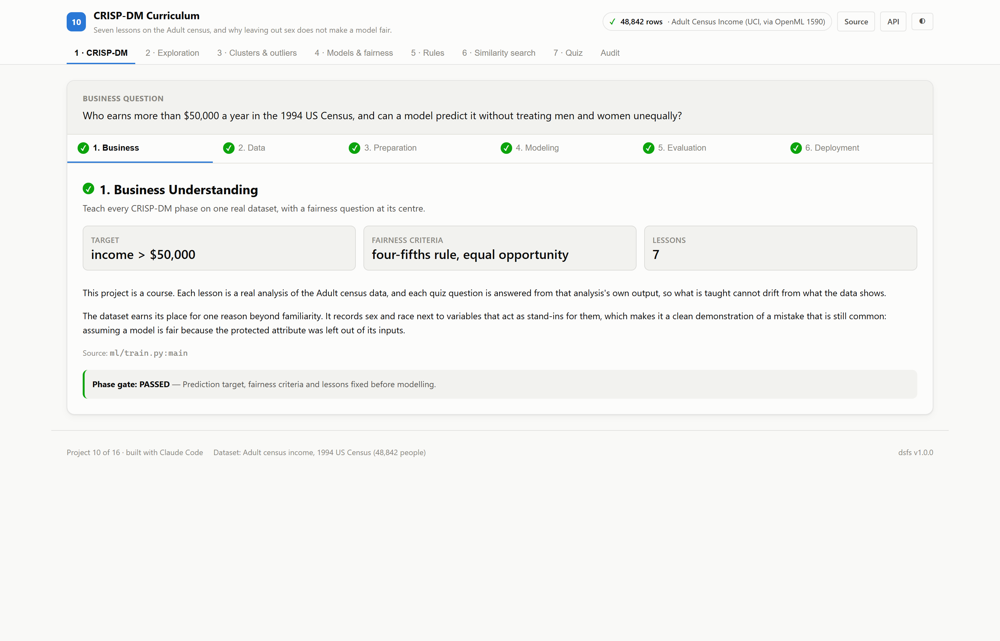

# Seven lessons on the Adult census, and why leaving out sex does not make a model fair.

*CRISP-DM Curriculum — project 10 of a sixteen-project data science portfolio built with an AI coding assistant, on real data.*

## The question

Who earns more than $50,000 a year in the 1994 US Census, and can a model predict it without treating men and women unequally?

This project is a course. Each lesson is a real analysis of the Adult census data, and each quiz question is answered from that analysis's own output, so what is taught cannot drift from what the data shows.

The dataset earns its place for one reason beyond familiarity. It records sex and race next to variables that act as stand-ins for them, which makes it a clean demonstration of a mistake that is still common: assuming a model is fair because the protected attribute was left out of its inputs.

## The data

48,842 people; **23.9%** earn above $50,000. The rate is **30.4%** for men and **10.9%** for women — a gap already present in the data, which any model trained on it will learn unless something stops it.

Three quirks shape preparation. Workclass, occupation and native country are missing for up to 5.8% of rows, marked `?` in the source. Capital gain is top-coded: 244 people report exactly $99,999. And `education` is a text copy of `education-num` — every education level maps to exactly one number, so only the ordinal version is modelled.

## What won

**LightGBM**, at 0.9300 on roc auc, against 0.5000 for the best baseline, Majority class.

| # | Model | ROC AUC | Balanced accuracy | Disparate impact (sex) | Equal-opportunity gap |
|---|---|---|---|---|---|
| 1 | **LightGBM** 🏆 | 0.9300 | 0.8004 | 0.3213 | 0.1002 |
| 2 | LightGBM, without sex or race | 0.9290 | 0.7998 | 0.3358 | 0.0769 |
| 3 | Logistic regression | 0.9055 | 0.7647 | 0.3000 | 0.1131 |
| 4 | Logistic regression, without sex or race | 0.9048 | 0.7643 | 0.3172 | 0.0823 |
| 5 | Majority class *(baseline)* | 0.5000 | 0.5000 | — | 0.0000 |

Ranked by roc auc (higher is better). Split: stratified random 75/25 (cross-sectional census); 12,211 evaluation rows. Generated from `artifacts/metrics.json`.

**LightGBM** is the most accurate, with ROC-AUC 0.9300. At a 0.5 threshold, LightGBM predicts high income for 25.7% of men and 8.3% of women: a disparate impact ratio of **0.32**, far below the four-fifths threshold of 0.8.

**Removing sex and race does almost nothing.** The unaware LightGBM's ratio is **0.34**, and its equal-opportunity gap — the difference in how often truly high-earning men and women are identified — moves from +0.100 to +0.077. The information was never only in the `sex` column.

Two more lessons check themselves on held-out people. The strongest association rules for high income are recomputed on the test set, and locality-sensitive hashing finds 90% of each person's ten most similar people while scanning 7.7% of the index.

## What I took away

- Leaving sex and race out of the inputs barely changed disparate impact, because the remaining features predict sex almost perfectly.
- Relationship status alone largely encodes sex in this data, which makes it a proxy any model can use.
- Accuracy flatters a skewed problem: predicting that nobody earns above $50K is right about three times in four.
- An outlier detector finds what is unusual, not what is wrong; here that was mostly people with any capital gain or loss.
- Approximate similarity search keeps most true neighbours while scanning a small fraction of the index.

## How it is built

The backend is FastAPI on port 8010 and the front end is React on port 5110. Most of the interface — the metrics panel, tournament table, CRISP-DM walkthrough, audit panel and charts — is shared across the portfolio and driven entirely by the training run's artifacts, so nothing on screen is typed by hand.

Code: [github.com/aniket-alt/ai-coding-assistant](https://github.com/aniket-alt/ai-coding-assistant/tree/main/10_crispdm_curriculum)

---

*Figures in this article are generated from the project's artifacts.*
