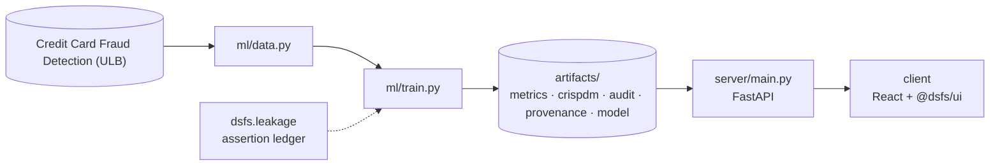

# Design document — Portfolio Audit

| | |
|---|---|
| Project | 11 · `11_portfolio_audit` |
| Domain | Detector benchmark · governance |
| Task | leakage detector benchmark |
| Ports | API 8011 · web 5111 |
| Dataset | ULB credit card fraud with planted leaks, plus this portfolio's own artifacts |

## 1. Problem

How much should anyone trust this portfolio's leakage audit, and which leaks would it miss?

Measure the auditor instead of trusting it.

### Goals

- Measure the auditor instead of trusting it.
- Build a catalogue of leaks that covers the ways real projects go wrong.
- Establish a clean reference score and confirm the controls really are clean.
- Score each detector, and both together, against two baselines.
- State plainly what the audit can and cannot see.
- Publish the benchmark beside the portfolio's audit results.

### Non-goals

- Proving any project leak-free. A benchmark can only show which known leak patterns are detected.
- Replacing code review. The detectors are a floor, not a certificate.

## 2. Architecture



Training is the only writer of results. The API serves the artifacts it wrote, and the client renders what the API returns, so a figure on screen always traces back to one run.

## 3. Components

| File | Lines | Responsibility |
|---|---:|---|
| `ml/mutations.py` | 169 | Project 11 -- a benchmark for the portfolio's own leakage auditor. |
| `ml/train.py` | 380 | Project 11 -- benchmark the portfolio's leakage auditor, then audit the portfolio. |
| `server/inference.py` | 45 | The benchmark results and the portfolio snapshot are read from metrics.json. Variant source code is read from the committed corpus, but only for ids the benchmark itself… |
| `server/main.py` | 58 | Project 11 -- FastAPI application. |
| `client/src/App.tsx` | 135 | LeakBenchmark is the project-specific view. The detector tournament uses the shared leaderboard, and the portfolio table renders each project's audit state exactly as its… |
| `client/src/LeakBenchmark.tsx` | 124 | Every planted leak and clean control, with what each detector concluded and how much the leak inflated the reported score. Selecting a row shows the variant's source, so a… |
| `client/src/main.tsx` | 10 | — |

Everything else — the FastAPI factory, dataset cache, provenance, CRISP-DM report, metrics record, leakage auditor and the six shared UI components — comes from `platform/`.

## 4. API

| Method | Path | Purpose |
|---|---|---|
| GET | `/api/benchmark` | Every planted leak and control, with both detectors' verdicts and the score inflation. |
| GET | `/api/corpus/{variant_id}` | The source of one benchmark variant, so what was planted can be checked. |
| GET | `/api/portfolio` | Audit state of every other built project, read from its artifacts at training time. |
| GET | `/api/health` | Liveness, version and whether artifacts are present. (platform) |
| GET | `/api/meta` | Project identity, ports and techniques. (platform) |
| GET | `/api/metrics` | The full run record: models, split, audit, environment. (platform) |
| GET | `/api/crispdm` | The six-phase CRISP-DM report written during training. (platform) |
| GET | `/api/audit` | Static leakage findings. (platform) |
| GET | `/api/provenance` | The dataset receipt. (platform) |
| GET | `/api/docs` | Interactive OpenAPI documentation. (platform) |

## 5. Data and evaluation

✅ **Real, third-party data**

| Field | Value |
|---|---|
| Dataset | Credit Card Fraud Detection (ULB) |
| Source | https://openml.org/data/v1/download/1673544/creditcard.arff |
| Licence | Public (Open Database License) — OpenML dataset 1597 |
| Rows × columns (as downloaded) | 284,807 × 31 |
| SHA-256 | `fdaf12730dc1fc426f318b71349f24f5c5fd00aa1152940be7e7509ae3d89d2a` |
| Benchmark | leaks are planted deliberately by this project; the data itself is real |
| Variants | 14 |

**Split.** planted-leak benchmark. 11 leaks and 3 clean controls.

## 6. Key decisions

- **Business understanding.** Leak catalogue, controls and scoring fixed before any detector was run.
- **Data understanding.** 14 variants across 4 leak families plus controls.
- **Data preparation.** Controls verified clean by score and by assertion.
- **Modeling.** 5 detectors scored.
- **Evaluation.** The auditor's blind spots are published with its results.
- **Deployment.** Corpus committed so the benchmark is inspectable.

## 7. Verification

- 3 of 3 runtime leakage assertions passed.
- Static source audit: 0 critical, 0 warnings.
- 10 screenshots captured by `scripts/capture_screenshots.py`, which fails if any view does not render its expected content.

| Assertion | Result | What it measured |
|---|---|---|
| `assert_leaks_differ_from_template` | ✅ passed | 11 leak variants compared with the clean template; 0 identical. |
| `assert_all_variants_executed` | ✅ passed | 14 variants executed; 0 failed for reasons other than a leakage check. |
| `assert_controls_are_clean` | ✅ passed | 3 controls scored within 0.0036 average precision of the template and raised 0 runtime checks. |

Recorded by the assertion ledger while training ran; generated from `artifacts/metrics.json`.

## 8. Risks

- The corpus holds one example of each leak on one dataset and one model; detection could differ on other code shapes.
- Score inflation is measured on a single split, so small inflations are within run-to-run noise.
- The portfolio snapshot reflects artifacts at the moment this project was trained, not live state.

## 9. Reproducibility

Last trained at commit `b6a62b4` on Python 3.11.6.

```bash
python ml/train.py
python -m uvicorn main:app --app-dir server --port 8011
npm run dev -w 11_portfolio_audit/client
```

---

*Generated by `scripts/generate_docs.py`.*
