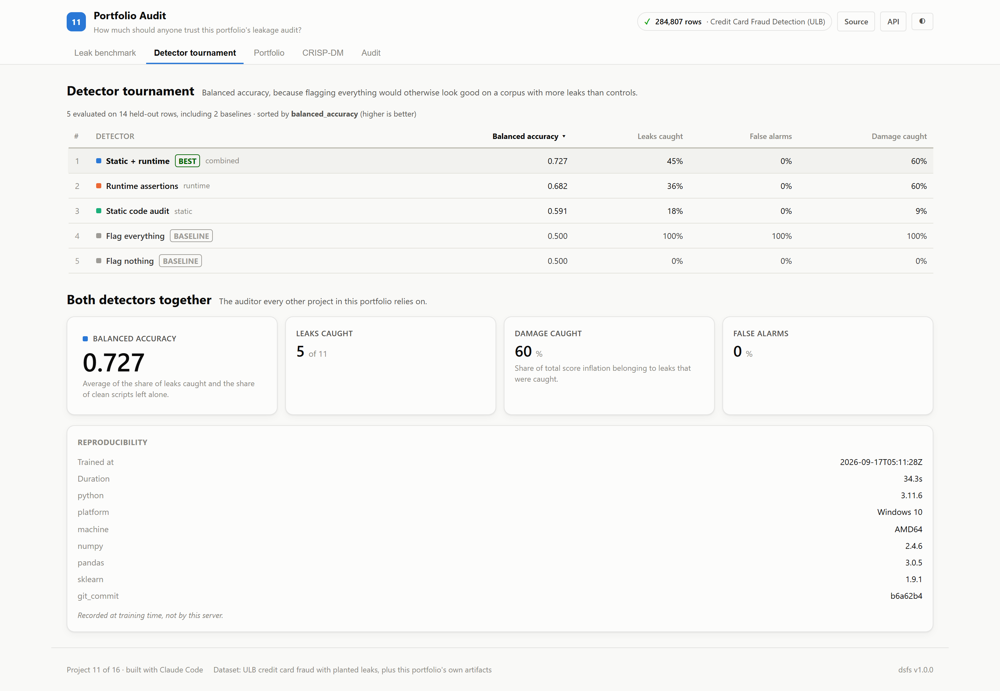
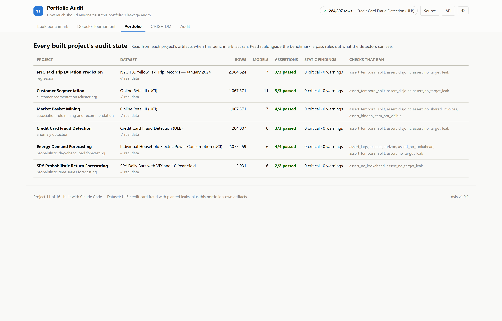
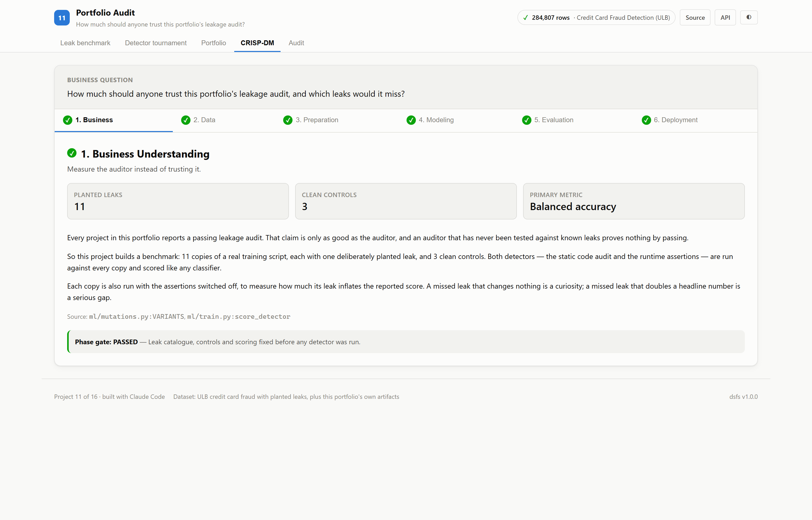
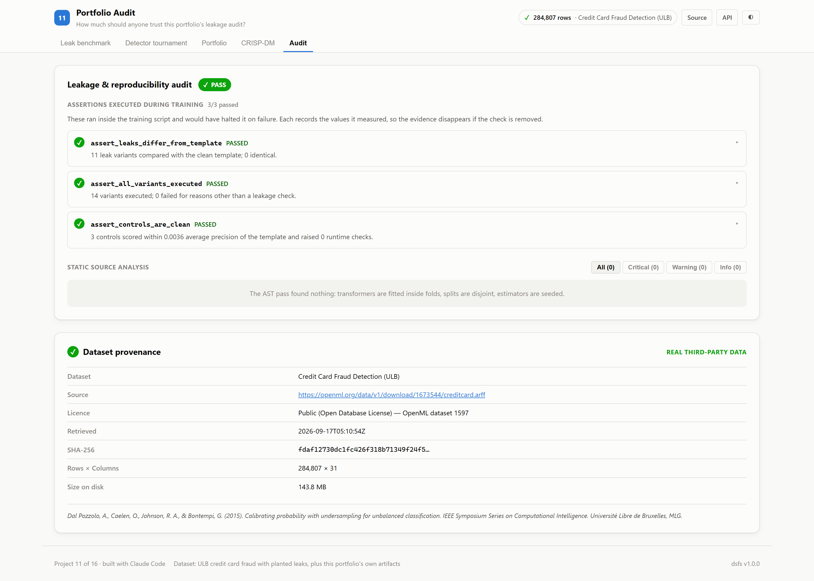

# 11 · Portfolio Audit

**How much should anyone trust this portfolio's leakage audit, and which leaks
would it miss?**

Every other project here reports a passing audit. This project tests the auditor
itself.

| | |
|---|---|
| Task | Benchmark of the portfolio's leakage detectors |
| Data | Real ULB credit card fraud transactions (shared with project 06), with leaks **planted deliberately** |
| Corpus | 11 leaky variants of one training script, and 3 clean controls |
| Result | Both detectors together catch **5 of 11** leaks with 0% false alarms |
| Ports | API `8011` · Web `5111` |

---

## The decision that defines this project

**An auditor that has never been tested against known leaks proves nothing by
passing.**

So this project takes one clean training script and plants a single known leak in
each of 11 copies: scalers fitted on the wrong rows, shuffled or
overlapping time splits, test rows copied into training, the label or a noisy
copy of it used as a feature, labels averaged from the future, target encoding
computed before the split, and hyperparameters chosen on the test set. Three
clean controls check that legitimate code is left alone.

Both detectors the portfolio relies on then run against every copy:

- the **static code audit**, which reads the source;
- the **runtime assertions**, which run inside it and inspect what it produced.

Every copy also runs with the assertions switched off, so the benchmark records
**how much each leak inflates the reported score** against the clean script's
0.7017 average precision.

Detectors are ranked on **balanced accuracy**, not F1. The corpus holds more leaks
than controls, so F1 would reward flagging everything; balanced accuracy gives
that exactly 0.5.

---

## Results

<!-- dsfs:leaderboard -->
| # | Detector | Balanced accuracy | Leaks caught | False alarms | Damage caught |
|---|---|---|---|---|---|
| 1 | **Static + runtime** 🏆 | 0.727 | 45.5% | 0.0% | 60.4% |
| 2 | Runtime assertions | 0.682 | 36.4% | 0.0% | 60.4% |
| 3 | Static code audit | 0.591 | 18.2% | 0.0% | 9.4% |
| 4 | Flag everything *(baseline)* | 0.500 | 100.0% | 100.0% | 100.0% |
| 5 | Flag nothing *(baseline)* | 0.500 | 0.0% | 0.0% | 0.0% |

Ranked by balanced accuracy (higher is better). Split: planted-leak benchmark; 14 evaluation rows. Generated from `artifacts/metrics.json`.
<!-- /dsfs:leaderboard -->

| Variant | Family | Inflation | Static | Runtime |
|---|---|---:|:---:|:---:|
| Clean template | control | — | — | — |
| Clean, scaler inside a pipeline | control | — | — | — |
| Clean, unshuffled train_test_split | control | — | — | — |
| Scaler fitted on every row | preprocessing | -0.016 | — | — |
| Scaler fitted on every row, innocuous name | preprocessing | -0.016 | — | — |
| Scaler fitted on the test set | preprocessing | -0.017 | ✓ | — |
| Shuffled split on time-ordered data | split | +0.061 | ✓ | ✓ |
| Train and test windows overlap | split | -0.008 | — | ✓ |
| Test rows copied into training | split | +0.031 | — | ✓ |
| The label used as a feature | target | +0.298 | — | ✓ |
| A noisy copy of the label | target | +0.159 | — | — |
| Rolling fraud rate centred on each row | target | +0.016 | — | — |
| Target encoding computed on all rows | target | +0.008 | — | — |
| Hyperparameter chosen on the test set | evaluation | +0.073 | — | — |

**Together the detectors catch 5 of 11 leaks and
60% of the total damage, with no false alarms on clean
code.** The runtime assertions do most of the work; the static audit adds one
catch the assertions miss, a scaler fitted on the test set.

**The costliest miss is *a noisy copy of the label*.** It raises average precision from
0.7017 to 0.8602, yet passes both
detectors: no feature is anywhere near perfectly correlated with the label, and the
split itself is clean. The leak lives in how a feature was computed.

**Name-based static rules are fragile.** Fitting a scaler on every row goes
unflagged here because the frame is called `frame` rather than something the rule
recognises, such as `df`.

**Not every leak raises a score.** Both scaler leaks slightly *lowered* average
precision on this data. They are still leaks, which is why inflation is reported
beside detection rather than used to decide whether something leaked.

### What this means for the rest of the portfolio

A passing audit in this repository rules out split mistakes and blatant label
leaks. It says little about label-derived features, target encodings, or tuning on
the test set. Those are guarded in each project by design — out-of-fold encoders
in [01](../01_nyc_taxi_prediction), walk-forward refits in
[12](../12_energy_forecasting) and [15](../15_spy_forecasting), baselines
everywhere — and should be read that way, not as certified by the auditor.

---

## Screenshot tour

### Leak benchmark
Inflation per planted leak, what each detector concluded, and the source of any
variant on selection.


### Detector tournament · Portfolio



### CRISP-DM · Audit



> Dark variants of every view are in [`screenshots/`](./screenshots).

---

## Keeping the benchmark honest

- **The corpus is committed.** Every variant's source is in
  [`artifacts/leak_corpus/`](./artifacts/leak_corpus), and the app shows it on
  selection.
- **Controls are verified, not assumed.** Each must score within 0.02 average
  precision of the clean template and trip no runtime check, or training stops.
- **The benchmark cannot contaminate this project's own audit.** Variants run
  their assertions through a wrapper that removes their entries from the ledger.
- **CI skips the corpus deliberately.** The repository-wide audit would otherwise
  fail on leaks planted on purpose; `scripts/run_audit.py` says so where it skips.

## Assertions that ran

<!-- dsfs:assertions -->
| Assertion | Result | What it measured |
|---|---|---|
| `assert_leaks_differ_from_template` | ✅ passed | 11 leak variants compared with the clean template; 0 identical. |
| `assert_all_variants_executed` | ✅ passed | 14 variants executed; 0 failed for reasons other than a leakage check. |
| `assert_controls_are_clean` | ✅ passed | 3 controls scored within 0.0036 average precision of the template and raised 0 runtime checks. |

Recorded by the assertion ledger while training ran; generated from `artifacts/metrics.json`.
<!-- /dsfs:assertions -->

---

## Running it

```bash
pip install -e ../platform
npm install

python ml/train.py     # uses project 06's cached fraud data; about a minute
python -m uvicorn main:app --app-dir server --port 8011
npm run dev -w 11_portfolio_audit/client     # http://localhost:5111
```

Generated documents: [paper](./paper.md) · [abstract](./abstract.md) ·
[article](./article.md) · [design doc](./DESIGN_DOC.md) ·
[audit report](./audit_report.md) · [reproduction skill](./skills/reproduce/SKILL.md)
