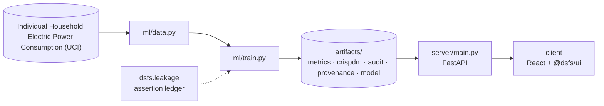

# Design document — Energy Demand Forecasting

| | |
|---|---|
| Project | 12 · `12_energy_forecasting` |
| Domain | Probabilistic day-ahead forecasting |
| Task | probabilistic day-ahead load forecasting |
| Ports | API 8012 · web 5112 |
| Dataset | UCI household electric power, 2006-2010 (2,075,259 minute readings) |

## 1. Problem

How much electricity will this household use in each hour of tomorrow, and how wide should the uncertainty be?

Issue a calibrated day-ahead forecast of hourly load.

### Goals

- Issue a calibrated day-ahead forecast of hourly load.
- Aggregate minute readings to hours without inventing values for gaps.
- Build features that exist when the forecast is issued, and prove it.
- Compare learned forecasters with three seasonal baselines and a fat-tailed interval.
- Decide whether the winner genuinely beats repeating the past, and measure the cost of a leak.
- Serve tomorrow's hourly band and the recent track record together.

### Non-goals

- Grid-level or multi-household forecasting. This is one home, which is far noisier than an aggregate.
- Intraday updating. The forecast is issued once, a day ahead.

## 2. Architecture



Training is the only writer of results. The API serves the artifacts it wrote, and the client renders what the API returns, so a figure on screen always traces back to one run.

## 3. Components

| File | Lines | Responsibility |
|---|---:|---|
| `ml/data.py` | 115 | Project 12 -- household electricity: acquisition and hourly aggregation. |
| `ml/features.py` | 94 | Rows are indexed by the hour being forecast, T. The forecast is issued 24 hours earlier, at T - 24, so every feature must be computable from readings at or before T - 24. |
| `ml/train.py` | 422 | Project 12 -- day-ahead household energy forecasting. |
| `server/inference.py` | 57 | Every response is read from the training run's metrics.json: tomorrow's band, the recent track record, load profiles, calibration, significance and the leakage demonstration.… |
| `server/main.py` | 55 | Project 12 -- FastAPI application. |
| `client/src/App.tsx` | 194 | LoadFan is the only project-specific view. Patterns, calibration, the tournament and the leakage demonstration are built from shared components reading the training artifacts. |
| `client/src/LoadFan.tsx` | 97 | Recent actual load against the day-ahead band issued for it, followed by the band for the day after the data ends. Showing the track record beside the forecast lets a reader… |
| `client/src/main.tsx` | 10 | — |

Everything else — the FastAPI factory, dataset cache, provenance, CRISP-DM report, metrics record, leakage auditor and the six shared UI components — comes from `platform/`.

## 4. API

| Method | Path | Purpose |
|---|---|---|
| GET | `/api/forecast` | Tomorrow's hourly band, with the last fourteen days of forecasts against actual load. |
| GET | `/api/patterns` | Average load by hour for weekdays and weekends, and by month. |
| GET | `/api/calibration` | Interval coverage, significance against yesterday, and the leakage demonstration. |
| GET | `/api/health` | Liveness, version and whether artifacts are present. (platform) |
| GET | `/api/meta` | Project identity, ports and techniques. (platform) |
| GET | `/api/metrics` | The full run record: models, split, audit, environment. (platform) |
| GET | `/api/crispdm` | The six-phase CRISP-DM report written during training. (platform) |
| GET | `/api/audit` | Static leakage findings. (platform) |
| GET | `/api/provenance` | The dataset receipt. (platform) |
| GET | `/api/docs` | Interactive OpenAPI documentation. (platform) |

## 5. Data and evaluation

✅ **Real, third-party data**

| Field | Value |
|---|---|
| Dataset | Individual Household Electric Power Consumption (UCI) |
| Source | https://archive.ics.uci.edu/static/public/235/individual+household+electric+power+consumption.zip |
| Licence | Creative Commons Attribution 4.0 (CC BY 4.0) |
| Rows × columns (as downloaded) | 2,075,259 × 7 |
| SHA-256 | `9f84b46ade8a2d8e1286ec4b2b6c2987a45a755c59f263be3b3b3d10dfbda3ff` |
| Hours after aggregation | 34,587 |
| Hours missing | 436 |

**Split.** walk-forward, 18 refits every 60 days, day-ahead. Hours with no recorded load are neither trained on nor scored.

## 6. Key decisions

- **Business understanding.** Horizon, minimum lag, loss and reference baseline fixed before modelling.
- **Data understanding.** 34,587 hours; gaps preserved as missing.
- **Data preparation.** Minimum-lag and recomputation checks passed.
- **Modeling.** 6 forecasters over 18 folds.
- **Evaluation.** No critical findings; leaky variant measured but excluded.
- **Deployment.** Final-fold quantile models persisted; forecasts served from artifacts.

## 7. Verification

- 4 of 4 runtime leakage assertions passed.
- Static source audit: 0 critical, 0 warnings.
- 12 screenshots captured by `scripts/capture_screenshots.py`, which fails if any view does not render its expected content.

| Assertion | Result | What it measured |
|---|---|---|
| `assert_lags_respect_horizon` | ✅ passed | 8 lags checked against a 24-hour horizon; shortest is 24 hours; 0 shorter than the horizon. |
| `assert_no_lookahead` | ✅ passed | 600 feature values across 30 target hours recomputed from data available at the forecast origin; 0 differed. |
| `assert_temporal_split` | ✅ passed | Last training timestamp 2007-12-16 17:00:00 precedes first test timestamp 2007-12-16 18:00:00 by 0 days 01:00:00; no embargo required. |
| `assert_no_target_leak` | ✅ passed | 20 numeric features correlated against the target; strongest was same_hour_4wk_mean at |r|=0.5275 (threshold 0.995). |

Recorded by the assertion ledger while training ran; generated from `artifacts/metrics.json`.

## 8. Risks

- No weather data. Heating and lighting follow temperature and daylight, which the model can only infer from the calendar.
- One household over four years; occupants' routines change and the model assumes the recent past resembles the near future.
- Hours with fewer than 45 recorded minutes are dropped, so the longest outages are simply not scored.

## 9. Reproducibility

Last trained at commit `39e3212` on Python 3.11.6.

```bash
python ml/train.py
python -m uvicorn main:app --app-dir server --port 8012
npm run dev -w 12_energy_forecasting/client
```

---

*Generated by `scripts/generate_docs.py`.*
