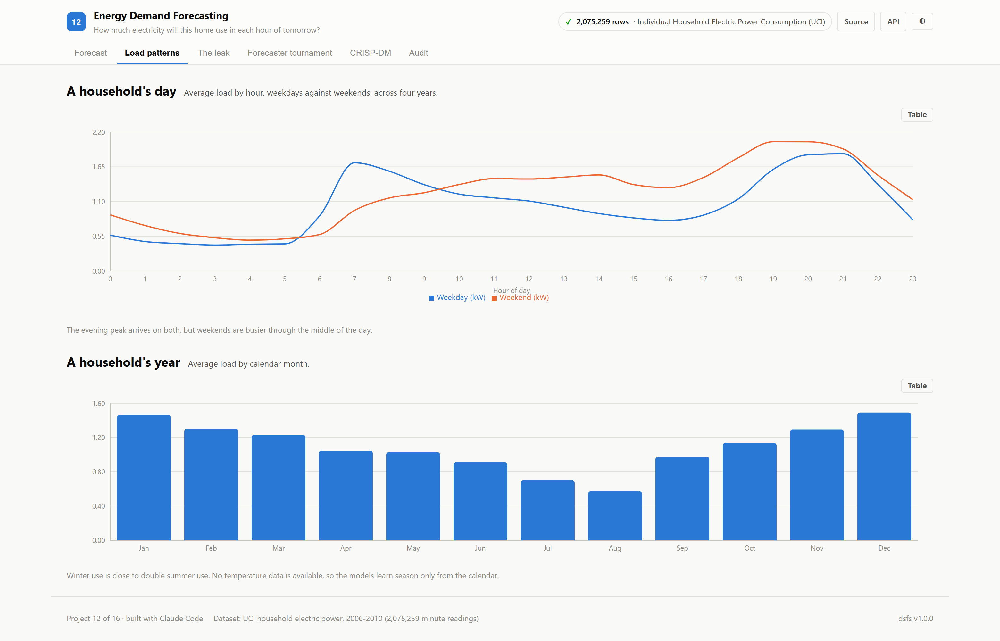
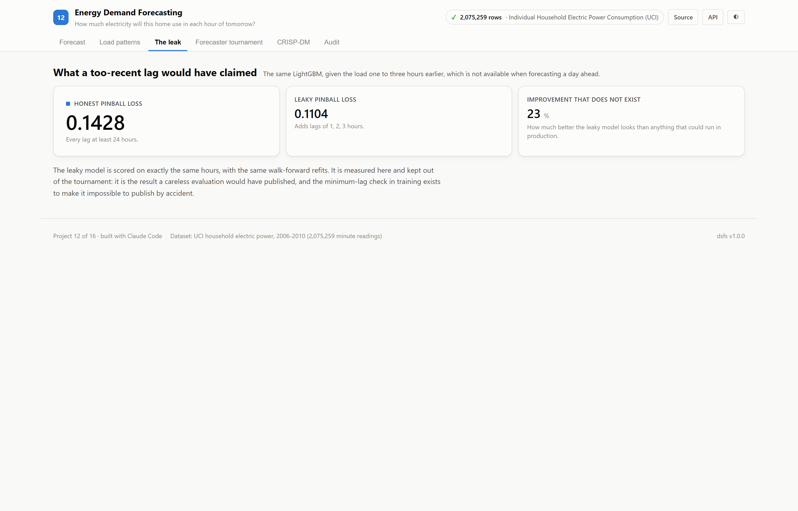
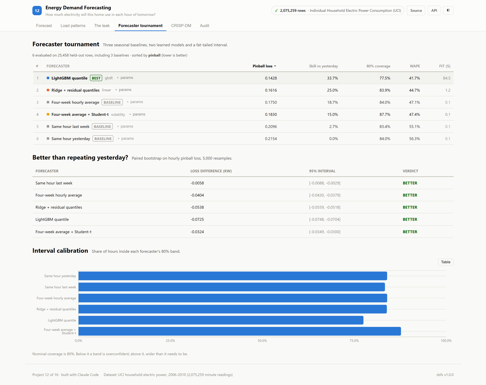
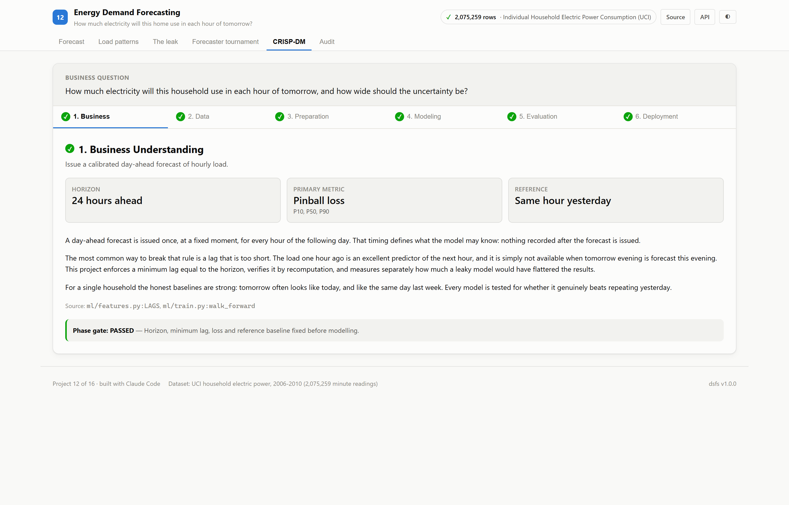
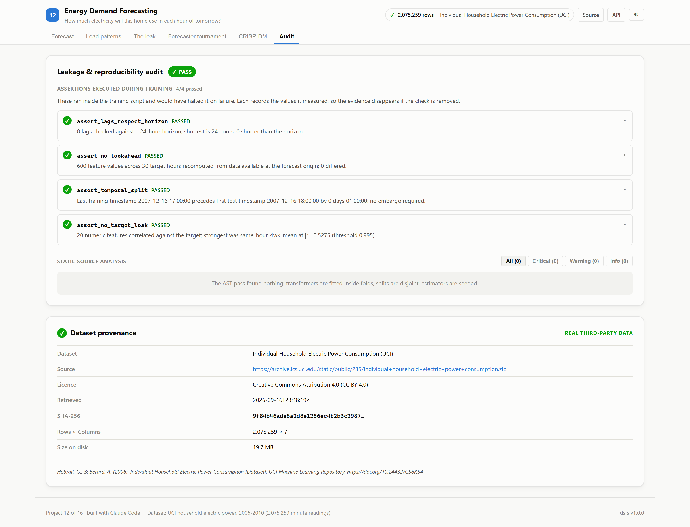

# 12 · Energy Demand Forecasting

**How much electricity will this household use in each hour of tomorrow, and how
wide should the uncertainty be?**

Built on the real UCI Individual Household Electric Power Consumption dataset:
2,075,259 minute readings from one home near Paris, December 2006 to
November 2010.

| | |
|---|---|
| Task | Probabilistic day-ahead load forecasting |
| Dataset | [UCI household power](https://archive.ics.uci.edu/dataset/235/individual+household+electric+power+consumption) · CC BY 4.0 |
| Evaluation | Walk-forward, refit every 60 days, forecasts issued 24 hours ahead |
| Winner | **LightGBM quantile**, 33.7% better than repeating yesterday |
| Ports | API `8012` · Web `5112` |

---

## The decision that defines this project

A day-ahead forecast is issued once, a full day before the hours it describes.
**Nothing recorded after that moment may be used.**

The easiest way to break that rule is a lag shorter than the horizon. The load one
hour ago predicts the next hour superbly, and it simply does not exist yet when
tomorrow evening is forecast this evening. This project handles that in three
ways:

1. **Every lag is at least 24 hours**, checked by an assertion that halts
   training otherwise.
2. **Features are recomputed from truncated history**, as if standing at each
   forecast origin with nothing after it: 600 values across
   30 target hours, 0 mismatches.
3. **The leak is measured rather than just avoided.** The same model with one- to
   three-hour lags scores a pinball loss of 0.1104 against
   0.1428 for the honest version — **23%
   better, and none of it real**. It is reported, and kept out of the leaderboard.

---

## Results

<!-- dsfs:leaderboard -->
| # | Forecaster | Pinball loss (kW) | Skill vs yesterday | 80% coverage | WAPE |
|---|---|---|---|---|---|
| 1 | **LightGBM quantile** 🏆 | 0.1428 | 33.7% | 77.5% | 41.7% |
| 2 | Ridge + residual quantiles | 0.1616 | 25.0% | 83.9% | 44.7% |
| 3 | Four-week hourly average *(baseline)* | 0.1750 | 18.7% | 84.0% | 47.1% |
| 4 | Four-week average + Student-t | 0.1830 | 15.0% | 87.7% | 47.4% |
| 5 | Same hour last week *(baseline)* | 0.2096 | 2.7% | 83.4% | 55.1% |
| 6 | Same hour yesterday *(baseline)* | 0.2154 | 0.0% | 84.0% | 56.3% |

Ranked by pinball loss (kw) (lower is better). Split: walk-forward, 18 refits every 60 days, day-ahead; 25,458 evaluation rows. Generated from `artifacts/metrics.json`.
<!-- /dsfs:leaderboard -->

**Here, unlike [SPY forecasting](../15_spy_forecasting), learning genuinely
helps.** Every forecaster is significantly better than repeating yesterday in a
paired bootstrap on hourly losses, and LightGBM quantile leads at
33.7% skill.

**Averaging beats repeating.** The four-week average of the same hour is
18.7% better than
yesterday with no model at all, because one day in a household is noisy and four
weeks of the same hour smooth that noise out.

**The best forecaster is not the best-calibrated.** LightGBM quantile's 80% band covers
77.5% of hours, slightly overconfident, while the
Ridge band covers 83.9%.
Pinball loss rewards the sharper band; coverage is reported beside it so the
trade-off stays visible.

| Forecaster | vs yesterday |
|---|---|
| Same hour last week | better |
| Four-week hourly average | better |
| Ridge + residual quantiles | better |
| LightGBM quantile | better |
| Four-week average + Student-t | better |

---

## Screenshot tour

### Day-ahead forecast
The last week of actual load against the band issued a day earlier for each hour,
followed by the forecast for the day after the data ends.


### Load patterns · The leak · Tournament




### CRISP-DM · Audit



> Dark variants of every view are in [`screenshots/`](./screenshots).

---

## What the data required

An hour is kept only if at least 45 of its minutes were recorded. That leaves
34,587 hours, 436 of them missing, with the longest gap
lasting 121 hours. Gaps are never interpolated: a forecast
scored against an interpolated value is scored against something that did not
happen. Missing hours are neither trained on nor scored.

Winter use is 1.95× summer use, and no weather data
is available, so season is learned only from the calendar.

## Shared forecasting tools

Pinball loss, interval coverage and the paired bootstrap now live in
[`platform/dsfs/forecasting.py`](../platform/dsfs/forecasting.py), shared with
project 15. Moving them there left project 15's metrics, significance results and
backtests byte-identical.

## Assertions that ran

<!-- dsfs:assertions -->
| Assertion | Result | What it measured |
|---|---|---|
| `assert_lags_respect_horizon` | ✅ passed | 8 lags checked against a 24-hour horizon; shortest is 24 hours; 0 shorter than the horizon. |
| `assert_no_lookahead` | ✅ passed | 600 feature values across 30 target hours recomputed from data available at the forecast origin; 0 differed. |
| `assert_temporal_split` | ✅ passed | Last training timestamp 2007-12-16 17:00:00 precedes first test timestamp 2007-12-16 18:00:00 by 0 days 01:00:00; no embargo required. |
| `assert_no_target_leak` | ✅ passed | 20 numeric features correlated against the target; strongest was same_hour_4wk_mean at |r|=0.5275 (threshold 0.995). |

Recorded by the assertion ledger while training ran; generated from `artifacts/metrics.json`.
<!-- /dsfs:assertions -->

---

## Running it

```bash
pip install -e ../platform
npm install

python ml/train.py     # downloads the data on first run; about three minutes
python -m uvicorn main:app --app-dir server --port 8012
npm run dev -w 12_energy_forecasting/client     # http://localhost:5112
```

Generated documents: [paper](./paper.md) · [abstract](./abstract.md) ·
[article](./article.md) · [design doc](./DESIGN_DOC.md) ·
[audit report](./audit_report.md) · [reproduction skill](./skills/reproduce/SKILL.md)
