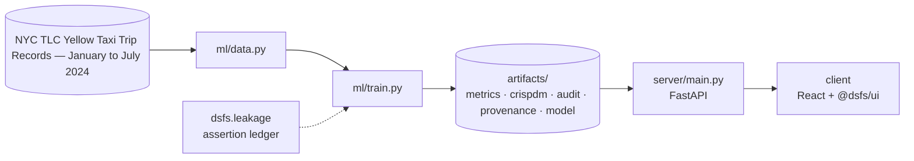

# Design document — MLOps & Governance

| | |
|---|---|
| Project | 13 · `13_mlops_governance` |
| Domain | Monitoring · retraining policy · explainability |
| Task | model monitoring and retraining policy |
| Ports | API 8013 · web 5113 |
| Dataset | NYC TLC yellow-cab trips, January to July 2024 |

## 1. Problem

Once project 01's taxi model is in service, how fast does it go stale, and which retraining policy keeps it accurate at the lowest cost?

Decide how often to retrain, using evidence from real months rather than a rule of thumb.

### Goals

- Decide how often to retrain, using evidence from real months rather than a rule of thumb.
- Measure how much the city actually changed between January and July.
- Guarantee no policy ever trains on the month it is judged on.
- Compare four retraining policies and two model-free baselines month by month.
- Decide which policy to run, and whether the drift alarm earns its place.
- Serve the model with its lineage, explanations, load profile and model card.

### Non-goals

- A production deployment. The registry, monitoring and load test run locally to show the decisions, not the infrastructure.
- Choosing a new model family each month. Model, features and hyperparameters are fixed so that only the retraining policy varies.

## 2. Architecture



Training is the only writer of results. The API serves the artifacts it wrote, and the client renders what the API returns, so a figure on screen always traces back to one run.

## 3. Components

| File | Lines | Responsibility |
|---|---:|---|
| `ml/data.py` | 84 | Project 13 -- seven months of real NYC taxi trips. |
| `ml/load_test.py` | 114 | Project 13 -- load-test the prediction API on this machine. |
| `ml/train.py` | 411 | Project 13 -- operate project 01's model through six months of real drift. |
| `server/inference.py` | 118 | Project 13 -- serving project 01's model in operation. |
| `server/main.py` | 82 | Project 13 -- FastAPI application. |
| `client/src/App.tsx` | 289 | Operations views for project 01's model: drift and retraining policy, explainable predictions, the model registry, load test and model card. Every figure is read from the… |
| `client/src/main.tsx` | 10 | — |

Everything else — the FastAPI factory, dataset cache, provenance, CRISP-DM report, metrics record, leakage auditor and the six shared UI components — comes from `platform/`.

## 4. API

| Method | Path | Purpose |
|---|---|---|
| POST | `/api/predict` | Trip duration with each feature's TreeSHAP contribution in minutes. |
| GET | `/api/zones` | The 263 taxi zones. |
| GET | `/api/drift` | Monthly drift against January and every policy's month-by-month error. |
| GET | `/api/registry` | Every model version fitted, with its training window and first month in service. |
| GET | `/api/load-test` | Latency and throughput measured against this API during training. |
| GET | `/api/model-card` | Intended use, data, evaluation, monitoring, capacity and limitations. |
| GET | `/api/health` | Liveness, version and whether artifacts are present. (platform) |
| GET | `/api/meta` | Project identity, ports and techniques. (platform) |
| GET | `/api/metrics` | The full run record: models, split, audit, environment. (platform) |
| GET | `/api/crispdm` | The six-phase CRISP-DM report written during training. (platform) |
| GET | `/api/audit` | Static leakage findings. (platform) |
| GET | `/api/provenance` | The dataset receipt. (platform) |
| GET | `/api/docs` | Interactive OpenAPI documentation. (platform) |

## 5. Data and evaluation

✅ **Real, third-party data**

| Field | Value |
|---|---|
| Dataset | NYC TLC Yellow Taxi Trip Records — January to July 2024 |
| Source | https://d37ci6vzurychx.cloudfront.net/trip-data/yellow_tripdata_2024-01.parquet |
| Licence | NYC Taxi & Limousine Commission open data (public domain) |
| Rows × columns (as downloaded) | 23,408,996 × 19 |
| SHA-256 | `c4d59da7bbc8abaeeeb1727947ee93d9891a71acb42854bd80db1571b2030510` |
| Months | [{'month': '2024-01', 'rows': 2964624, 'sha256': 'c4d59da7bbc8abaeeeb1727947ee93d9891a71acb42854bd80db1571b2030510'}, {'month': '2024-02', 'rows': 3007526, 'sha256': 'c76c43c18c6c6664080dd920baab4928988d5786a6b65980792ca7cd796f9f20'}, {'month': '2024-03', 'rows': 3582628, 'sha256': '2d4cdc8fb96726cdd3803b13b02d2e61e71d45720aff0ebc693a8bdd1f249823'}, {'month': '2024-04', 'rows': 3514289, 'sha256': 'ce37f736c7cf9e92164c850ef2b502a8f7bb590fc1804b6edbcb80293da01b89'}, {'month': '2024-05', 'rows': 3723833, 'sha256': '1974230be2b5a3ea92e47b5eb77f32dbf1de896d81ad8df4ab6faba52749ad23'}, {'month': '2024-06', 'rows': 3539193, 'sha256': '677cf14c8347f745b583f012fbdba072334c6c4efa17bfd6a64369f2ba30329c'}, {'month': '2024-07', 'rows': 3076903, 'sha256': 'af12d6b04daeb78550799ae99933d495b27d715b6dbb0fad9bb750a4537d3070'}] |
| Rows modelled per month | 150,000 |

**Split.** month-by-month, each policy trained only on finished months. 150,000 sampled trips per month.

## 6. Key decisions

- **Business understanding.** Policies, drift threshold and evaluation fixed before any month was scored.
- **Data understanding.** Seven real months cleaned with project 01's rules; drift measured on every monitored month.
- **Data preparation.** 14 registry entries verified against their serving month.
- **Modeling.** 6 strategies scored on 6 months.
- **Evaluation.** No critical findings; every policy judged only on months it had not seen.
- **Deployment.** Model, registry, drift history, load profile and model card persisted together.

## 7. Verification

- 3 of 3 runtime leakage assertions passed.
- Static source audit: 0 critical, 0 warnings.
- 12 screenshots captured by `scripts/capture_screenshots.py`, which fails if any view does not render its expected content.

| Assertion | Result | What it measured |
|---|---|---|
| `assert_temporal_split` | ✅ passed | Last training timestamp 2024-01-30 23:07:53 precedes first test timestamp 2024-02-01 00:00:03 by 1 days 00:52:10; no embargo required. |
| `assert_no_target_leak` | ✅ passed | 22 numeric features correlated against the target; strongest was zp_median_distance at |r|=0.7821 (threshold 0.995). |
| `assert_policies_train_only_on_finished_months` | ✅ passed | 14 model fits checked; 0 used a month at or after the month they served. |

Recorded by the assertion ledger while training ran; generated from `artifacts/metrics.json`.

## 8. Risks

- Each month is a 150,000-trip sample, not the full month; per-month RMSE carries sampling noise.
- Six monitored months is a short history for judging a policy, and spring 2024 may not resemble other years.
- The load test ran on one development machine with one server worker, so its figures describe that setup only.
- TreeSHAP contributions explain this model's arithmetic, not the causes of a trip's duration.

## 9. Reproducibility

Last trained at commit `ada6490` on Python 3.11.6.

```bash
python ml/train.py
python -m uvicorn main:app --app-dir server --port 8013
npm run dev -w 13_mlops_governance/client
```

---

*Generated by `scripts/generate_docs.py`.*
