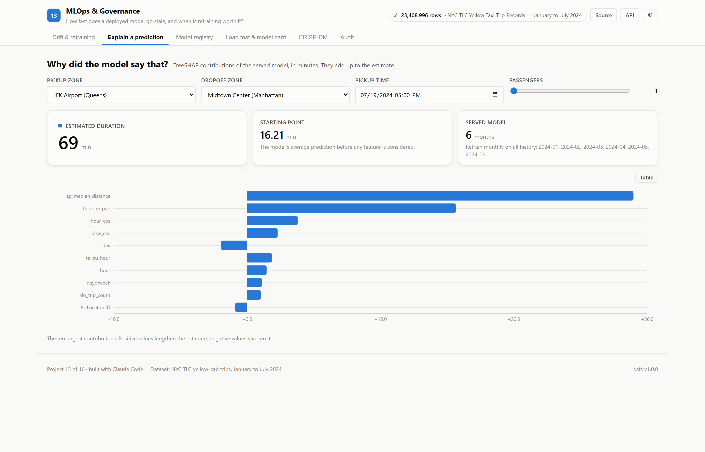
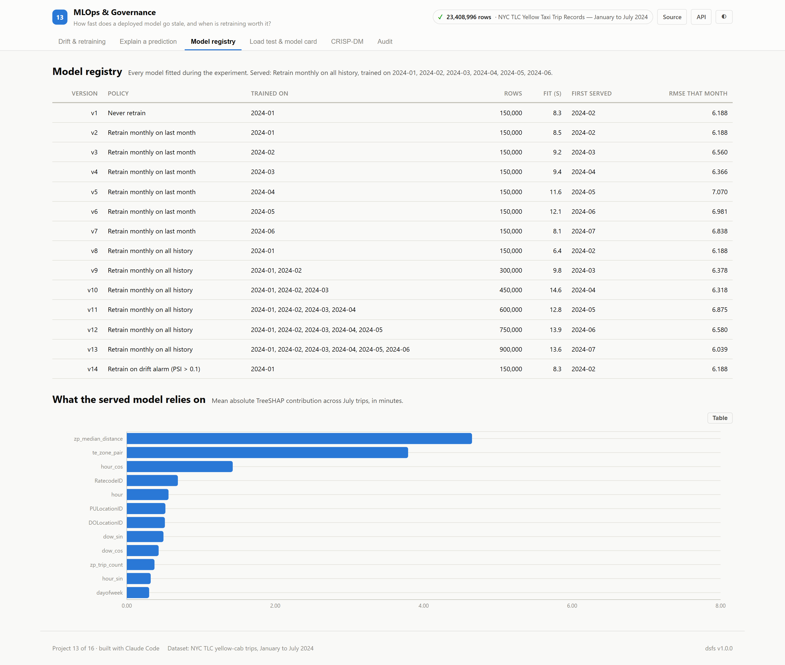
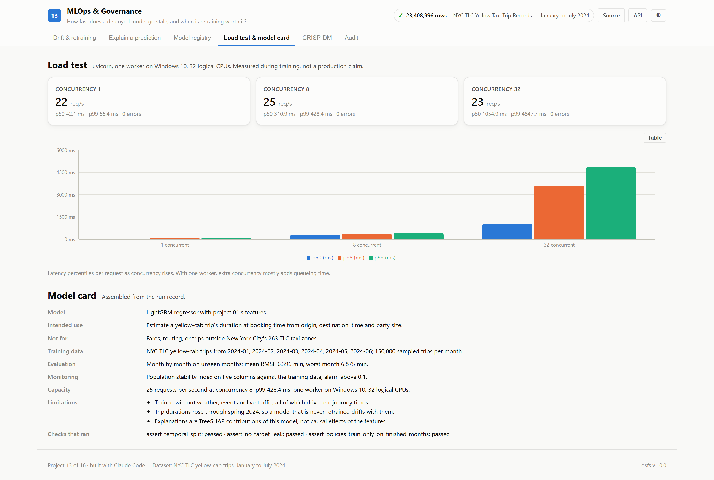
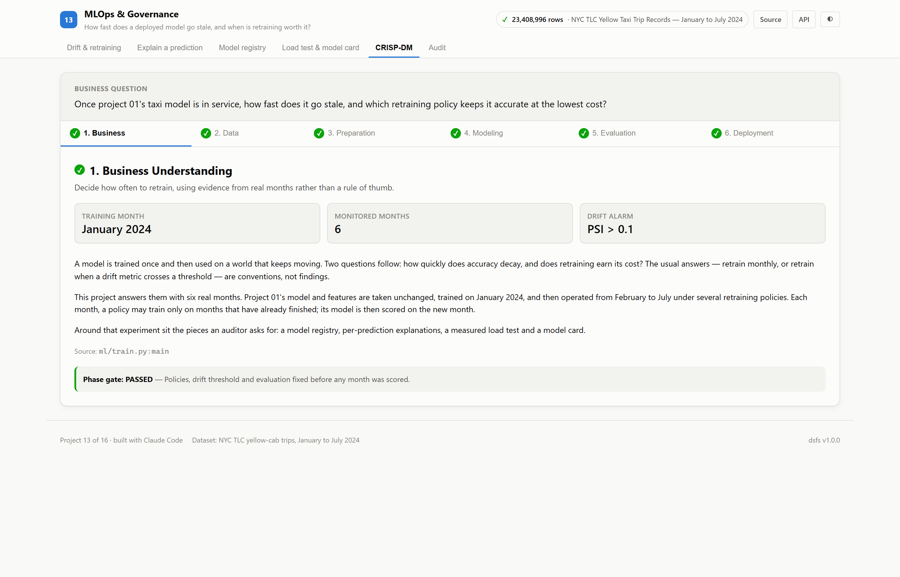
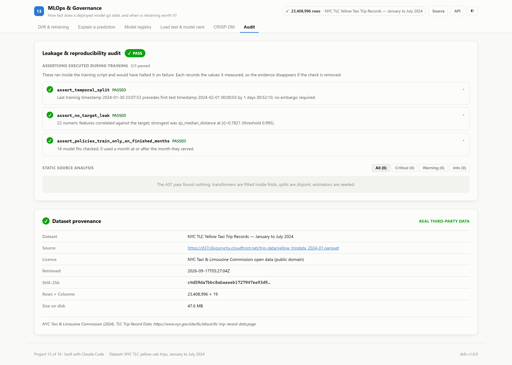

# 13 · MLOps & Governance

**A trip-duration model is deployed in January. How fast does it go stale, would
drift monitoring notice, and is retraining worth it?**

Built on the real NYC TLC yellow-cab trip records for January to July 2024:
23,408,996 trips across 7 monthly files. It reuses
[project 01](../01_nyc_taxi_prediction)'s cleaning and features unchanged, so the
only thing that varies is how the model is kept up to date.

| | |
|---|---|
| Task | Retraining policy evaluation, drift monitoring, explanation, load testing |
| Dataset | [NYC TLC trip records](https://www.nyc.gov/site/tlc/about/tlc-trip-record-data.page) · public |
| Evaluation | Month by month, February to July; each strategy trains only on months that have finished |
| Winner | **Retrain monthly on all history**, 9.3% lower mean RMSE than never retraining |
| Ports | API `8013` · Web `5113` |

---

## The decision that defines this project

A retraining policy is judged the way a model is: **on months it has not seen.**
Before each month is scored, every strategy may only train on months that have
already finished. An assertion checks this for all 14 models fitted,
and halts training otherwise.

Four policies share one model, one feature set and one set of hyperparameters,
and two baselines sit beside them:

- **Never retrain** — the January model serves all six months.
- **Retrain monthly on last month** — only the most recent month.
- **Retrain monthly on all history** — everything since January.
- **Retrain on drift alarm** — retrain only when the population stability index
  (PSI) of any monitored column exceeds 0.1.

---

## Results

<!-- dsfs:leaderboard -->
| # | Strategy | Mean RMSE (min) | Worst month | July | Models fitted | Within 5 min |
|---|---|---|---|---|---|---|
| 1 | **Retrain monthly on all history** 🏆 | 6.396 | 6.875 | 6.039 | 6 | 77.0% |
| 2 | Retrain monthly on last month | 6.667 | 7.070 | 6.838 | 6 | 75.3% |
| 3 | Never retrain | 7.054 | 7.858 | 6.878 | 1 | 75.4% |
| 4 | Retrain on drift alarm (PSI > 0.1) | 7.054 | 7.858 | 6.878 | 1 | 75.4% |
| 5 | Route median lookup, refreshed monthly *(baseline)* | 8.322 | 9.171 | 7.733 | 0 | 71.0% |
| 6 | January median, never refreshed *(baseline)* | 14.051 | 15.396 | 14.078 | 0 | 46.1% |

Ranked by mean rmse (min) (lower is better). Split: month-by-month, each policy trained only on finished months; 900,000 evaluation rows. Generated from `artifacts/metrics.json`.
<!-- /dsfs:leaderboard -->

**Retraining pays, and more history beats more recency.** Retraining monthly on
all history had lower RMSE than never retraining in 5 of
5 months after February's shared starting model, and lower than
retraining on the last month alone in 5 of 5. By
July it scored 6.039 minutes against 6.878 for the
January model. No significance test was run on these monthly differences, and
each month is a 150,000-trip sample.

**The drift alarm never fired, and never retraining was the worse choice.** The
largest PSI the alarm saw was 0.038, well under its 0.1
threshold, so it made the same decisions as never retraining (0 retrains)
and scored identically. The largest PSI of any month against January was
0.038. Yet the median trip lengthened from
11.73 minutes in 2024-01 to
13.45 in 2024-05, and the January model's error
peaked in 2024-05 at 7.858. A shift that
small in distribution was still large enough to cost accuracy. **Monitoring
inputs is not a substitute for measuring errors once the true durations arrive.**

**The learned models are far ahead of the lookups.** A route median refreshed
monthly scores 8.322; a single January median scores
14.051.

---

## Explanations

Every prediction the API serves comes with TreeSHAP contributions in minutes,
which add up exactly to the estimate. Across July trips, the served model leans
most on `zp_median_distance` (mean 4.65 minutes)
and `te_zone_pair` (3.79), then
`hour_cos` (1.43). These explain the
model's arithmetic, not what causes a trip to take longer.

## Load test

Run during training against the real API with one uvicorn worker on
Windows 10, 32 logical CPUs; 600 requests per level after
50 warm-up requests. Each request computes a
prediction and its explanation.

| Concurrency | Throughput | p50 | p95 | p99 | Errors |
|---|---|---|---|---|---|
| 1 | 21.7 req/s | 42 ms | 64 ms | 66 ms | 0 |
| 8 | 25.3 req/s | 311 ms | 386 ms | 428 ms | 0 |
| 32 | 23.1 req/s | 1055 ms | 3611 ms | 4848 ms | 0 |

Throughput stays between 21.7 and
25.3 requests per second at every
level, so extra clients only wait longer: p99 rises from 66 ms
to 4,848 ms. More capacity would need more workers, not more
concurrency.

## Model registry and model card

All 14 models fitted during the experiment are recorded with the months
they were trained on, their row counts, fit times and the error in the month
each was first served. The model card is assembled from the run record rather
than written by hand, so its figures cannot drift from the results.

---

## Screenshot tour

### Drift & retraining
The strategy leaderboard, error month by month, PSI against January and every
alarm decision.


### Explain a prediction · Model registry · Load test & model card




### CRISP-DM · Audit



> Dark variants of every view are in [`screenshots/`](./screenshots).

---

## Assertions that ran

<!-- dsfs:assertions -->
| Assertion | Result | What it measured |
|---|---|---|
| `assert_temporal_split` | ✅ passed | Last training timestamp 2024-01-30 23:07:53 precedes first test timestamp 2024-02-01 00:00:03 by 1 days 00:52:10; no embargo required. |
| `assert_no_target_leak` | ✅ passed | 22 numeric features correlated against the target; strongest was zp_median_distance at |r|=0.7821 (threshold 0.995). |
| `assert_policies_train_only_on_finished_months` | ✅ passed | 14 model fits checked; 0 used a month at or after the month they served. |

Recorded by the assertion ledger while training ran; generated from `artifacts/metrics.json`.
<!-- /dsfs:assertions -->

---

## Running it

```bash
pip install -e ../platform
npm install

python ml/train.py     # downloads seven months of trips on first run; about five minutes
python -m uvicorn main:app --app-dir server --port 8013
npm run dev -w 13_mlops_governance/client     # http://localhost:5113
```

Generated documents: [paper](./paper.md) · [abstract](./abstract.md) ·
[article](./article.md) · [design doc](./DESIGN_DOC.md) ·
[audit report](./audit_report.md) · [reproduction skill](./skills/reproduce/SKILL.md)
