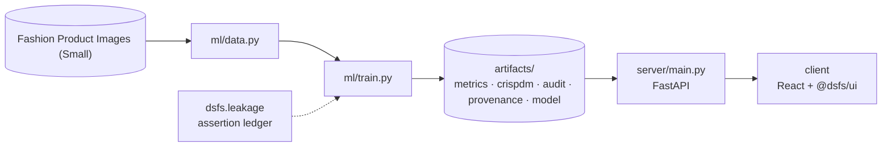

# Design document — Multimodal AutoML

| | |
|---|---|
| Project | 14 · `14_multimodal_automl` |
| Domain | Multimodal classification · CLIP · fusion |
| Task | 45-class product classification from image, text and catalogue fields |
| Ports | API 8014 · web 5114 |
| Dataset | Fashion Product Images (Small), 44,072 products |

## 1. Problem

Can a catalogue classify products by type from their photo, name and attributes, and does combining them beat the best single source?

Measure what each modality contributes to classifying products, and whether fusion pays.

### Goals

- Measure what each modality contributes to classifying products, and whether fusion pays.
- Find what in the catalogue would flatter a model.
- Split so siblings never straddle train and test, and build each modality's features.
- Model each modality alone, then fuse them late, early and with AutoGluon.
- Separate what fusion adds from what the name gives away.
- Serve the gallery, per-modality predictions and text search.

### Non-goals

- Fine-tuning a vision or language model. CLIP is used frozen, as a feature extractor.
- Classifying rare article types. Types with fewer than 150 products are left out.

## 2. Architecture



Training is the only writer of results. The API serves the artifacts it wrote, and the client renders what the API returns, so a figure on screen always traces back to one run.

## 3. Components

| File | Lines | Responsibility |
|---|---:|---|
| `ml/autogluon_run.py` | 55 | ../.venv-automl/Scripts/python ml/autogluon_run.py |
| `ml/data.py` | 96 | Project 14 -- fashion products: images, names and catalogue attributes. |
| `ml/embed.py` | 69 | Project 14 -- CLIP embeddings for every product image and name. |
| `ml/train.py` | 395 | Project 14 -- what does each modality add, and is fusing them worth it? |
| `server/inference.py` | 158 | Project 14 -- serving the multimodal results. |
| `server/main.py` | 80 | Project 14 -- FastAPI application. |
| `client/src/App.tsx` | 195 | Project 14 client -- multimodal product classification. |
| `client/src/Explorer.tsx` | 183 | Project-14-specific views: the product gallery, a product's predictions, text search over photos and live name classification. Each draws one API response. |
| `client/src/main.tsx` | 10 | — |

Everything else — the FastAPI factory, dataset cache, provenance, CRISP-DM report, metrics record, leakage auditor and the six shared UI components — comes from `platform/`.

## 4. API

| Method | Path | Purpose |
|---|---|---|
| GET | `/api/results` | Leak measurements, bootstrap verdicts, per-class gains, confusions and search quality. |
| GET | `/api/gallery` | Test products, with the image model's and the fusion model's predictions. |
| GET | `/api/products/{product_id}` | One test product with the top three predictions of each model. |
| GET | `/api/images/{product_id}` |  |
| POST | `/api/classify-name` | Classify a typed product name with both text models, with and without label words. |
| GET | `/api/search` | Find test products whose photos best match a description, using CLIP. |
| GET | `/api/health` | Liveness, version and whether artifacts are present. (platform) |
| GET | `/api/meta` | Project identity, ports and techniques. (platform) |
| GET | `/api/metrics` | The full run record: models, split, audit, environment. (platform) |
| GET | `/api/crispdm` | The six-phase CRISP-DM report written during training. (platform) |
| GET | `/api/audit` | Static leakage findings. (platform) |
| GET | `/api/provenance` | The dataset receipt. (platform) |
| GET | `/api/docs` | Interactive OpenAPI documentation. (platform) |

## 5. Data and evaluation

✅ **Real, third-party data**

| Field | Value |
|---|---|
| Dataset | Fashion Product Images (Small) |
| Source | https://huggingface.co/datasets/ashraq/fashion-product-images-small/resolve/3859c76db2f6f3d3b9a3863345e3ccdbff75879d/data/train-00000-of-00002-6cff4c59f91661c3.parquet |
| Licence | MIT, as declared by the Kaggle dataset; product photographs originate from a retailer's catalogue |
| Rows × columns (as downloaded) | 44,072 × 10 |
| SHA-256 | `0f9b4042c6eea3c77aa0794630c956d1985de791c365abdb332f9d9cfa78d00a` |

**Split.** grouped by display name: 70% train, 15% validation, 15% test. 

## 6. Key decisions

- **Business understanding.** Target, modalities and the leak to be measured fixed before modelling.
- **Data understanding.** Label-in-name rate and duplicate names measured.
- **Data preparation.** Executed assertions: no shared names across splits, every class tested, hierarchy fields excluded.
- **Modeling.** 10 contestants scored on the same test products.
- **Evaluation.** Paired bootstrap against the best single modality; leaks measured, not assumed.
- **Deployment.** Test-set predictions and CLIP search served from the training run's artifacts.

## 7. Verification

- 3 of 3 runtime leakage assertions passed.
- Static source audit: 0 critical, 1 warnings.
- 16 screenshots captured by `scripts/capture_screenshots.py`, which fails if any view does not render its expected content.

| Assertion | Result | What it measured |
|---|---|---|
| `assert_no_name_in_two_splits` | ✅ passed | 28,510 training, 6,111 validation and 6,254 test products grouped by display name; 0 names appear in more than one split. |
| `assert_every_class_in_test` | ✅ passed | All 45 article types have test products; missing: []. |
| `assert_hierarchy_fields_excluded` | ✅ passed | Catalogue features ['gender', 'baseColour', 'season', 'year', 'usage']; the coarser category levels, which determine most of the article type, are excluded. |

Recorded by the assertion ledger while training ran; generated from `artifacts/metrics.json`.

## 8. Risks

- The product photographs come from a retailer's catalogue; the MIT licence is the Kaggle dataset author's and may not cover the images themselves.
- Catalogue labels were entered by people and some are inconsistent, such as shirts labelled as tops.
- Grouping by exact display name does not catch near-identical names, so some siblings may still straddle the split.
- Fusion weights and regularisation were chosen on one validation split; a different split could favour different settings.

## 9. Reproducibility

Last trained at commit `9922732` on Python 3.11.6.

```bash
python ml/train.py
../.venv-automl/Scripts/python ml/autogluon_run.py
python ml/train.py
python -m uvicorn main:app --app-dir server --port 8014
npm run dev -w 14_multimodal_automl/client
```

---

*Generated by `scripts/generate_docs.py`.*
