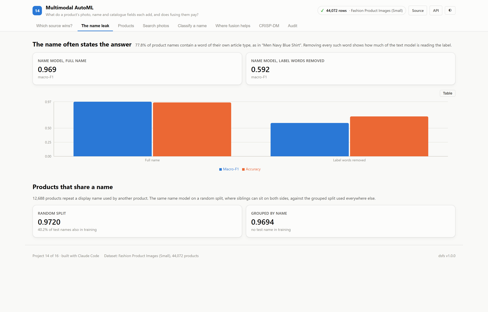
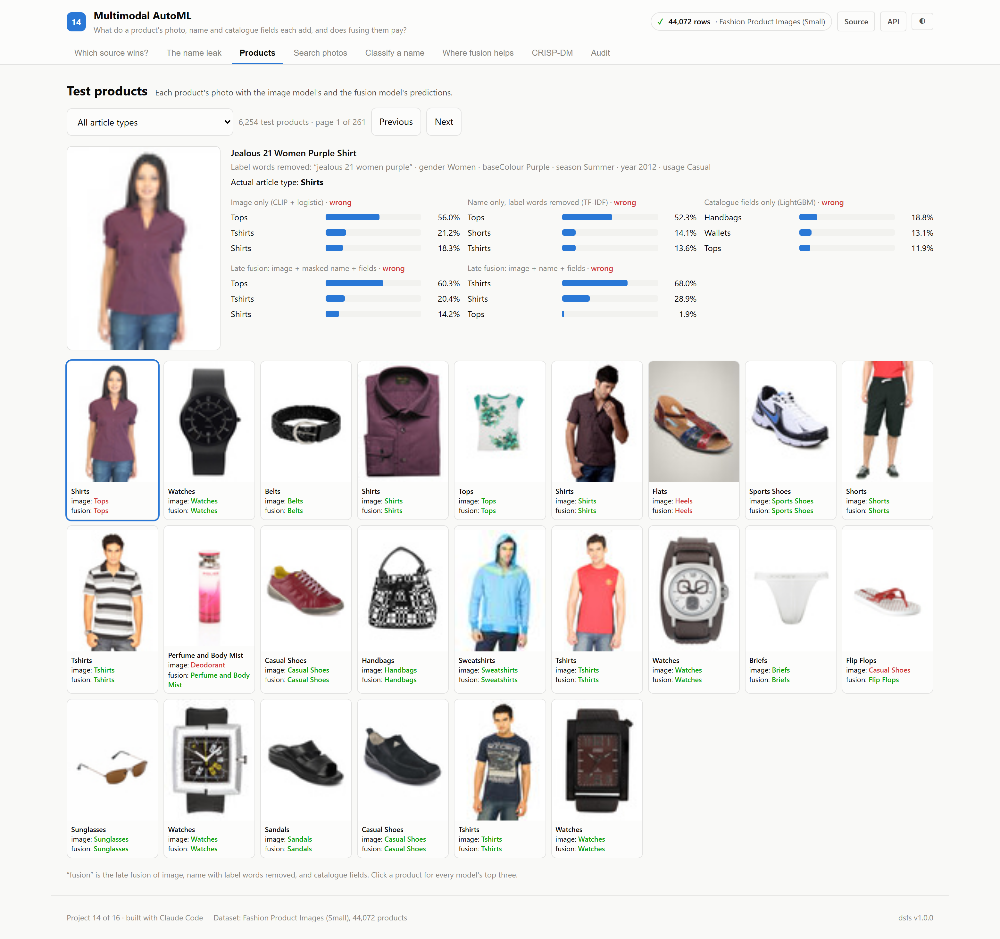
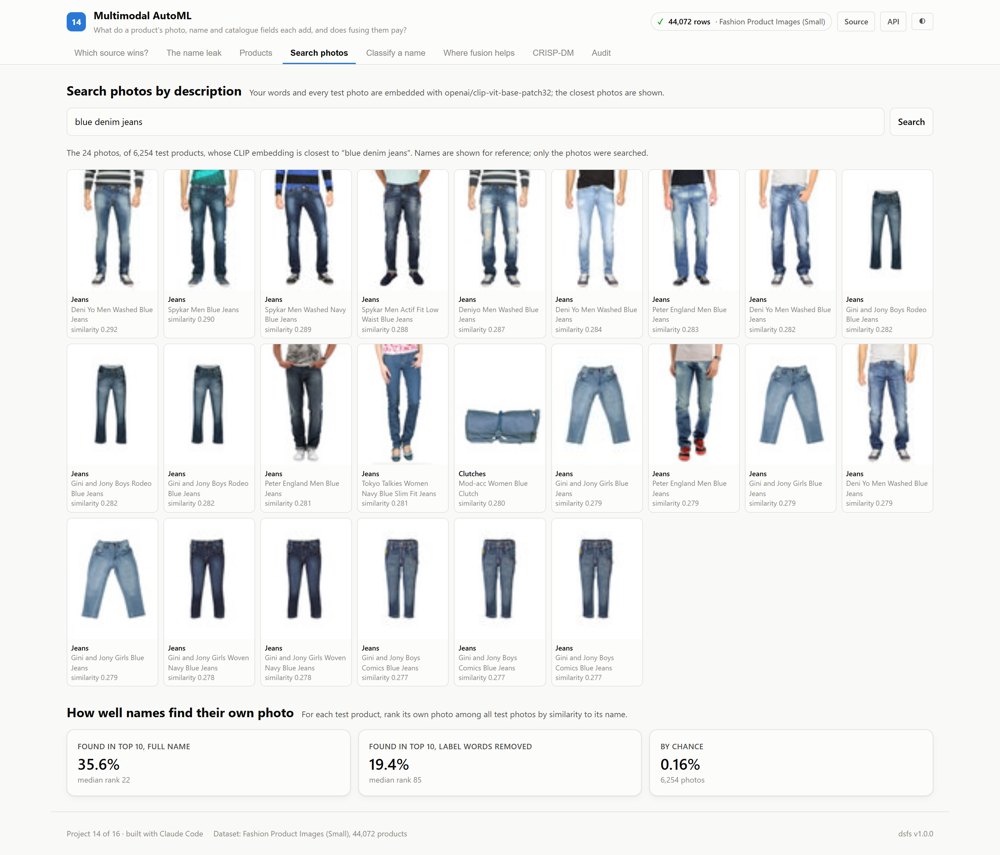
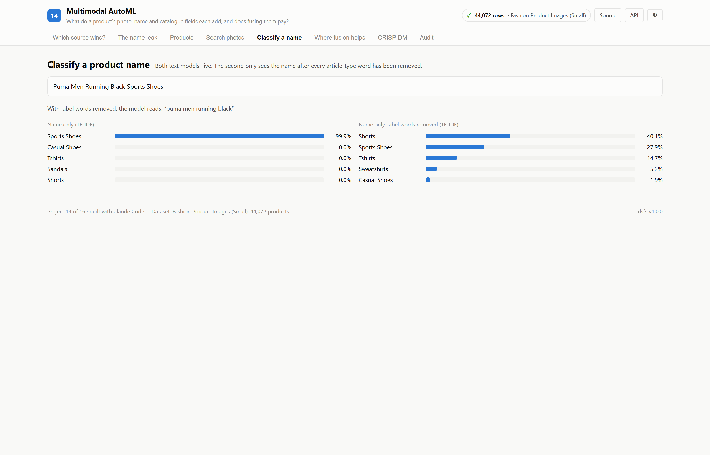
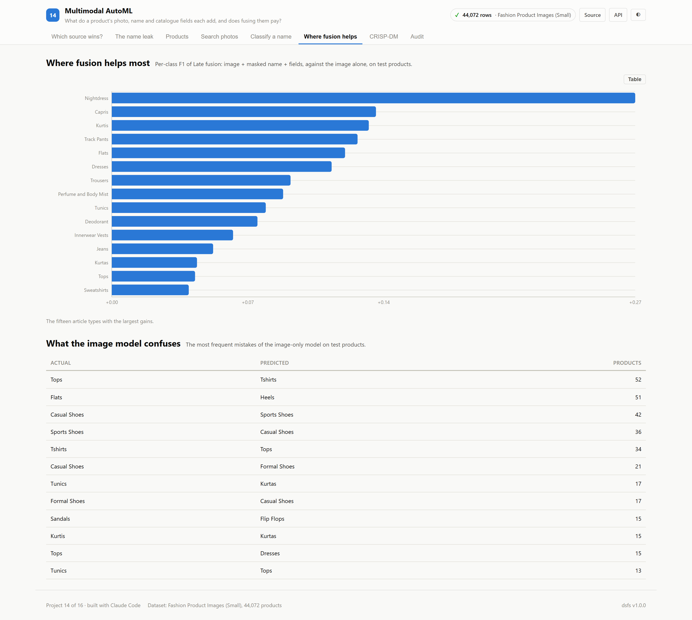

# 14 · Multimodal AutoML

**A catalogue has a photo, a name and a few fields for every product. What does each
of them tell a model about the product's type — and does combining them beat the
best single source, once the answer written into the name is taken away?**

Built on the real Fashion Product Images (Small) dataset: 44,072 products from
a fashion retailer's catalogue, each with a photograph, a display name and
catalogue fields. The 45 article types with at least 150 products are used
(40,875 products).

| | |
|---|---|
| Task | 45-class article-type classification (shirts, watches, sports shoes…) |
| Dataset | [Kaggle: Fashion Product Images (Small)](https://www.kaggle.com/datasets/paramaggarwal/fashion-product-images-small) · MIT (see the note on images below) |
| Modalities | Photo (CLIP), display name (TF-IDF), catalogue fields (LightGBM) |
| Split | Grouped by display name: 28,510 train · 6,111 validation · 6,254 test |
| Ports | API `8014` · Web `5114` |

---

## The decision that defines this project

**The name often contains the answer.** 77.8% of display names include a word
of their own article type — "Turtle Check Men Navy Blue **Shirt**" is labelled Shirts.
A text model that learns to read that word looks superb and has learned little
else. So the name is modelled twice: as written, and with every word of every
article-type name removed. **Fusion is judged with the masked name.**

**Siblings share names.** 12,688 products repeat a name used by another product.
The split keeps every product
with the same name on one side; an assertion confirms that no name appears in two
of the train, validation and test sets.

---

## Results

<!-- dsfs:leaderboard -->
| # | Contestant | Macro-F1 | Accuracy | Top-3 accuracy |
|---|---|---|---|---|
| 1 | **Late fusion: image + name + fields** 🏆 | 0.9740 | 97.5% | 99.9% |
| 2 | Name only (TF-IDF) | 0.9694 | 95.6% | 99.7% |
| 3 | Early fusion: image + name + fields | 0.9554 | 96.9% | 99.7% |
| 4 | AutoGluon on fused features | 0.9465 | 96.5% | 99.6% |
| 5 | Late fusion: image + masked name + fields | 0.8585 | 91.3% | 99.4% |
| 6 | Image only (CLIP + logistic) | 0.8183 | 88.9% | 98.7% |
| 7 | Name only, label words removed (TF-IDF) | 0.5922 | 70.8% | 92.0% |
| 8 | CLIP zero-shot, image vs class names *(baseline)* | 0.5283 | 53.6% | 76.6% |
| 9 | Catalogue fields only (LightGBM) | 0.3023 | 49.2% | 78.1% |
| 10 | Most common article type *(baseline)* | 0.0060 | 15.5% | 31.3% |

Ranked by macro-f1 (higher is better). Split: grouped by display name: 70% train, 15% validation, 15% test; 6,254 evaluation rows. Generated from `artifacts/metrics.json`.
<!-- /dsfs:leaderboard -->

**The name leak is large.** The name model's macro-F1 is 0.969 with the full name
and **0.592** once label words are removed. The same fusion scores
0.974 with the full name and 0.859 with the masked name, so the
top of the leaderboard is measuring, in large part, whether the model can read
the label.

**The duplicate-name leak is small.** On a random split, where
40.2% of test names also occur in training, the same name
model scores 0.9720, against 0.9694 on the grouped split.
Measured, it barely matters here; the grouped split is kept anyway.

**Honest fusion pays.** The image alone reaches macro-F1 0.818. Fusing image, masked
name and catalogue fields reaches **0.859**. Against the image alone:
+2.5 points of accuracy (95% interval +2.0 to +3.0), **better**.

**AutoGluon** on the same fused features (4 models in 897 seconds, best
WeightedEnsemble_L3) reaches macro-F1 0.946; against the image alone,
+7.6 points of accuracy (95% interval +6.8 to +8.4), **better**. Its features include the full name's SVD, so it
belongs with the leak-affected contestants. Two differences from the others: with
45 classes and 640 features each model is slow to fit, so the time limit allowed
only 4; and AutoGluon learned from the training and validation products
together, where the other models used validation only to choose their settings.

**Pretrained knowledge alone.** CLIP matching each photo to "a photo of <article type>",
with no training on this catalogue, scores macro-F1 0.528. The catalogue fields
alone score 0.302.

### Where fusion helps

The article types where fusing the masked name and fields most improved on the
image alone:

| Article type | Test products | F1, image only | F1, fused | Gain |
|---|---|---|---|---|
| Nightdress | 13 | 0.600 | 0.870 | +0.270 |
| Capris | 27 | 0.531 | 0.667 | +0.136 |
| Kurtis | 27 | 0.118 | 0.250 | +0.132 |
| Track Pants | 50 | 0.804 | 0.931 | +0.127 |
| Flats | 86 | 0.273 | 0.393 | +0.120 |

Fusion was worse for Belts (-0.004), Backpacks (-0.000).

The image model's most frequent confusions are between visually similar types:
Tops taken for Tshirts (52), Flats taken for Heels (51), Casual Shoes taken for Sports Shoes (42), Sports Shoes taken for Casual Shoes (36).

### Searching photos by description

Each test product's name was used to search all 6,254 test photos with CLIP.
Its own photo appeared in the top 10 for 35.6% of products with the full
name and 19.4% with label words removed, against
0.16% by chance. The target is one exact photo among thousands of products,
many of the same type and colour.

---

## A note on the images

The Kaggle dataset is published under the MIT licence. The photographs originate
from a retailer's product catalogue, and that licence is the dataset author's; it
may not extend to the images themselves. They are used here for study. The app
reads them from the downloaded dataset cache; the repository itself contains only
the screenshots, which show some of them.

## Screenshot tour








> CRISP-DM, audit and dark variants of every view are in [`screenshots/`](./screenshots).

---

## Assertions that ran

<!-- dsfs:assertions -->
| Assertion | Result | What it measured |
|---|---|---|
| `assert_no_name_in_two_splits` | ✅ passed | 28,510 training, 6,111 validation and 6,254 test products grouped by display name; 0 names appear in more than one split. |
| `assert_every_class_in_test` | ✅ passed | All 45 article types have test products; missing: []. |
| `assert_hierarchy_fields_excluded` | ✅ passed | Catalogue features ['gender', 'baseColour', 'season', 'year', 'usage']; the coarser category levels, which determine most of the article type, are excluded. |

Recorded by the assertion ledger while training ran; generated from `artifacts/metrics.json`.
<!-- /dsfs:assertions -->

---

## Running it

```bash
pip install -e ../platform
pip install torch --index-url https://download.pytorch.org/whl/cu128   # or the CPU build
pip install transformers
npm install

python ml/train.py     # downloads 271 MB and embeds 44,072 images with CLIP; a few minutes on a GPU
../.venv-automl/Scripts/python ml/autogluon_run.py     # optional, about 15 minutes; see project 07
python ml/train.py     # again, to include AutoGluon
python -m uvicorn main:app --app-dir server --port 8014
npm run dev -w 14_multimodal_automl/client     # http://localhost:5114
```

Generated documents: [paper](./paper.md) · [abstract](./abstract.md) ·
[article](./article.md) · [design doc](./DESIGN_DOC.md) ·
[audit report](./audit_report.md) · [reproduction skill](./skills/reproduce/SKILL.md)
