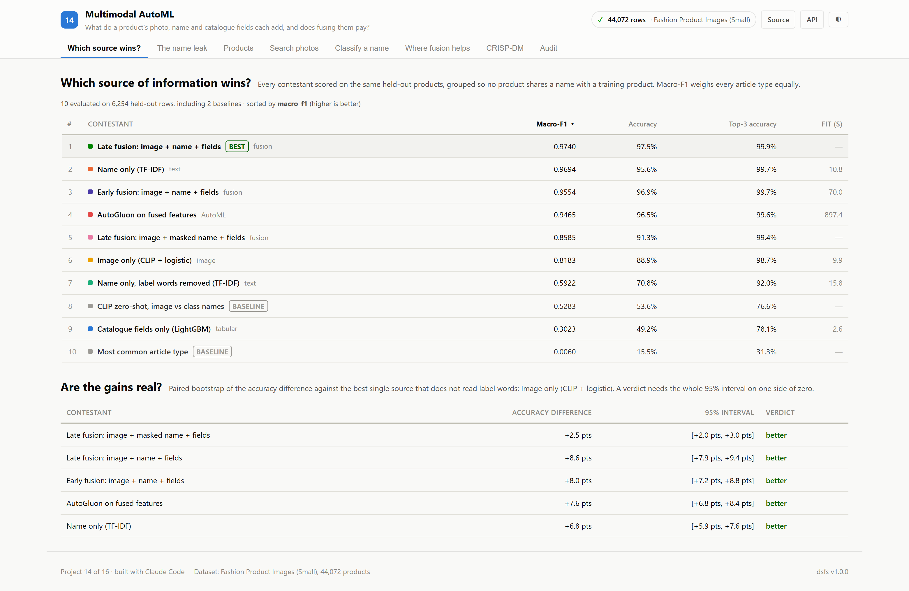

# What do a product's photo, name and catalogue fields each add, and does fusing them pay?

*Multimodal AutoML — project 14 of a sixteen-project data science portfolio built with an AI coding assistant, on real data.*

## The question

Can a catalogue classify products by type from their photo, name and attributes, and does combining them beat the best single source?

A retailer receives products from many suppliers, and each has to be filed under the right article type. There are three kinds of evidence: a photograph, a free-text name and a few catalogue fields. Multimodal AutoML promises to combine them automatically. This project measures each source alone, fuses them several ways, and asks whether fusion beats the strongest single source by more than chance -- and how much of the text's apparent strength is simply the label written in the name.

## The data

44,072 products in 141 article types. The 45 types with at least 150 products are kept: 40,875 products.

**The name often states the answer.** 77.8% of names contain a word of their own article type. **Siblings share names.** 12,688 products repeat a display name already used by another.

## What won

**Late fusion: image + name + fields**, at 0.9740 on macro-f1, against 0.5283 for the best baseline, CLIP zero-shot, image vs class names.

| # | Contestant | Macro-F1 | Accuracy | Top-3 accuracy |
|---|---|---|---|---|
| 1 | **Late fusion: image + name + fields** 🏆 | 0.9740 | 97.5% | 99.9% |
| 2 | Name only (TF-IDF) | 0.9694 | 95.6% | 99.7% |
| 3 | Early fusion: image + name + fields | 0.9554 | 96.9% | 99.7% |
| 4 | AutoGluon on fused features | 0.9465 | 96.5% | 99.6% |
| 5 | Late fusion: image + masked name + fields | 0.8585 | 91.3% | 99.4% |
| 6 | Image only (CLIP + logistic) | 0.8183 | 88.9% | 98.7% |
| 7 | Name only, label words removed (TF-IDF) | 0.5922 | 70.8% | 92.0% |
| 8 | CLIP zero-shot, image vs class names *(baseline)* | 0.5283 | 53.6% | 76.6% |
| 9 | Catalogue fields only (LightGBM) | 0.3023 | 49.2% | 78.1% |
| 10 | Most common article type *(baseline)* | 0.0060 | 15.5% | 31.3% |

Ranked by macro-f1 (higher is better). Split: grouped by display name: 70% train, 15% validation, 15% test; 6,254 evaluation rows. Generated from `artifacts/metrics.json`.

**Late fusion: image + name + fields** has the highest macro-F1, 0.9740. The image alone reaches 0.8183; CLIP zero-shot, with no training, 0.5283.

**The name leak.** The name model's macro-F1 falls from 0.9694 to 0.5922 when label words are removed. On a random split, where 40.2% of test names also occur in training, it would have reported 0.9720.

**Does fusion pay?** Against the best honest single modality (Image only (CLIP + logistic)), late fusion of image, masked name and fields changes accuracy by +0.0249 (95% interval +0.0198 to +0.0301): **better**.

## What I took away

- A text field that contains the label can make a model look almost perfect; masking the label words is a cheap way to see what is left.
- With the label words masked, fusing the name and catalogue fields with the photo was significantly better than the photo alone.
- Grouping the split by shared names changed the measured score very little here, which is only knowable by measuring it.
- A frozen CLIP model gave a strong image classifier with a logistic regression on top, and a usable zero-shot one with none.
- Under a fifteen-minute limit, AutoGluon on fused features did not beat a simple late fusion whose weights were chosen on validation.

## How it is built

The backend is FastAPI on port 8014 and the front end is React on port 5114. Most of the interface — the metrics panel, tournament table, CRISP-DM walkthrough, audit panel and charts — is shared across the portfolio and driven entirely by the training run's artifacts, so nothing on screen is typed by hand.

Code: [github.com/aniket-alt/ai-coding-assistant](https://github.com/aniket-alt/ai-coding-assistant/tree/main/14_multimodal_automl)

---

*Figures in this article are generated from the project's artifacts.*
