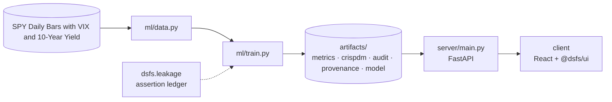

# Design document — SPY Probabilistic Forecasting

| | |
|---|---|
| Project | 15 · `15_spy_forecasting` |
| Domain | Probabilistic time series · walk-forward backtesting |
| Task | probabilistic time series forecasting |
| Ports | API 8015 · web 5115 |
| Dataset | SPY daily bars with VIX and 10-year yield, 2015-2026 (2,931 days) |

## 1. Problem

How much can tomorrow's S&P 500 move actually be predicted, and how wide should the honest uncertainty band be?

Produce a calibrated distribution for the next day's return, and establish honestly whether it beats doing nothing.

### Goals

- Produce a calibrated distribution for the next day's return, and establish honestly whether it beats doing nothing.
- Characterise the return series before assuming anything about it.
- Build features that use only the past, and prove it rather than assert it.
- Compare feature-driven models against baselines that assume returns are unpredictable.
- State plainly how much signal there is, and resist the temptation to overclaim.
- Serve a distribution, not a number.

### Non-goals

- A trading system. The backtest exists to calibrate expectations, not to recommend positions.
- Intraday or multi-asset forecasting.

## 2. Architecture



Training is the only writer of results. The API serves the artifacts it wrote, and the client renders what the API returns, so a figure on screen always traces back to one run.

## 3. Components

| File | Lines | Responsibility |
|---|---:|---|
| `ml/data.py` | 175 | Project 15 -- SPY forecasting: market data acquisition. |
| `ml/features.py` | 139 | Every feature at row t is computed from information available at the close of day t, and the target is the return of day t+1. That single rule is the whole discipline of this… |
| `ml/train.py` | 587 | Project 15 -- walk-forward forecasting tournament. |
| `server/inference.py` | 90 | Everything served here was computed during the walk-forward run and stored in metrics.json. Nothing is recalculated at request time, so the forecast band a visitor sees is the… |
| `server/main.py` | 74 | Project 15 -- FastAPI application. |
| `client/src/App.tsx` | 354 | ForecastFan is the only project-specific view. This project is the hardest test of the shared components: the primary metric is lower-is-better, the "models" include pure… |
| `client/src/ForecastFan.tsx` | 180 | Shows recent SPY closes and the next-period quantile band, in price terms. |
| `client/src/main.tsx` | 10 | — |

Everything else — the FastAPI factory, dataset cache, provenance, CRISP-DM report, metrics record, leakage auditor and the six shared UI components — comes from `platform/`.

## 4. API

| Method | Path | Purpose |
|---|---|---|
| GET | `/api/forecast` | Next-period quantile band in return and price terms. |
| GET | `/api/prices` | Recent closes, for the forecast chart. |
| GET | `/api/backtest` | Walk-forward equity curves against buy-and-hold. |
| GET | `/api/calibration` | Interval coverage and significance versus a random walk. |
| GET | `/api/dataset` | Distributional facts and the lookahead verification result. |
| GET | `/api/health` | Liveness, version and whether artifacts are present. (platform) |
| GET | `/api/meta` | Project identity, ports and techniques. (platform) |
| GET | `/api/metrics` | The full run record: models, split, audit, environment. (platform) |
| GET | `/api/crispdm` | The six-phase CRISP-DM report written during training. (platform) |
| GET | `/api/audit` | Static leakage findings. (platform) |
| GET | `/api/provenance` | The dataset receipt. (platform) |
| GET | `/api/docs` | Interactive OpenAPI documentation. (platform) |

## 5. Data and evaluation

✅ **Real, third-party data**

| Field | Value |
|---|---|
| Dataset | SPY Daily Bars with VIX and 10-Year Yield |
| Source | https://finance.yahoo.com/quote/SPY/history |
| Licence | Yahoo Finance terms of use — personal and research use |
| Rows × columns (as downloaded) | 2,931 × 7 |
| SHA-256 | `1e37e3dd2c6da9f77b12695e298b45196868bb004833daa20cbf95679d3309ab` |

**Split.** walk-forward, 32 quarterly refits, purged. Expanding window; every forecast is out-of-sample by construction.

## 6. Key decisions

- **Business understanding.** Target, loss function and calibration criterion fixed before modelling.
- **Data understanding.** Distributional properties established; normality rejected before modelling.
- **Data preparation.** Lookahead check passed over 780 recomputed values.
- **Modeling.** 6 models across 32 walk-forward folds.
- **Evaluation.** No critical findings; every forecast is out-of-sample by construction.
- **Deployment.** Forecasts, calibration and the buy-and-hold comparison all served.

## 7. Verification

- 2 of 2 runtime leakage assertions passed.
- Static source audit: 0 critical, 0 warnings.
- 12 screenshots captured by `scripts/capture_screenshots.py`, which fails if any view does not render its expected content.

| Assertion | Result | What it measured |
|---|---|---|
| `assert_no_lookahead` | ✅ passed | 780 feature values across 30 dates recomputed on truncated history; 0 differed from the full-history value. |
| `assert_no_target_leak` | ✅ passed | 26 numeric features correlated against the target; strongest was ret_lag2 at |r|=0.0909 (threshold 0.995). |

Recorded by the assertion ledger while training ran; generated from `artifacts/metrics.json`.

## 8. Risks

- Yahoo Finance data is adjusted retroactively for splits and dividends, so a later download can differ slightly.
- One asset over one period that was mostly a bull market. Results may not hold in a long bear market.
- The backtest charges a flat execution cost and ignores slippage in fast markets.

## 9. Reproducibility

Last trained at commit `39e3212` on Python 3.11.6.

```bash
python ml/data.py
python ml/train.py --horizon 1
python -m uvicorn main:app --app-dir server --port 8015
npm run dev -w 15_spy_forecasting/client
```

---

*Generated by `scripts/generate_docs.py`.*
