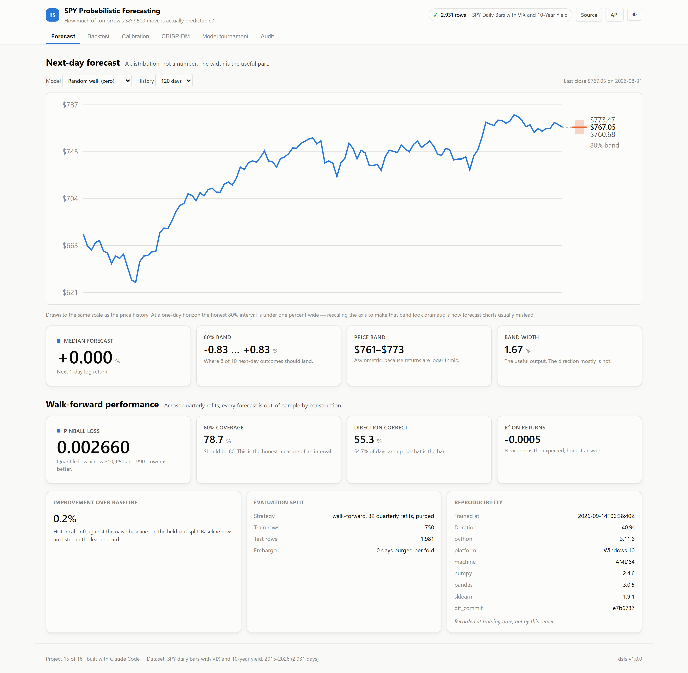
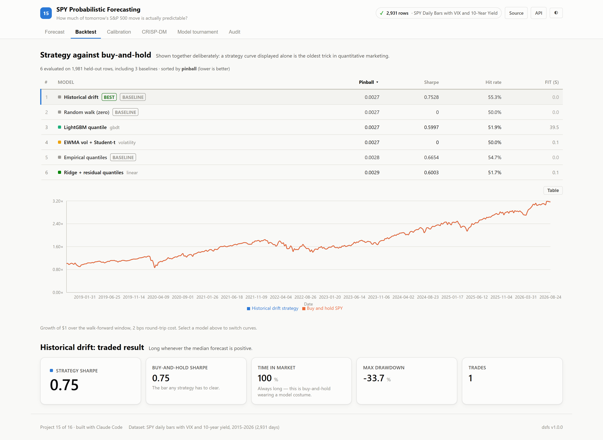
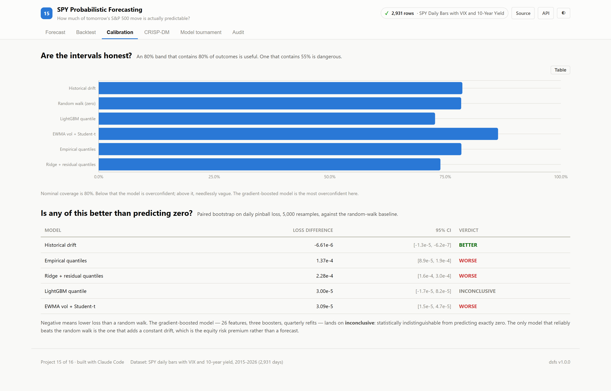
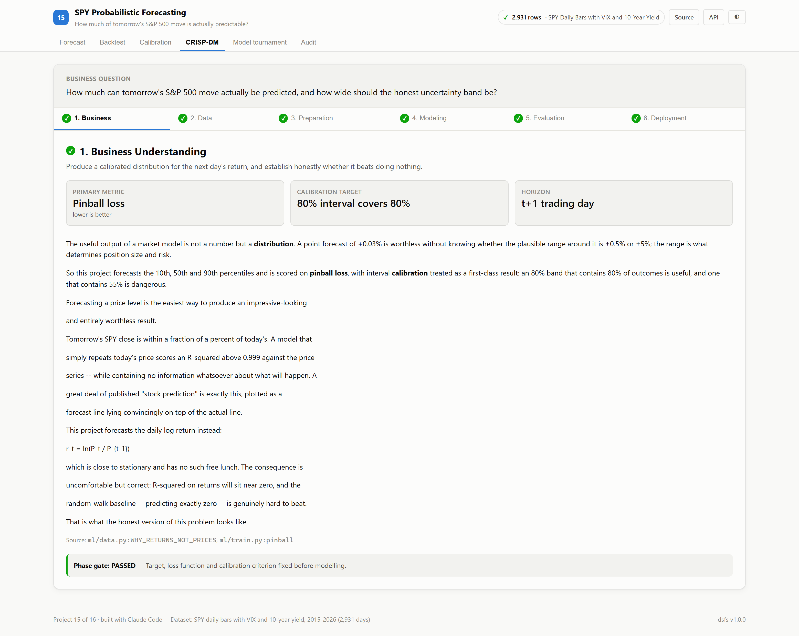
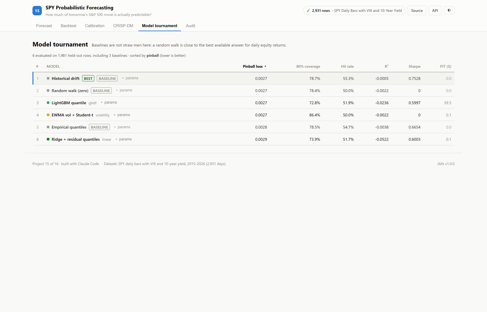
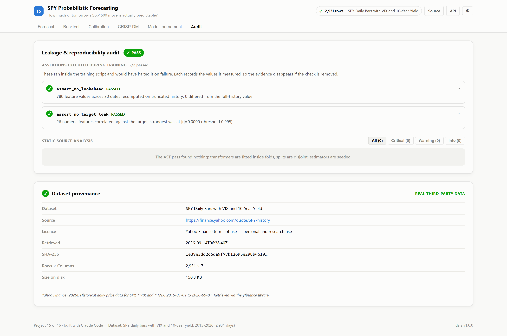

# 15 · SPY Probabilistic Forecasting

**How much of tomorrow's S&P 500 move is actually predictable?**

The short answer, measured over 32 walk-forward refits on 2,931 real trading
days: **almost none of it.** This project is built to establish that carefully
rather than to hide it.

| | |
|---|---|
| Task | Probabilistic time series · quantile forecasting |
| Dataset | SPY, ^VIX, ^TNX daily bars, 2015–2026 (2,931 days) · Yahoo Finance |
| Evaluation | Walk-forward, 32 quarterly refits, purged |
| Primary metric | Pinball loss (lower is better) |
| Winner | **Historical drift** — a baseline |
| Strategy Sharpe | **0.75**, against **0.75** for buy-and-hold |
| Leakage audit | 0 critical · 2 runtime assertions passed |
| Ports | API `8015` · Web `5115` |

---

## Two decisions that define this project

### Forecast returns, not prices

Tomorrow's SPY close is within a fraction of a percent of today's. A model that
simply repeats today's price scores **R² above 0.999** against the price series
while containing no information at all. A great deal of published "stock
prediction" is exactly this, plotted as a forecast line lying convincingly on
top of the actual line.

This project forecasts the daily log return, `r_t = ln(P_t / P_{t-1})`, which
is near-stationary and offers no such free lunch.

### Forecast a distribution, not a number

A point forecast of +0.03% is useless without knowing whether the plausible
range around it is ±0.5% or ±5%. The width determines position size and risk.
So the models produce the 10th, 50th and 90th percentiles, are scored on
**pinball loss**, and are judged on whether their 80% interval actually
contains 80% of outcomes.

---

## Screenshot tour

### Forecast


The band is drawn to the same scale as the price history. At a one-day horizon
the honest 80% interval is about 1.7% wide — rescaling the axis to make that
look dramatic is how forecast charts usually mislead.

### Backtest


Strategy and buy-and-hold on the same axes, always. A strategy curve shown
alone is the oldest trick in quantitative marketing.

### Calibration


Coverage against the nominal 80%, plus a paired bootstrap asking whether any
model beats a random walk at all.

### CRISP-DM · Tournament · Audit




> Dark variants of every view are in [`screenshots/`](./screenshots).

---

## Results

Across 32 walk-forward folds, 1,981 out-of-sample forecast days:

| # | Model | Pinball | 80% coverage | Hit rate | R² | Sharpe |
|---|---|---|---|---|---|---|
| 1 | **Historical drift** 🏆 *(baseline)* | 0.002660 | 78.7% | 55.3% | −0.0005 | 0.75 |
| 2 | Random walk (zero) *(baseline)* | 0.002667 | 78.4% | 50.0% | −0.0022 | 0.00 |
| 3 | LightGBM quantile | 0.002697 | 72.8% | 51.9% | −0.0236 | 0.60 |
| 4 | EWMA vol + Student-t | 0.002698 | 86.4% | 50.0% | −0.0022 | 0.00 |
| 5 | Empirical quantiles *(baseline)* | 0.002804 | 78.5% | 54.7% | −0.0038 | 0.67 |
| 6 | Ridge + residual quantiles | 0.002895 | 73.9% | 51.7% | −0.0522 | 0.60 |

**Read that table honestly and three things follow.**

**A baseline won.** "Historical drift" predicts the trailing mean return and
nothing else. Its backtest reports **100% time in market and 1 trade** — it is
buy-and-hold wearing a model costume. Its Sharpe of 0.75 is *identical* to
buy-and-hold's 0.75, because it is the same position.

**Every model has negative R² on returns.** All six are worse than predicting
the sample mean. That is the expected result for daily equity returns and it is
not a failure of the modelling.

**Directional accuracy is roughly the base rate.** 54.7% of days in this window
are positive, and the best hit rate is 55.3%. A model that said "up" every day
would score about the same.

### Is any of it better than predicting zero?

Paired bootstrap on daily pinball loss, 5,000 resamples, against the random walk:

| Model | Mean difference | Verdict |
|---|---|---|
| Historical drift | −6.6 × 10⁻⁶ | **better** |
| LightGBM quantile | +3.0 × 10⁻⁵ | inconclusive |
| EWMA vol + Student-t | +3.1 × 10⁻⁵ | worse |
| Empirical quantiles | +1.4 × 10⁻⁴ | worse |
| Ridge + residual quantiles | +2.3 × 10⁻⁴ | worse |

The gradient-boosted model — 26 features, three boosters trained on the pinball
objective, refitted quarterly — is **statistically indistinguishable from
predicting exactly zero**.

The only model that reliably beats the random walk does so by adding a constant
positive drift. That is the equity risk premium, not a forecast.

---

## Where the real signal is

Not in the first moment. In the second.

The intervals *can* be calibrated: the random walk's volatility-derived 80% band
covers 78.4% of outcomes, close to nominal. Volatility clusters and is genuinely
predictable, even when direction is not.

The failure modes are instructive too. LightGBM's interval covers only **72.8%**
— overconfident, the dangerous direction. The Student-*t* EWMA band covers
**86.4%** — too wide, merely inefficient. Given the data's excess kurtosis of
14.5, erring wide is the defensible mistake.

---

## What the data says

| | |
|---|---|
| Window | 2015-01-05 → 2026-08-31, 2,931 trading days |
| SPY | $166.62 → $767.05 (+360%) |
| Annualised return / volatility | +12.97% / 17.61% |
| **Buy-and-hold Sharpe** | **0.74** |
| Max drawdown | −33.7% |
| Excess kurtosis | **14.5** (a normal distribution has 0) |
| Worst day | −11.59% on 2020-03-16 |
| Best day | +9.99% on 2025-04-09 |

Buy-and-hold Sharpe of 0.74 is the number every strategy must beat, and it is
the reference that makes reported Sharpe ratios of 2 or 3 on daily equity data
implausible on their face.

---

## Method

### Lookahead is verified, not asserted

Every feature at row *t* uses only data through the close of *t*. That rule is
easy to break by accident — a centred rolling window, a `shift()` in the wrong
direction — so it is checked empirically:

> The feature block is recomputed on **truncated history**, as if standing at
> each of 30 randomly chosen dates with nothing after them, and every value must
> match what the full-history computation produced.

**780 values compared, 0 mismatches.** A feature that peeks ahead cannot survive
this, because removing the future would change it.

### Walk-forward with purging

32 quarterly refits on an expanding window. Every forecast is out-of-sample by
construction; there is no single train/test split, because one split on eleven
years of market data mostly measures which regime happened to land in the test
set. At multi-day horizons the last *h − 1* training rows are purged, since
their targets overlap the test block.

### Assertions that ran

```
assert_no_lookahead     780 feature values across 30 dates recomputed on
                        truncated history; 0 differed
assert_no_target_leak   26 features correlated against the target; strongest
                        was ret_lag2 at |r| = 0.0909 (threshold 0.995)
```

Both figures come from `artifacts/metrics.json`, where the assertion ledger
wrote them during the run.

> **This project found a bug in the shared auditor.** `assert_no_target_leak`
> rebuilt the target with a `RangeIndex` while this project's features carry a
> `DatetimeIndex`. Pandas aligned on index, found no overlap, and returned
> `NaN` for every correlation — so the check *passed without measuring
> anything*. A silent false pass is worse than no check. Fixed in
> `platform/dsfs/leakage.py`, with a regression test that plants a perfectly
> correlated feature on a `DatetimeIndex` frame and confirms it is caught.

---

## Running it

```bash
pip install -e ../platform
npm install

python ml/data.py                 # fetch + cache SPY, VIX, TNX
python ml/train.py --horizon 1    # walk-forward tournament
python -m uvicorn main:app --app-dir server --port 8015
npm run dev -w 15_spy_forecasting/client    # http://localhost:5115
```

## API

| Endpoint | Purpose |
|---|---|
| `GET /api/forecast` | Next-period quantile band, in return and price terms |
| `GET /api/prices` | Recent closes |
| `GET /api/backtest` | Walk-forward equity curves against buy-and-hold |
| `GET /api/calibration` | Coverage and paired-bootstrap significance |
| `GET /api/dataset` | Distributional facts and the lookahead result |
| `GET /api/metrics`, `/api/crispdm`, `/api/audit`, `/api/provenance` | Platform standard |

---

## A note on the source portfolio

The project this replicates reported a **2.15 Sharpe ratio** and a 68.2%
directional hit rate. Its `core/data_engine.py` generates SPY prices with
geometric Brownian motion starting at $510 on 2026-03-01 — a future date — and
its `chronos_engine.py` docstring reads *"Simulates Chronos-T5 foundation model
probabilistic quantile sampling"* over a NumPy Monte Carlo loop.

Those results were measured against data the same script invented.

This version uses real market data and reports a Sharpe of 0.75, equal to
buy-and-hold, with an ML model that cannot be distinguished from predicting
zero. That is a far less impressive headline and a far more useful one.
