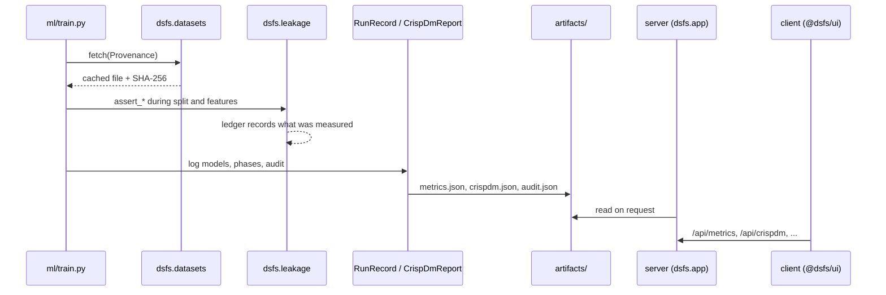
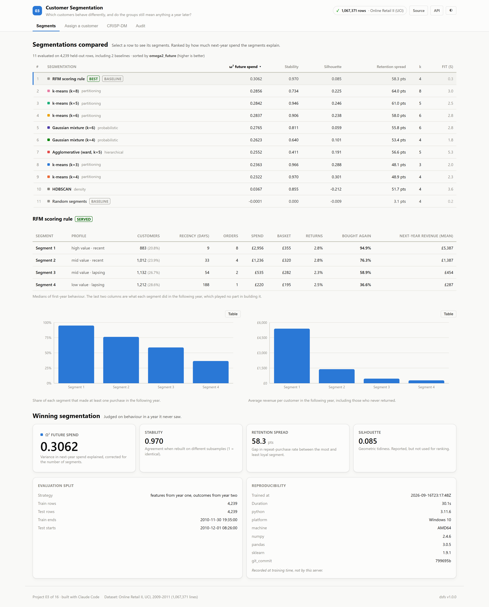
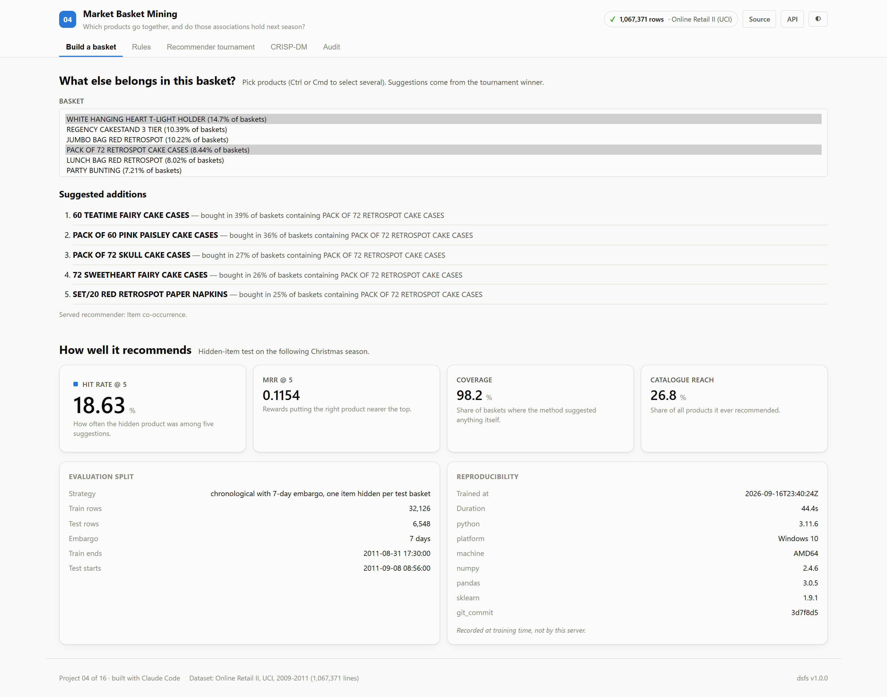
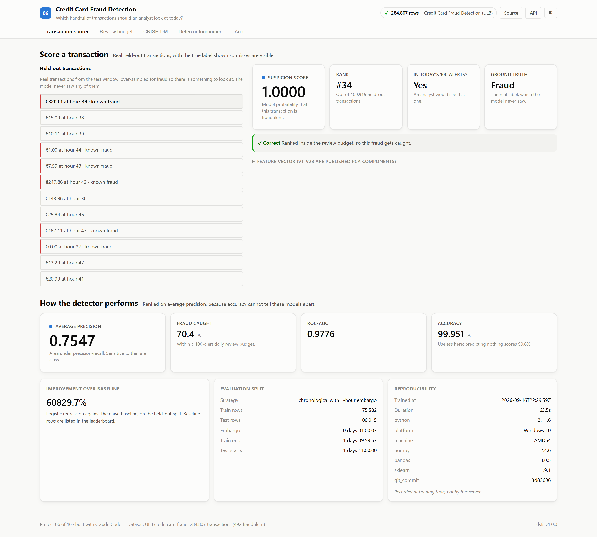
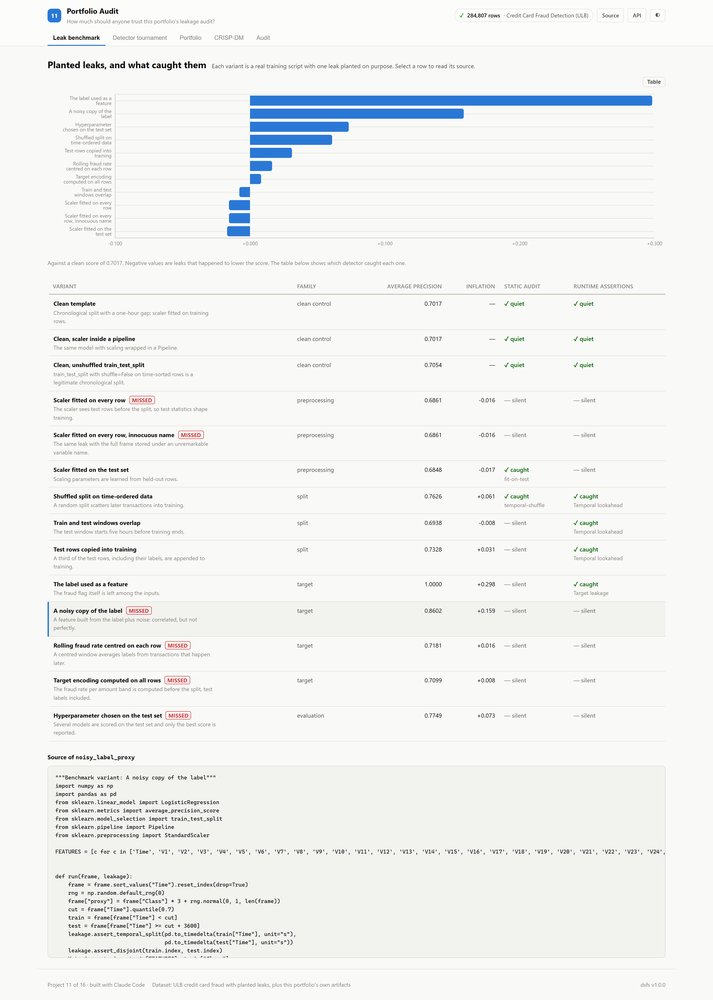
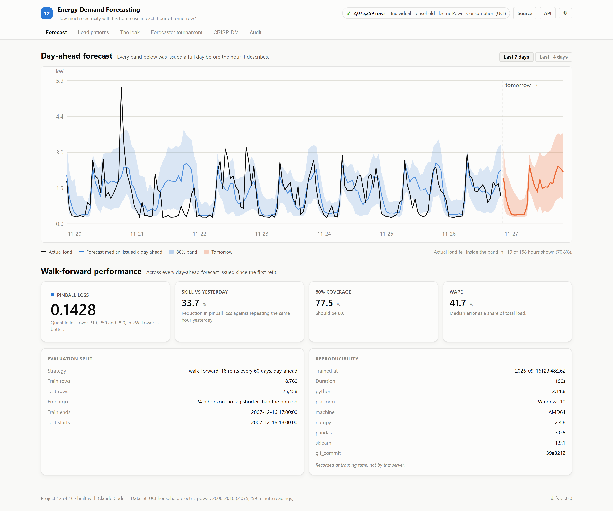

# Code walkthrough

A guided tour of the repository, generated from the source files themselves: each summary is the header comment of the file it describes.

## The platform

Shared by every project. A project imports it instead of re-implementing data sourcing, reporting, auditing or its interface.

| File | Lines | What it does |
|---|---:|---|
| [`platform/dsfs/__init__.py`](./platform/dsfs/__init__.py) | 26 | dsfs -- the shared kernel behind this 16-project data science portfolio. |
| [`platform/dsfs/app.py`](./platform/dsfs/app.py) | 165 | FastAPI application factory shared by all 16 project backends. |
| [`platform/dsfs/crispdm.py`](./platform/dsfs/crispdm.py) | 134 | CRISP-DM as a data structure, not a section heading. |
| [`platform/dsfs/datasets.py`](./platform/dsfs/datasets.py) | 102 | `fetch()` downloads a URL once into `datasets/cache/`, checksums it, and returns a stamped `Provenance`. Re-running is free and offline-safe. Every project's data step goes… |
| [`platform/dsfs/docs.py`](./platform/dsfs/docs.py) | 994 | Every figure in a generated document is read from the artifacts a training run wrote: metrics.json, crispdm.json, provenance.json and audit.json. The only hand-written inputs… |
| [`platform/dsfs/forecasting.py`](./platform/dsfs/forecasting.py) | 73 | Shared evaluation for probabilistic forecasts. |
| [`platform/dsfs/leakage.py`](./platform/dsfs/leakage.py) | 458 | Leakage auditor: static (AST) + runtime assertions. |
| [`platform/dsfs/metrics.py`](./platform/dsfs/metrics.py) | 205 | The single source of truth for every number this portfolio publishes. |
| [`platform/dsfs/provenance.py`](./platform/dsfs/provenance.py) | 100 | Thesis of this portfolio: every number in every README traces to a real, citable dataset. A `Provenance` is the receipt. Projects cannot register a dataset without one, and… |
| [`platform/web/src/components/AppShell.tsx`](./platform/web/src/components/AppShell.tsx) | 295 | AppShell -- the frame every project's client renders inside. |
| [`platform/web/src/components/AuditPanel.tsx`](./platform/web/src/components/AuditPanel.tsx) | 288 | AuditPanel -- the leakage audit, published in the running app. |
| [`platform/web/src/components/Chart.tsx`](./platform/web/src/components/Chart.tsx) | 353 | Chart -- a thin wrapper over Recharts, not a charting library. |
| [`platform/web/src/components/CrispDmWalkthrough.tsx`](./platform/web/src/components/CrispDmWalkthrough.tsx) | 246 | CrispDmWalkthrough -- the six phases, driven entirely by report data. |
| [`platform/web/src/components/MarkdownMath.tsx`](./platform/web/src/components/MarkdownMath.tsx) | 198 | MarkdownMath -- renders the narrative markdown the backend produces, including KaTeX maths. |
| [`platform/web/src/components/MetricsPanel.tsx`](./platform/web/src/components/MetricsPanel.tsx) | 175 | MetricsPanel -- the headline summary of a training run. |
| [`platform/web/src/components/ModelLeaderboard.tsx`](./platform/web/src/components/ModelLeaderboard.tsx) | 250 | ModelLeaderboard -- the tournament table, for any project. |
| [`platform/web/src/components/PredictionForm.tsx`](./platform/web/src/components/PredictionForm.tsx) | 410 | PredictionForm -- schema-driven inference input. |
| [`platform/web/src/components/ProvenanceBadge.tsx`](./platform/web/src/components/ProvenanceBadge.tsx) | 179 | ProvenanceBadge -- renders the dataset receipt. |
| [`platform/web/src/components/StatTile.tsx`](./platform/web/src/components/StatTile.tsx) | 175 | Per the dataviz form heuristic, one number is not a chart. Hero figures use proportional figures; only aligned columns get tabular-nums. Delta direction ships with an arrow… |
| [`platform/web/src/hooks/useApi.ts`](./platform/web/src/hooks/useApi.ts) | 114 | Typed data access for the platform endpoints every backend exposes. |
| [`platform/web/src/index.ts`](./platform/web/src/index.ts) | 47 | @dsfs/ui -- shared design system and data-science UI primitives. |
| [`platform/web/src/types.ts`](./platform/web/src/types.ts) | 152 | TypeScript mirrors of the `dsfs` Python dataclasses. |

### How one training run flows through it

## 01 · NYC Taxi Trip Duration

How long will this cab ride take? Estimated from booking-time information only. Best: **LightGBM** (rmse (min) 5.345). [README](./01_nyc_taxi_prediction/README.md) · [paper](./01_nyc_taxi_prediction/paper.md) · [design doc](./01_nyc_taxi_prediction/DESIGN_DOC.md)

| File | Lines | What it does |
|---|---:|---|
| [`ml/build_zone_map.py`](./01_nyc_taxi_prediction/ml/build_zone_map.py) | 163 | Build the taxi-zone SVG map from the official TLC shapefile. |
| [`ml/data.py`](./01_nyc_taxi_prediction/ml/data.py) | 254 | Project 01 -- NYC Taxi trip duration: data acquisition and cleaning. |
| [`ml/features.py`](./01_nyc_taxi_prediction/ml/features.py) | 268 | Every feature here must be computable at the moment a rider requests a cab. |
| [`ml/train.py`](./01_nyc_taxi_prediction/ml/train.py) | 428 | Project 01 -- model tournament, audit, and artefact generation. |
| [`server/inference.py`](./01_nyc_taxi_prediction/server/inference.py) | 153 | Loads the persisted model together with the encoders it was trained with, so a prediction at request time is assembled exactly as it was during training. The zone statistics… |
| [`server/main.py`](./01_nyc_taxi_prediction/server/main.py) | 81 | Thanks to the platform factory, this file contains only what is specific to taxi prediction. Health, metadata, CRISP-DM, metrics, provenance and audit endpoints all arrive from… |
| [`client/src/App.tsx`](./01_nyc_taxi_prediction/client/src/App.tsx) | 226 | Almost everything here comes from @dsfs/ui. The only code specific to this project is the zone map and the trip estimator; the rest -- metrics, the tournament table, the… |
| [`client/src/TripEstimator.tsx`](./01_nyc_taxi_prediction/client/src/TripEstimator.tsx) | 159 | Composes the shared PredictionForm with this project's zone map, and renders the API's response. Every figure shown is a field of that response; nothing is recomputed here. |
| [`client/src/ZoneMap.tsx`](./01_nyc_taxi_prediction/client/src/ZoneMap.tsx) | 193 | Renders the 263 real TLC taxi zones as inline SVG. Geometry comes from the official TLC shapefile (EPSG:2263), simplified at build time by `ml/build_zone_map.py` -- so this is… |
| [`client/src/main.tsx`](./01_nyc_taxi_prediction/client/src/main.tsx) | 10 |  |

| Method | Endpoint | Purpose |
|---|---|---|
| POST | `/api/predict` | Estimate duration for one booking, with an interval from measured error. |
| GET | `/api/zones` | The 263 taxi zones, for the origin and destination pickers. |
| GET | `/api/importance` | Which features the winning model actually leans on. |

## 03 · Customer Segmentation

Which customers behave differently, and do the groups still mean anything a year later? Best: **RFM scoring rule** (ω² next-year spend 0.3062). [README](./03_customer_segmentation/README.md) · [paper](./03_customer_segmentation/paper.md) · [design doc](./03_customer_segmentation/DESIGN_DOC.md)

| File | Lines | What it does |
|---|---:|---|
| [`ml/features.py`](./03_customer_segmentation/ml/features.py) | 71 | Project 03 -- customer features and future outcomes. |
| [`ml/train.py`](./03_customer_segmentation/ml/train.py) | 442 | Project 03 -- segmentation tournament, audit, and artefact generation. |
| [`server/inference.py`](./03_customer_segmentation/server/inference.py) | 82 | Assigns a customer to the nearest segment of the winning segmentation and returns what that segment went on to do. Every profile figure comes from the training run's… |
| [`server/main.py`](./03_customer_segmentation/server/main.py) | 69 | Project 03 -- FastAPI application. |
| [`client/src/App.tsx`](./03_customer_segmentation/client/src/App.tsx) | 154 | SegmentExplorer is the only project-specific view. The customer assignment form is the shared schema-driven PredictionForm, with slider bounds taken from the training data's… |
| [`client/src/SegmentExplorer.tsx`](./03_customer_segmentation/client/src/SegmentExplorer.tsx) | 147 | Choosing a row in the shared leaderboard loads that segmentation's profiles, so the comparison is between whole segmentations rather than one winner. Every figure is a field of… |
| [`client/src/main.tsx`](./03_customer_segmentation/client/src/main.tsx) | 10 |  |

| Method | Endpoint | Purpose |
|---|---|---|
| GET | `/api/segments` | Segment profiles for one segmentation, defaulting to the winner. |
| GET | `/api/feature-ranges` | 5th percentile, median and 95th percentile of each feature, for input bounds. |
| POST | `/api/assign` | Assign a customer to the nearest segment of the winning segmentation. |

## 04 · Market Basket Mining

Which products go together, and do those associations hold next season? Best: **Item co-occurrence** (hit rate @ 5 18.6%). [README](./04_market_basket/README.md) · [paper](./04_market_basket/paper.md) · [design doc](./04_market_basket/DESIGN_DOC.md)

| File | Lines | What it does |
|---|---:|---|
| [`ml/baskets.py`](./04_market_basket/ml/baskets.py) | 279 | Project 04 -- baskets, association rules and recommenders. |
| [`ml/train.py`](./04_market_basket/ml/train.py) | 371 | Project 04 -- market basket tournament, rule survival, and artefacts. |
| [`server/inference.py`](./04_market_basket/server/inference.py) | 84 | Recommends products for a basket with the tournament's winning method, and explains each suggestion by the basket item that most strongly implies it. Rules and their… |
| [`server/main.py`](./04_market_basket/server/main.py) | 60 | Project 04 -- FastAPI application. |
| [`client/src/App.tsx`](./04_market_basket/client/src/App.tsx) | 168 | RuleTable is the only project-specific view. The basket builder is the shared PredictionForm with a multiselect fed by /api/items, and the tournament is the shared… |
| [`client/src/RuleTable.tsx`](./04_market_basket/client/src/RuleTable.tsx) | 103 | The strongest mined rules, each shown with its statistics in the training period beside what it did in the following season. A rule's training confidence alone says little;… |
| [`client/src/main.tsx`](./04_market_basket/client/src/main.tsx) | 10 |  |

| Method | Endpoint | Purpose |
|---|---|---|
| GET | `/api/items` | The 300 most frequently bought products, for building a basket. |
| GET | `/api/rules` | Strongest rules, with their statistics in training and in the following season. |
| POST | `/api/recommend` | Five product suggestions for a basket, each with the reason it was suggested. |

## 06 · Credit Card Fraud Detection

Which handful of transactions should an analyst look at today? Best: **Logistic regression** (avg precision 0.7547). [README](./06_anomaly_detection/README.md) · [paper](./06_anomaly_detection/paper.md) · [design doc](./06_anomaly_detection/DESIGN_DOC.md)

| File | Lines | What it does |
|---|---:|---|
| [`ml/data.py`](./06_anomaly_detection/ml/data.py) | 187 | Project 06 -- Credit card fraud detection: data acquisition. |
| [`ml/train.py`](./06_anomaly_detection/ml/train.py) | 531 | Project 06 -- fraud detection tournament, audit, and artefact generation. |
| [`server/inference.py`](./06_anomaly_detection/server/inference.py) | 140 | Scores a transaction and, more usefully, says where that score sits. A raw suspicion score is close to meaningless on its own: what an analyst needs to know is whether this… |
| [`server/main.py`](./06_anomaly_detection/server/main.py) | 84 | Only the fraud-specific endpoints live here; health, meta, metrics, CRISP-DM, provenance and audit arrive from the platform factory. |
| [`client/src/App.tsx`](./06_anomaly_detection/client/src/App.tsx) | 293 | The only project-specific view is TransactionScorer. Metrics, the detector tournament, the CRISP-DM walkthrough, the audit and every chart come from @dsfs/ui unchanged -- which… |
| [`client/src/TransactionScorer.tsx`](./06_anomaly_detection/client/src/TransactionScorer.tsx) | 208 | Scores real held-out transactions. The true label travels with each sample, so the view can show when the model gets one wrong -- which it does, for about a third of the fraud.… |
| [`client/src/main.tsx`](./06_anomaly_detection/client/src/main.tsx) | 10 |  |

| Method | Endpoint | Purpose |
|---|---|---|
| POST | `/api/score` | Score a transaction and locate it in the held-out distribution. |
| GET | `/api/samples` | Real held-out transactions the UI can load as presets. |
| GET | `/api/budget-curve` | Precision and recall at each analyst review budget. |
| GET | `/api/eda` | Fraud rate by hour and by transaction amount band. |

## 11 · Portfolio Audit

How much should anyone trust this portfolio's leakage audit? Best: **Static + runtime** (balanced accuracy 0.727). [README](./11_portfolio_audit/README.md) · [paper](./11_portfolio_audit/paper.md) · [design doc](./11_portfolio_audit/DESIGN_DOC.md)

| File | Lines | What it does |
|---|---:|---|
| [`ml/mutations.py`](./11_portfolio_audit/ml/mutations.py) | 169 | Project 11 -- a benchmark for the portfolio's own leakage auditor. |
| [`ml/train.py`](./11_portfolio_audit/ml/train.py) | 380 | Project 11 -- benchmark the portfolio's leakage auditor, then audit the portfolio. |
| [`server/inference.py`](./11_portfolio_audit/server/inference.py) | 45 | The benchmark results and the portfolio snapshot are read from metrics.json. Variant source code is read from the committed corpus, but only for ids the benchmark itself… |
| [`server/main.py`](./11_portfolio_audit/server/main.py) | 58 | Project 11 -- FastAPI application. |
| [`client/src/App.tsx`](./11_portfolio_audit/client/src/App.tsx) | 135 | LeakBenchmark is the project-specific view. The detector tournament uses the shared leaderboard, and the portfolio table renders each project's audit state exactly as its… |
| [`client/src/LeakBenchmark.tsx`](./11_portfolio_audit/client/src/LeakBenchmark.tsx) | 124 | Every planted leak and clean control, with what each detector concluded and how much the leak inflated the reported score. Selecting a row shows the variant's source, so a… |
| [`client/src/main.tsx`](./11_portfolio_audit/client/src/main.tsx) | 10 |  |

| Method | Endpoint | Purpose |
|---|---|---|
| GET | `/api/benchmark` | Every planted leak and control, with both detectors' verdicts and the score inflation. |
| GET | `/api/corpus/{variant_id}` | The source of one benchmark variant, so what was planted can be checked. |
| GET | `/api/portfolio` | Audit state of every other built project, read from its artifacts at training time. |

## 12 · Energy Demand Forecasting

How much electricity will this home use in each hour of tomorrow? Best: **LightGBM quantile** (pinball loss (kw) 0.1428). [README](./12_energy_forecasting/README.md) · [paper](./12_energy_forecasting/paper.md) · [design doc](./12_energy_forecasting/DESIGN_DOC.md)

| File | Lines | What it does |
|---|---:|---|
| [`ml/data.py`](./12_energy_forecasting/ml/data.py) | 115 | Project 12 -- household electricity: acquisition and hourly aggregation. |
| [`ml/features.py`](./12_energy_forecasting/ml/features.py) | 94 | Rows are indexed by the hour being forecast, T. The forecast is issued 24 hours earlier, at T - 24, so every feature must be computable from readings at or before T - 24. |
| [`ml/train.py`](./12_energy_forecasting/ml/train.py) | 422 | Project 12 -- day-ahead household energy forecasting. |
| [`server/inference.py`](./12_energy_forecasting/server/inference.py) | 57 | Every response is read from the training run's metrics.json: tomorrow's band, the recent track record, load profiles, calibration, significance and the leakage demonstration.… |
| [`server/main.py`](./12_energy_forecasting/server/main.py) | 55 | Project 12 -- FastAPI application. |
| [`client/src/App.tsx`](./12_energy_forecasting/client/src/App.tsx) | 194 | LoadFan is the only project-specific view. Patterns, calibration, the tournament and the leakage demonstration are built from shared components reading the training artifacts. |
| [`client/src/LoadFan.tsx`](./12_energy_forecasting/client/src/LoadFan.tsx) | 97 | Recent actual load against the day-ahead band issued for it, followed by the band for the day after the data ends. Showing the track record beside the forecast lets a reader… |
| [`client/src/main.tsx`](./12_energy_forecasting/client/src/main.tsx) | 10 |  |

| Method | Endpoint | Purpose |
|---|---|---|
| GET | `/api/forecast` | Tomorrow's hourly band, with the last fourteen days of forecasts against actual load. |
| GET | `/api/patterns` | Average load by hour for weekdays and weekends, and by month. |
| GET | `/api/calibration` | Interval coverage, significance against yesterday, and the leakage demonstration. |

## 15 · SPY Probabilistic Forecasting

How much of tomorrow's S&P 500 move is actually predictable? Best: **Historical drift** (pinball loss 0.002660). [README](./15_spy_forecasting/README.md) · [paper](./15_spy_forecasting/paper.md) · [design doc](./15_spy_forecasting/DESIGN_DOC.md)

| File | Lines | What it does |
|---|---:|---|
| [`ml/data.py`](./15_spy_forecasting/ml/data.py) | 175 | Project 15 -- SPY forecasting: market data acquisition. |
| [`ml/features.py`](./15_spy_forecasting/ml/features.py) | 139 | Every feature at row t is computed from information available at the close of day t, and the target is the return of day t+1. That single rule is the whole discipline of this… |
| [`ml/train.py`](./15_spy_forecasting/ml/train.py) | 587 | Project 15 -- walk-forward forecasting tournament. |
| [`server/inference.py`](./15_spy_forecasting/server/inference.py) | 90 | Everything served here was computed during the walk-forward run and stored in metrics.json. Nothing is recalculated at request time, so the forecast band a visitor sees is the… |
| [`server/main.py`](./15_spy_forecasting/server/main.py) | 74 | Project 15 -- FastAPI application. |
| [`client/src/App.tsx`](./15_spy_forecasting/client/src/App.tsx) | 354 | ForecastFan is the only project-specific view. This project is the hardest test of the shared components: the primary metric is lower-is-better, the "models" include pure… |
| [`client/src/ForecastFan.tsx`](./15_spy_forecasting/client/src/ForecastFan.tsx) | 180 | Shows recent SPY closes and the next-period quantile band, in price terms. |
| [`client/src/main.tsx`](./15_spy_forecasting/client/src/main.tsx) | 10 |  |

| Method | Endpoint | Purpose |
|---|---|---|
| GET | `/api/forecast` | Next-period quantile band in return and price terms. |
| GET | `/api/prices` | Recent closes, for the forecast chart. |
| GET | `/api/backtest` | Walk-forward equity curves against buy-and-hold. |
| GET | `/api/calibration` | Interval coverage and significance versus a random walk. |
| GET | `/api/dataset` | Distributional facts and the lookahead verification result. |

---

*Generated by `scripts/generate_docs.py`.*
