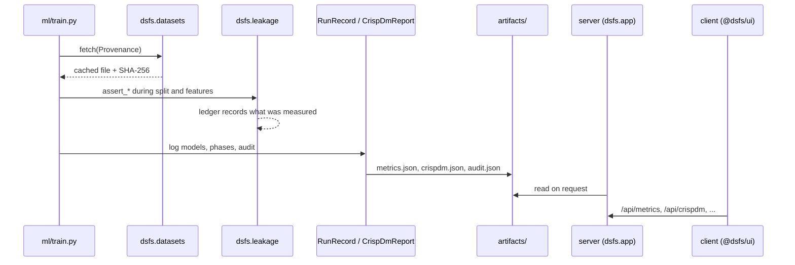
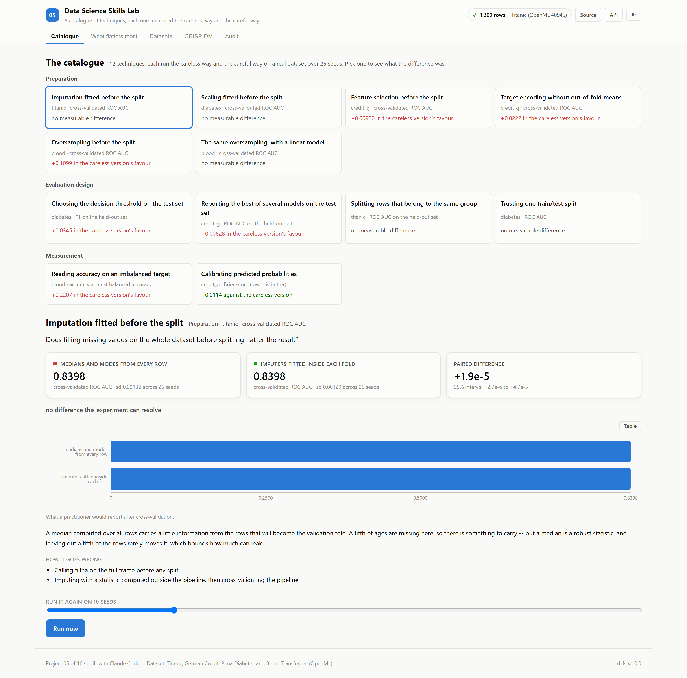
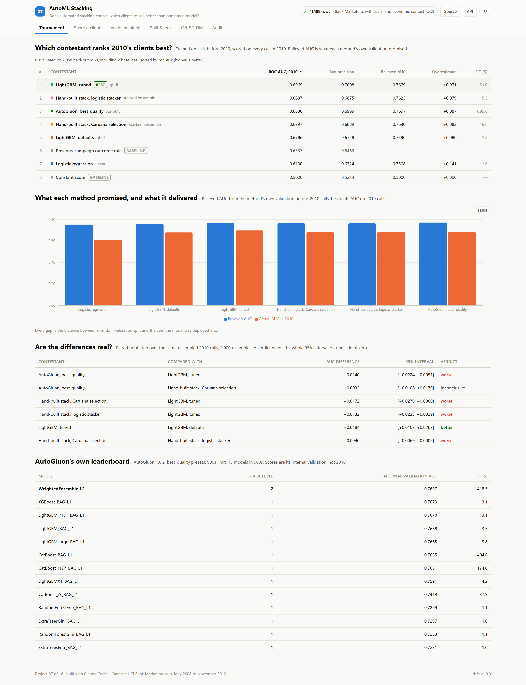
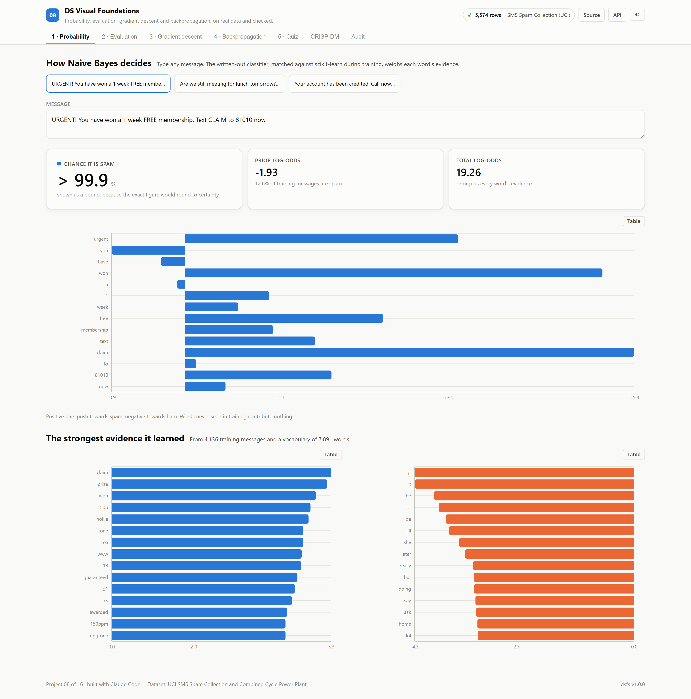
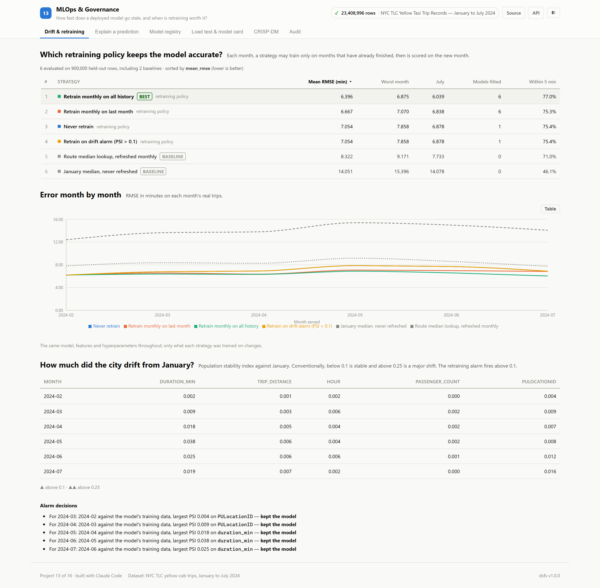

# Code walkthrough

A guided tour of the repository, generated from the source files themselves: each summary is the header comment of the file it describes.

## The platform

Shared by every project. A project imports it instead of re-implementing data sourcing, reporting, auditing or its interface.

| File | Lines | What it does |
|---|---:|---|
| [`platform/dsfs/__init__.py`](./platform/dsfs/__init__.py) | 26 | dsfs -- the shared kernel behind this 16-project data science portfolio. |
| [`platform/dsfs/app.py`](./platform/dsfs/app.py) | 165 | FastAPI application factory shared by all 16 project backends. |
| [`platform/dsfs/crispdm.py`](./platform/dsfs/crispdm.py) | 134 | CRISP-DM as a data structure, not a section heading. |
| [`platform/dsfs/datasets.py`](./platform/dsfs/datasets.py) | 156 | `fetch()` downloads a URL once into `datasets/cache/`, checksums it, and returns a stamped `Provenance`. Re-running is free and offline-safe. Every project's data step goes… |
| [`platform/dsfs/docs.py`](./platform/dsfs/docs.py) | 998 | Every figure in a generated document is read from the artifacts a training run wrote: metrics.json, crispdm.json, provenance.json and audit.json. The only hand-written inputs… |
| [`platform/dsfs/forecasting.py`](./platform/dsfs/forecasting.py) | 73 | Shared evaluation for probabilistic forecasts. |
| [`platform/dsfs/leakage.py`](./platform/dsfs/leakage.py) | 458 | Leakage auditor: static (AST) + runtime assertions. |
| [`platform/dsfs/metrics.py`](./platform/dsfs/metrics.py) | 205 | The single source of truth for every number this portfolio publishes. |
| [`platform/dsfs/provenance.py`](./platform/dsfs/provenance.py) | 100 | Thesis of this portfolio: every number in every README traces to a real, citable dataset. A `Provenance` is the receipt. Projects cannot register a dataset without one, and… |
| [`platform/web/src/components/AppShell.tsx`](./platform/web/src/components/AppShell.tsx) | 295 | AppShell -- the frame every project's client renders inside. |
| [`platform/web/src/components/AuditPanel.tsx`](./platform/web/src/components/AuditPanel.tsx) | 288 | AuditPanel -- the leakage audit, published in the running app. |
| [`platform/web/src/components/Chart.tsx`](./platform/web/src/components/Chart.tsx) | 370 | Chart -- a thin wrapper over Recharts, not a charting library. |
| [`platform/web/src/components/CrispDmWalkthrough.tsx`](./platform/web/src/components/CrispDmWalkthrough.tsx) | 246 | CrispDmWalkthrough -- the six phases, driven entirely by report data. |
| [`platform/web/src/components/MarkdownMath.tsx`](./platform/web/src/components/MarkdownMath.tsx) | 198 | MarkdownMath -- renders the narrative markdown the backend produces, including KaTeX maths. |
| [`platform/web/src/components/MetricsPanel.tsx`](./platform/web/src/components/MetricsPanel.tsx) | 175 | MetricsPanel -- the headline summary of a training run. |
| [`platform/web/src/components/ModelLeaderboard.tsx`](./platform/web/src/components/ModelLeaderboard.tsx) | 269 | ModelLeaderboard -- the tournament table, for any project. |
| [`platform/web/src/components/PredictionForm.tsx`](./platform/web/src/components/PredictionForm.tsx) | 410 | PredictionForm -- schema-driven inference input. |
| [`platform/web/src/components/ProvenanceBadge.tsx`](./platform/web/src/components/ProvenanceBadge.tsx) | 179 | ProvenanceBadge -- renders the dataset receipt. |
| [`platform/web/src/components/StatTile.tsx`](./platform/web/src/components/StatTile.tsx) | 175 | Per the dataviz form heuristic, one number is not a chart. Hero figures use proportional figures; only aligned columns get tabular-nums. Delta direction ships with an arrow… |
| [`platform/web/src/hooks/useApi.ts`](./platform/web/src/hooks/useApi.ts) | 114 | Typed data access for the platform endpoints every backend exposes. |
| [`platform/web/src/index.ts`](./platform/web/src/index.ts) | 47 | @dsfs/ui -- shared design system and data-science UI primitives. |
| [`platform/web/src/types.ts`](./platform/web/src/types.ts) | 152 | TypeScript mirrors of the `dsfs` Python dataclasses. |

### How one training run flows through it

## 00 · Task Workspace

A live task workspace: every tab stays in sync, and no edit silently overwrites another. Best: **Quick-entry parser** (exact parses 100.0%). [README](./00_task_workspace/README.md) · [paper](./00_task_workspace/paper.md) · [design doc](./00_task_workspace/DESIGN_DOC.md)

| File | Lines | What it does |
|---|---:|---|
| [`ml/train.py`](./00_task_workspace/ml/train.py) | 361 | Project 00 -- verify the workspace's three promises. |
| [`server/main.py`](./00_task_workspace/server/main.py) | 240 | Project 00 -- FastAPI application: the task workspace. |
| [`server/parser.py`](./00_task_workspace/server/parser.py) | 139 | "Draft the Q3 report !high #work #finance @friday ~45m" -> title "Draft the Q3 report", priority high, tags work and finance, due the coming Friday, estimate 45 minutes |
| [`server/seed.py`](./00_task_workspace/server/seed.py) | 57 | A fixed, seeded set of tasks so an empty workspace has something to show. It is generated, not real usage data, and the project's provenance says so. Dates are placed relative… |
| [`server/store.py`](./00_task_workspace/server/store.py) | 175 | Project 00 -- task storage with optimistic concurrency. |
| [`client/src/App.tsx`](./00_task_workspace/client/src/App.tsx) | 212 | Every view reads the same live task state (useTasks) and writes back through it. Analytics come from /api/analytics and the verification results from /api/evidence; the client… |
| [`client/src/Views.tsx`](./00_task_workspace/client/src/Views.tsx) | 309 | Workspace views -- project-00-specific. They group and arrange the tasks the server holds; every change goes back through useTasks, which sends the task's version so a… |
| [`client/src/main.tsx`](./00_task_workspace/client/src/main.tsx) | 10 |  |
| [`client/src/useTasks.ts`](./00_task_workspace/client/src/useTasks.ts) | 106 | Loads every task once, then applies server-sent events. Each event carries a global sequence number: if one is skipped (a dropped connection, a sleeping laptop), the hook… |

| Method | Endpoint | Purpose |
|---|---|---|
| GET | `/api/parse` | Preview what quick entry would create, resolved against today's date. |
| GET | `/api/tasks` | Every task, with the sequence number of the latest event, so a client knows where to resume. |
| GET | `/api/analytics` | Completions per day, streaks, workload by status and quadrant, and estimate accuracy. |
| GET | `/api/evidence` | Parser accuracy, live-update latency and conflict tests from the recorded verification run. |

## 01 · NYC Taxi Trip Duration

How long will this cab ride take? Estimated from booking-time information only. Best: **LightGBM** (rmse (min) 5.345). [README](./01_nyc_taxi_prediction/README.md) · [paper](./01_nyc_taxi_prediction/paper.md) · [design doc](./01_nyc_taxi_prediction/DESIGN_DOC.md)

| File | Lines | What it does |
|---|---:|---|
| [`ml/build_zone_map.py`](./01_nyc_taxi_prediction/ml/build_zone_map.py) | 163 | Build the taxi-zone SVG map from the official TLC shapefile. |
| [`ml/data.py`](./01_nyc_taxi_prediction/ml/data.py) | 256 | Project 01 -- NYC Taxi trip duration: data acquisition and cleaning. |
| [`ml/features.py`](./01_nyc_taxi_prediction/ml/features.py) | 268 | Every feature here must be computable at the moment a rider requests a cab. |
| [`ml/train.py`](./01_nyc_taxi_prediction/ml/train.py) | 428 | Project 01 -- model tournament, audit, and artefact generation. |
| [`server/inference.py`](./01_nyc_taxi_prediction/server/inference.py) | 153 | Loads the persisted model together with the encoders it was trained with, so a prediction at request time is assembled exactly as it was during training. The zone statistics… |
| [`server/main.py`](./01_nyc_taxi_prediction/server/main.py) | 81 | Thanks to the platform factory, this file contains only what is specific to taxi prediction. Health, metadata, CRISP-DM, metrics, provenance and audit endpoints all arrive from… |
| [`client/src/App.tsx`](./01_nyc_taxi_prediction/client/src/App.tsx) | 226 | Almost everything here comes from @dsfs/ui. The only code specific to this project is the zone map and the trip estimator; the rest -- metrics, the tournament table, the… |
| [`client/src/TripEstimator.tsx`](./01_nyc_taxi_prediction/client/src/TripEstimator.tsx) | 159 | Composes the shared PredictionForm with this project's zone map, and renders the API's response. Every figure shown is a field of that response; nothing is recomputed here. |
| [`client/src/ZoneMap.tsx`](./01_nyc_taxi_prediction/client/src/ZoneMap.tsx) | 193 | Renders the 263 real TLC taxi zones as inline SVG. Geometry comes from the official TLC shapefile (EPSG:2263), simplified at build time by `ml/build_zone_map.py` -- so this is… |
| [`client/src/main.tsx`](./01_nyc_taxi_prediction/client/src/main.tsx) | 10 |  |

| Method | Endpoint | Purpose |
|---|---|---|
| POST | `/api/predict` | Estimate duration for one booking, with an interval from measured error. |
| GET | `/api/zones` | The 263 taxi zones, for the origin and destination pickers. |
| GET | `/api/importance` | Which features the winning model actually leans on. |

## 02 · Nano LLM Transformer

A small language model written from scratch, and which of its parts earn their place. Best: **NanoLM, RoPE · SwiGLU · RMSNorm** (validation perplexity 4.029). [README](./02_nano_llm/README.md) · [paper](./02_nano_llm/paper.md) · [design doc](./02_nano_llm/DESIGN_DOC.md)

| File | Lines | What it does |
|---|---:|---|
| [`ml/data.py`](./02_nano_llm/ml/data.py) | 108 | Project 02 -- TinyStories: acquisition, deduplication and tokenisation. |
| [`ml/model.py`](./02_nano_llm/ml/model.py) | 220 | Project 02 -- a small decoder-only transformer, written from scratch. |
| [`ml/train.py`](./02_nano_llm/ml/train.py) | 470 | Project 02 -- train a small language model on TinyStories, and measure it honestly. |
| [`server/inference.py`](./02_nano_llm/server/inference.py) | 116 | Project 02 -- serving the trained language model. |
| [`server/main.py`](./02_nano_llm/server/main.py) | 91 | Project 02 -- FastAPI application. |
| [`client/src/App.tsx`](./02_nano_llm/client/src/App.tsx) | 197 | Studio, tokenizer and attention views call the live model; training, ablation and check views read the training run. |
| [`client/src/Studio.tsx`](./02_nano_llm/client/src/Studio.tsx) | 214 | Project-02-specific views: the generation studio, the tokenizer and the attention map. Each renders exactly what one API call returned. |
| [`client/src/main.tsx`](./02_nano_llm/client/src/main.tsx) | 10 |  |

| Method | Endpoint | Purpose |
|---|---|---|
| POST | `/api/generate` | Continue a prompt with nucleus sampling. |
| POST | `/api/tokenize` | Split text into the model's BPE tokens. |
| POST | `/api/attention` | Attention weights of every layer and head for a short prompt. |
| GET | `/api/training` | Loss curves, baselines and the deduplication counts. |
| GET | `/api/ablations` | Each component swapped for its older equivalent, beside a second seed of the reference. |
| GET | `/api/checks` | Executed mechanics checks, generation timings and fixed-seed samples. |

## 03 · Customer Segmentation

Which customers behave differently, and do the groups still mean anything a year later? Best: **RFM scoring rule** (ω² next-year spend 0.3062). [README](./03_customer_segmentation/README.md) · [paper](./03_customer_segmentation/paper.md) · [design doc](./03_customer_segmentation/DESIGN_DOC.md)

| File | Lines | What it does |
|---|---:|---|
| [`ml/features.py`](./03_customer_segmentation/ml/features.py) | 71 | Project 03 -- customer features and future outcomes. |
| [`ml/train.py`](./03_customer_segmentation/ml/train.py) | 442 | Project 03 -- segmentation tournament, audit, and artefact generation. |
| [`server/inference.py`](./03_customer_segmentation/server/inference.py) | 82 | Assigns a customer to the nearest segment of the winning segmentation and returns what that segment went on to do. Every profile figure comes from the training run's… |
| [`server/main.py`](./03_customer_segmentation/server/main.py) | 69 | Project 03 -- FastAPI application. |
| [`client/src/App.tsx`](./03_customer_segmentation/client/src/App.tsx) | 154 | SegmentExplorer is the only project-specific view. The customer assignment form is the shared schema-driven PredictionForm, with slider bounds taken from the training data's… |
| [`client/src/SegmentExplorer.tsx`](./03_customer_segmentation/client/src/SegmentExplorer.tsx) | 147 | Choosing a row in the shared leaderboard loads that segmentation's profiles, so the comparison is between whole segmentations rather than one winner. Every figure is a field of… |
| [`client/src/main.tsx`](./03_customer_segmentation/client/src/main.tsx) | 10 |  |

| Method | Endpoint | Purpose |
|---|---|---|
| GET | `/api/segments` | Segment profiles for one segmentation, defaulting to the winner. |
| GET | `/api/feature-ranges` | 5th percentile, median and 95th percentile of each feature, for input bounds. |
| POST | `/api/assign` | Assign a customer to the nearest segment of the winning segmentation. |

## 04 · Market Basket Mining

Which products go together, and do those associations hold next season? Best: **Item co-occurrence** (hit rate @ 5 18.6%). [README](./04_market_basket/README.md) · [paper](./04_market_basket/paper.md) · [design doc](./04_market_basket/DESIGN_DOC.md)

| File | Lines | What it does |
|---|---:|---|
| [`ml/baskets.py`](./04_market_basket/ml/baskets.py) | 279 | Project 04 -- baskets, association rules and recommenders. |
| [`ml/train.py`](./04_market_basket/ml/train.py) | 371 | Project 04 -- market basket tournament, rule survival, and artefacts. |
| [`server/inference.py`](./04_market_basket/server/inference.py) | 84 | Recommends products for a basket with the tournament's winning method, and explains each suggestion by the basket item that most strongly implies it. Rules and their… |
| [`server/main.py`](./04_market_basket/server/main.py) | 60 | Project 04 -- FastAPI application. |
| [`client/src/App.tsx`](./04_market_basket/client/src/App.tsx) | 168 | RuleTable is the only project-specific view. The basket builder is the shared PredictionForm with a multiselect fed by /api/items, and the tournament is the shared… |
| [`client/src/RuleTable.tsx`](./04_market_basket/client/src/RuleTable.tsx) | 103 | The strongest mined rules, each shown with its statistics in the training period beside what it did in the following season. A rule's training confidence alone says little;… |
| [`client/src/main.tsx`](./04_market_basket/client/src/main.tsx) | 10 |  |

| Method | Endpoint | Purpose |
|---|---|---|
| GET | `/api/items` | The 300 most frequently bought products, for building a basket. |
| GET | `/api/rules` | Strongest rules, with their statistics in training and in the following season. |
| POST | `/api/recommend` | Five product suggestions for a basket, each with the reason it was suggested. |

## 05 · Data Science Skills Lab

A catalogue of techniques, each one measured the careless way and the careful way. Best: **Reading accuracy on an imbalanced target** (how much it flatters 0.2207). [README](./05_skills_lab/README.md) · [paper](./05_skills_lab/paper.md) · [design doc](./05_skills_lab/DESIGN_DOC.md)

| File | Lines | What it does |
|---|---:|---|
| [`ml/data.py`](./05_skills_lab/ml/data.py) | 119 | Project 05 -- four small, real datasets for the skills catalogue. |
| [`ml/skills.py`](./05_skills_lab/ml/skills.py) | 459 | Project 05 -- the skills catalogue, as executable comparisons. |
| [`ml/train.py`](./05_skills_lab/ml/train.py) | 227 | Project 05 -- run the skills catalogue and record what it measured. |
| [`server/inference.py`](./05_skills_lab/server/inference.py) | 80 | Recorded results are read from the training run. A skill can also be re-run on request, through the same code the training run used, so a reader can watch an interval narrow as… |
| [`server/main.py`](./05_skills_lab/server/main.py) | 57 | Project 05 -- FastAPI application. |
| [`client/src/App.tsx`](./05_skills_lab/client/src/App.tsx) | 166 | Browse the entries, open one to see its measured comparison, and run any of them again. Nothing here computes a result: every number is returned by the API, from the training… |
| [`client/src/Catalogue.tsx`](./05_skills_lab/client/src/Catalogue.tsx) | 135 | Project-05-specific views: the catalogue list, one skill's comparison, and the live re-run. Every number shown is returned by the API; the client only decides how many decimals… |
| [`client/src/main.tsx`](./05_skills_lab/client/src/main.tsx) | 10 |  |

| Method | Endpoint | Purpose |
|---|---|---|
| GET | `/api/catalogue` | Every skill's recorded comparison, the datasets behind them, and the auditor's warnings. |
| GET | `/api/skills/{skill_id}` | One skill's recorded comparison. |
| POST | `/api/skills/{skill_id}/rerun` | Run this skill again now, on a chosen number of seeds, beside what the training run recorded. |

## 06 · Credit Card Fraud Detection

Which handful of transactions should an analyst look at today? Best: **Logistic regression** (avg precision 0.7547). [README](./06_anomaly_detection/README.md) · [paper](./06_anomaly_detection/paper.md) · [design doc](./06_anomaly_detection/DESIGN_DOC.md)

| File | Lines | What it does |
|---|---:|---|
| [`ml/data.py`](./06_anomaly_detection/ml/data.py) | 187 | Project 06 -- Credit card fraud detection: data acquisition. |
| [`ml/train.py`](./06_anomaly_detection/ml/train.py) | 531 | Project 06 -- fraud detection tournament, audit, and artefact generation. |
| [`server/inference.py`](./06_anomaly_detection/server/inference.py) | 140 | Scores a transaction and, more usefully, says where that score sits. A raw suspicion score is close to meaningless on its own: what an analyst needs to know is whether this… |
| [`server/main.py`](./06_anomaly_detection/server/main.py) | 84 | Only the fraud-specific endpoints live here; health, meta, metrics, CRISP-DM, provenance and audit arrive from the platform factory. |
| [`client/src/App.tsx`](./06_anomaly_detection/client/src/App.tsx) | 293 | The only project-specific view is TransactionScorer. Metrics, the detector tournament, the CRISP-DM walkthrough, the audit and every chart come from @dsfs/ui unchanged -- which… |
| [`client/src/TransactionScorer.tsx`](./06_anomaly_detection/client/src/TransactionScorer.tsx) | 208 | Scores real held-out transactions. The true label travels with each sample, so the view can show when the model gets one wrong -- which it does, for about a third of the fraud.… |
| [`client/src/main.tsx`](./06_anomaly_detection/client/src/main.tsx) | 10 |  |

| Method | Endpoint | Purpose |
|---|---|---|
| POST | `/api/score` | Score a transaction and locate it in the held-out distribution. |
| GET | `/api/samples` | Real held-out transactions the UI can load as presets. |
| GET | `/api/budget-curve` | Precision and recall at each analyst review budget. |
| GET | `/api/eda` | Fraud rate by hour and by transaction amount band. |

## 07 · AutoML Stacking

Does automated stacking choose which clients to call better than one tuned model? Best: **LightGBM, tuned** (roc auc, 2010 0.6969). [README](./07_automl_stacking/README.md) · [paper](./07_automl_stacking/paper.md) · [design doc](./07_automl_stacking/DESIGN_DOC.md)

| File | Lines | What it does |
|---|---:|---|
| [`ml/autogluon_run.py`](./07_automl_stacking/ml/autogluon_run.py) | 82 | ../.venv-automl/Scripts/python ml/autogluon_run.py |
| [`ml/data.py`](./07_automl_stacking/ml/data.py) | 86 | Project 07 -- bank telemarketing calls: acquisition and dating. |
| [`ml/features.py`](./07_automl_stacking/ml/features.py) | 43 | Project 07 -- preprocessing shared by every hand-built contestant. |
| [`ml/train.py`](./07_automl_stacking/ml/train.py) | 517 | Project 07 -- does automated stacking beat one well-tuned model? |
| [`server/inference.py`](./07_automl_stacking/server/inference.py) | 119 | Project 07 -- serving the tournament's servable winner, with the stack beside it. |
| [`server/main.py`](./07_automl_stacking/server/main.py) | 69 | Project 07 -- FastAPI application. |
| [`client/src/App.tsx`](./07_automl_stacking/client/src/App.tsx) | 323 | Every figure comes from the training run or the prediction API. The only project-specific pieces are the call form's field list and the tables of bootstrap verdicts and… |
| [`client/src/main.tsx`](./07_automl_stacking/client/src/main.tsx) | 10 |  |

| Method | Endpoint | Purpose |
|---|---|---|
| GET | `/api/form` | Recorded values of each categorical feature, numeric ranges, and a starting client. |
| POST | `/api/predict` | Chance a client subscribes, with every stacked model's score and weight. |
| GET | `/api/tournament` | Paired bootstrap verdicts, AutoGluon's own leaderboard and the estimate check. |
| GET | `/api/stacking` | Level-one models, the Caruana selection trajectory and the tuning trace. |
| GET | `/api/shift` | Success rate over time, the duration leak and permutation importance. |

## 08 · DS Visual Foundations

Probability, evaluation, gradient descent and backpropagation, on real data and checked. Best: **Logistic regression, TF-IDF** (average precision 0.9729). [README](./08_visual_foundations/README.md) · [paper](./08_visual_foundations/paper.md) · [design doc](./08_visual_foundations/DESIGN_DOC.md)

| File | Lines | What it does |
|---|---:|---|
| [`ml/data.py`](./08_visual_foundations/ml/data.py) | 72 | Project 08 -- the two real datasets behind the visual lessons. |
| [`ml/lessons.py`](./08_visual_foundations/ml/lessons.py) | 221 | Project 08 -- the algorithms the lessons teach, written out in full. |
| [`ml/train.py`](./08_visual_foundations/ml/train.py) | 339 | Project 08 -- visual foundations, computed from real data. |
| [`server/inference.py`](./08_visual_foundations/server/inference.py) | 127 | Project 08 -- serving the lessons from the checked implementations. |
| [`server/main.py`](./08_visual_foundations/server/main.py) | 110 | Project 08 -- FastAPI application. |
| [`client/src/App.tsx`](./08_visual_foundations/client/src/App.tsx) | 223 | Four lessons on real data, a quiz, and the shared CRISP-DM and audit views. Every figure comes from the API: live computations by the checked implementations, or the recorded… |
| [`client/src/Lessons.tsx`](./08_visual_foundations/client/src/Lessons.tsx) | 223 | Project-08-specific lesson views. Each calls one API endpoint and draws what it returns; the probabilities, confusion counts, loss curves and gradients are all computed on the… |
| [`client/src/Quiz.tsx`](./08_visual_foundations/client/src/Quiz.tsx) | 76 | Quiz -- the same server-checked quiz as project 10, over this course's lessons. |
| [`client/src/main.tsx`](./08_visual_foundations/client/src/main.tsx) | 10 |  |

| Method | Endpoint | Purpose |
|---|---|---|
| POST | `/api/classify` | Spam probability of a message, with every word's contribution to the log-odds. |
| GET | `/api/spam` | Dataset facts, the duplicate-leak experiment and the precision-recall curve. |
| GET | `/api/threshold` | Confusion matrix on the held-out messages at a threshold. |
| GET | `/api/gradient-descent` | Recorded runs, stability limits and condition numbers. |
| POST | `/api/gradient-descent` | Run gradient descent now, at any learning rate, with or without feature scaling. |
| GET | `/api/backprop` | One training row through the trained network, with every chain-rule factor. |
| GET | `/api/backprop/training` | Loss curve, gradient checks and test error of the network. |
| GET | `/api/quiz` |  |
| POST | `/api/quiz/{question_id}` |  |

## 09 · FlowForge DAG Engine

A typed workflow engine, with evidence that it is correct and scales. Best: **Kahn's algorithm** (ms at 8,000 nodes 0.18). [README](./09_flowforge_dag/README.md) · [paper](./09_flowforge_dag/paper.md) · [design doc](./09_flowforge_dag/DESIGN_DOC.md)

| File | Lines | What it does |
|---|---:|---|
| [`ml/train.py`](./09_flowforge_dag/ml/train.py) | 294 | Project 09 -- verify and measure the FlowForge engine. |
| [`server/main.py`](./09_flowforge_dag/server/main.py) | 72 | Project 09 -- FastAPI application: the engine's recorded evidence. |
| [`client/src/App.tsx`](./09_flowforge_dag/client/src/App.tsx) | 182 | Project 09 client -- the engine and its evidence. |
| [`client/src/Canvas.tsx`](./09_flowforge_dag/client/src/Canvas.tsx) | 266 | The workflow canvas and run replay -- project-09-specific. |
| [`client/src/main.tsx`](./09_flowforge_dag/client/src/main.tsx) | 10 |  |

| Method | Endpoint | Purpose |
|---|---|---|
| GET | `/api/evidence` | Unit, property, type and mutation test results from the recorded run. |
| GET | `/api/benchmarks` | Ordering and executor timings from the recorded run. |
| GET | `/api/source/{name}` | The engine's own source for the type-design view, read from disk. |

## 10 · CRISP-DM Curriculum

Seven lessons on the Adult census, and why leaving out sex does not make a model fair. Best: **LightGBM** (roc auc 0.9300). [README](./10_crispdm_curriculum/README.md) · [paper](./10_crispdm_curriculum/paper.md) · [design doc](./10_crispdm_curriculum/DESIGN_DOC.md)

| File | Lines | What it does |
|---|---:|---|
| [`ml/data.py`](./10_crispdm_curriculum/ml/data.py) | 53 | 48,842 records from the 1994 US Census, extracted by Barry Becker, with the classic question of whether a person's income exceeds $50,000 a year. The dataset is also a standard… |
| [`ml/train.py`](./10_crispdm_curriculum/ml/train.py) | 494 | Project 10 -- a CRISP-DM curriculum on the Adult census data. |
| [`server/inference.py`](./10_crispdm_curriculum/server/inference.py) | 72 | Every lesson is read from the training run's metrics.json. Quiz questions are sent without their answers; a choice is checked on the server, so the answer cannot be read from… |
| [`server/main.py`](./10_crispdm_curriculum/server/main.py) | 87 | Project 10 -- FastAPI application. |
| [`client/src/App.tsx`](./10_crispdm_curriculum/client/src/App.tsx) | 225 | One tab per lesson, built from shared components reading the training run, plus the quiz. The fairness lesson is the centre of the course. |
| [`client/src/Quiz.tsx`](./10_crispdm_curriculum/client/src/Quiz.tsx) | 76 | Questions arrive without answers. Each choice is checked by the server, whose explanation quotes figures from the training run, so the quiz teaches what this data actually showed. |
| [`client/src/main.tsx`](./10_crispdm_curriculum/client/src/main.tsx) | 10 |  |

| Method | Endpoint | Purpose |
|---|---|---|
| GET | `/api/eda` | Base rates by sex, race and age, missing values and data quirks. |
| GET | `/api/unsupervised` | k-means cluster profiles and what the isolation forest flagged. |
| GET | `/api/fairness` | Accuracy and fairness of each model, with and without sex and race. |
| GET | `/api/rules` | Strongest association rules for high income, rechecked on test people. |
| GET | `/api/lsh` | Recall and speed of locality-sensitive hashing against exact search. |
| GET | `/api/quiz` | Quiz questions, without their answers. |
| POST | `/api/quiz/{question_id}` | Check one answer; the explanation is computed from this run. |

## 11 · Portfolio Audit

How much should anyone trust this portfolio's leakage audit? Best: **Static + runtime** (balanced accuracy 0.727). [README](./11_portfolio_audit/README.md) · [paper](./11_portfolio_audit/paper.md) · [design doc](./11_portfolio_audit/DESIGN_DOC.md)

| File | Lines | What it does |
|---|---:|---|
| [`ml/mutations.py`](./11_portfolio_audit/ml/mutations.py) | 169 | Project 11 -- a benchmark for the portfolio's own leakage auditor. |
| [`ml/train.py`](./11_portfolio_audit/ml/train.py) | 380 | Project 11 -- benchmark the portfolio's leakage auditor, then audit the portfolio. |
| [`server/inference.py`](./11_portfolio_audit/server/inference.py) | 45 | The benchmark results and the portfolio snapshot are read from metrics.json. Variant source code is read from the committed corpus, but only for ids the benchmark itself… |
| [`server/main.py`](./11_portfolio_audit/server/main.py) | 58 | Project 11 -- FastAPI application. |
| [`client/src/App.tsx`](./11_portfolio_audit/client/src/App.tsx) | 135 | LeakBenchmark is the project-specific view. The detector tournament uses the shared leaderboard, and the portfolio table renders each project's audit state exactly as its… |
| [`client/src/LeakBenchmark.tsx`](./11_portfolio_audit/client/src/LeakBenchmark.tsx) | 124 | Every planted leak and clean control, with what each detector concluded and how much the leak inflated the reported score. Selecting a row shows the variant's source, so a… |
| [`client/src/main.tsx`](./11_portfolio_audit/client/src/main.tsx) | 10 |  |

| Method | Endpoint | Purpose |
|---|---|---|
| GET | `/api/benchmark` | Every planted leak and control, with both detectors' verdicts and the score inflation. |
| GET | `/api/corpus/{variant_id}` | The source of one benchmark variant, so what was planted can be checked. |
| GET | `/api/portfolio` | Audit state of every other built project, read from its artifacts at training time. |

## 12 · Energy Demand Forecasting

How much electricity will this home use in each hour of tomorrow? Best: **LightGBM quantile** (pinball loss (kw) 0.1428). [README](./12_energy_forecasting/README.md) · [paper](./12_energy_forecasting/paper.md) · [design doc](./12_energy_forecasting/DESIGN_DOC.md)

| File | Lines | What it does |
|---|---:|---|
| [`ml/data.py`](./12_energy_forecasting/ml/data.py) | 115 | Project 12 -- household electricity: acquisition and hourly aggregation. |
| [`ml/features.py`](./12_energy_forecasting/ml/features.py) | 94 | Rows are indexed by the hour being forecast, T. The forecast is issued 24 hours earlier, at T - 24, so every feature must be computable from readings at or before T - 24. |
| [`ml/train.py`](./12_energy_forecasting/ml/train.py) | 422 | Project 12 -- day-ahead household energy forecasting. |
| [`server/inference.py`](./12_energy_forecasting/server/inference.py) | 57 | Every response is read from the training run's metrics.json: tomorrow's band, the recent track record, load profiles, calibration, significance and the leakage demonstration.… |
| [`server/main.py`](./12_energy_forecasting/server/main.py) | 55 | Project 12 -- FastAPI application. |
| [`client/src/App.tsx`](./12_energy_forecasting/client/src/App.tsx) | 194 | LoadFan is the only project-specific view. Patterns, calibration, the tournament and the leakage demonstration are built from shared components reading the training artifacts. |
| [`client/src/LoadFan.tsx`](./12_energy_forecasting/client/src/LoadFan.tsx) | 97 | Recent actual load against the day-ahead band issued for it, followed by the band for the day after the data ends. Showing the track record beside the forecast lets a reader… |
| [`client/src/main.tsx`](./12_energy_forecasting/client/src/main.tsx) | 10 |  |

| Method | Endpoint | Purpose |
|---|---|---|
| GET | `/api/forecast` | Tomorrow's hourly band, with the last fourteen days of forecasts against actual load. |
| GET | `/api/patterns` | Average load by hour for weekdays and weekends, and by month. |
| GET | `/api/calibration` | Interval coverage, significance against yesterday, and the leakage demonstration. |

## 13 · MLOps & Governance

How fast does a deployed model go stale, and when is retraining worth it? Best: **Retrain monthly on all history** (mean rmse (min) 6.396). [README](./13_mlops_governance/README.md) · [paper](./13_mlops_governance/paper.md) · [design doc](./13_mlops_governance/DESIGN_DOC.md)

| File | Lines | What it does |
|---|---:|---|
| [`ml/data.py`](./13_mlops_governance/ml/data.py) | 84 | Project 13 -- seven months of real NYC taxi trips. |
| [`ml/load_test.py`](./13_mlops_governance/ml/load_test.py) | 114 | Project 13 -- load-test the prediction API on this machine. |
| [`ml/train.py`](./13_mlops_governance/ml/train.py) | 411 | Project 13 -- operate project 01's model through six months of real drift. |
| [`server/inference.py`](./13_mlops_governance/server/inference.py) | 118 | Project 13 -- serving project 01's model in operation. |
| [`server/main.py`](./13_mlops_governance/server/main.py) | 82 | Project 13 -- FastAPI application. |
| [`client/src/App.tsx`](./13_mlops_governance/client/src/App.tsx) | 289 | Operations views for project 01's model: drift and retraining policy, explainable predictions, the model registry, load test and model card. Every figure is read from the… |
| [`client/src/main.tsx`](./13_mlops_governance/client/src/main.tsx) | 10 |  |

| Method | Endpoint | Purpose |
|---|---|---|
| POST | `/api/predict` | Trip duration with each feature's TreeSHAP contribution in minutes. |
| GET | `/api/zones` | The 263 taxi zones. |
| GET | `/api/drift` | Monthly drift against January and every policy's month-by-month error. |
| GET | `/api/registry` | Every model version fitted, with its training window and first month in service. |
| GET | `/api/load-test` | Latency and throughput measured against this API during training. |
| GET | `/api/model-card` | Intended use, data, evaluation, monitoring, capacity and limitations. |

## 14 · Multimodal AutoML

What do a product's photo, name and catalogue fields each add, and does fusing them pay? Best: **Late fusion: image + name + fields** (macro-f1 0.9740). [README](./14_multimodal_automl/README.md) · [paper](./14_multimodal_automl/paper.md) · [design doc](./14_multimodal_automl/DESIGN_DOC.md)

| File | Lines | What it does |
|---|---:|---|
| [`ml/autogluon_run.py`](./14_multimodal_automl/ml/autogluon_run.py) | 55 | ../.venv-automl/Scripts/python ml/autogluon_run.py |
| [`ml/data.py`](./14_multimodal_automl/ml/data.py) | 96 | Project 14 -- fashion products: images, names and catalogue attributes. |
| [`ml/embed.py`](./14_multimodal_automl/ml/embed.py) | 69 | Project 14 -- CLIP embeddings for every product image and name. |
| [`ml/train.py`](./14_multimodal_automl/ml/train.py) | 395 | Project 14 -- what does each modality add, and is fusing them worth it? |
| [`server/inference.py`](./14_multimodal_automl/server/inference.py) | 158 | Project 14 -- serving the multimodal results. |
| [`server/main.py`](./14_multimodal_automl/server/main.py) | 80 | Project 14 -- FastAPI application. |
| [`client/src/App.tsx`](./14_multimodal_automl/client/src/App.tsx) | 195 | Project 14 client -- multimodal product classification. |
| [`client/src/Explorer.tsx`](./14_multimodal_automl/client/src/Explorer.tsx) | 183 | Project-14-specific views: the product gallery, a product's predictions, text search over photos and live name classification. Each draws one API response. |
| [`client/src/main.tsx`](./14_multimodal_automl/client/src/main.tsx) | 10 |  |

| Method | Endpoint | Purpose |
|---|---|---|
| GET | `/api/results` | Leak measurements, bootstrap verdicts, per-class gains, confusions and search quality. |
| GET | `/api/gallery` | Test products, with the image model's and the fusion model's predictions. |
| GET | `/api/products/{product_id}` | One test product with the top three predictions of each model. |
| GET | `/api/images/{product_id}` |  |
| POST | `/api/classify-name` | Classify a typed product name with both text models, with and without label words. |
| GET | `/api/search` | Find test products whose photos best match a description, using CLIP. |

## 15 · SPY Probabilistic Forecasting

How much of tomorrow's S&P 500 move is actually predictable? Best: **Historical drift** (pinball loss 0.002660). [README](./15_spy_forecasting/README.md) · [paper](./15_spy_forecasting/paper.md) · [design doc](./15_spy_forecasting/DESIGN_DOC.md)

| File | Lines | What it does |
|---|---:|---|
| [`ml/data.py`](./15_spy_forecasting/ml/data.py) | 175 | Project 15 -- SPY forecasting: market data acquisition. |
| [`ml/features.py`](./15_spy_forecasting/ml/features.py) | 139 | Every feature at row t is computed from information available at the close of day t, and the target is the return of day t+1. That single rule is the whole discipline of this… |
| [`ml/train.py`](./15_spy_forecasting/ml/train.py) | 587 | Project 15 -- walk-forward forecasting tournament. |
| [`server/inference.py`](./15_spy_forecasting/server/inference.py) | 90 | Everything served here was computed during the walk-forward run and stored in metrics.json. Nothing is recalculated at request time, so the forecast band a visitor sees is the… |
| [`server/main.py`](./15_spy_forecasting/server/main.py) | 74 | Project 15 -- FastAPI application. |
| [`client/src/App.tsx`](./15_spy_forecasting/client/src/App.tsx) | 354 | ForecastFan is the only project-specific view. This project is the hardest test of the shared components: the primary metric is lower-is-better, the "models" include pure… |
| [`client/src/ForecastFan.tsx`](./15_spy_forecasting/client/src/ForecastFan.tsx) | 180 | Shows recent SPY closes and the next-period quantile band, in price terms. |
| [`client/src/main.tsx`](./15_spy_forecasting/client/src/main.tsx) | 10 |  |

| Method | Endpoint | Purpose |
|---|---|---|
| GET | `/api/forecast` | Next-period quantile band in return and price terms. |
| GET | `/api/prices` | Recent closes, for the forecast chart. |
| GET | `/api/backtest` | Walk-forward equity curves against buy-and-hold. |
| GET | `/api/calibration` | Interval coverage and significance versus a random walk. |
| GET | `/api/dataset` | Distributional facts and the lookahead verification result. |

---

*Generated by `scripts/generate_docs.py`.*
